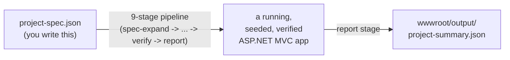

<!-- last-verified: e95fedf -->
# dps-nn (ДПС-НН)

> ASCII name `dps-nn`, display name `ДПС-НН`. Internal C# assemblies/namespaces remain `Genesis.*` by design (ADR-009); the installed tool command is `dps-nn`.

Declarative generator for complete, self-contained ASP.NET Core 10 MVC + EF Core (SQL Server) applications with Bulgarian-only UI, driven by a single `project-spec.json`.

Built as a diploma-work sample factory: one spec in -> one buildable, runnable, seeded, verified project out, plus a machine-readable report (`wwwroot/output/project-summary.json`) consumed by downstream documentation tooling.

## Overview



One `dotnet run --project src/Genesis.Cli -- run --all --spec ... --out ...` turns a spec into a
buildable, seeded, verified project — see `docs/reference/control-flow.md` for the full 9-stage
breakdown and `docs/explanation/architecture-decisions.md` for *why* it's built this way.

## Quickstart (clean machine)

```bash
# prerequisites
# 1. .NET SDK 10.0.100 (pinned via global.json)
# 2. SQL Server or LocalDB reachable via the generated app's DefaultConnection
# 3. the identity/controller scaffolder:
dotnet tool install -g dotnet-aspnet-codegenerator
# 4. dotnet-ef, matching the generated project's EF Core 10.0.* packages:
dotnet tool update -g dotnet-ef --version 10.0.*
# (if it's not installed at all, use `tool install` instead of `tool update` above)
# NOTE: an outdated dotnet-ef can build the generated project successfully and
# only then fail with "the specified deps.json does not exist" - that message is
# the tool itself being too old for a net10.0 project, not a problem with the
# generated code. The pipeline's own error message repeats this exact fix if it
# happens during `seed`.

# build the tool itself (assemblies stay Genesis.*)
# dps-nn.slnx is already checked in - do NOT recreate a .sln (the .NET 10 SDK defaults
# `dotnet new sln` to .slnx anyway; 1-build-and-check.bat handles this for you too)
dotnet build
dotnet test

# generate a project from the fixture spec
cd <repo root>   # templates/ + spec.schema.json must be in cwd (or install as a tool)
dotnet run --project src/Genesis.Cli -- run --all --spec fixtures/project-spec.facenote.json --out out

# optional env vars
#   ANTHROPIC_API_KEY  - automatic LLM mode (else: manual file contract, exit code 3 = paste needed)
#   PEXELS_API_KEY / PIXABAY_API_KEY - real stock photos (else picsum fallback)
#   ConnectionStrings__DefaultConnection - override the generated app's DB
```

## Pipeline

`spec build` (LLM, optional) -> `spec expand` (lock file) -> `scaffold` -> `emit-models` -> `identity` -> `emit-controllers-views` -> `seed` -> `verify` -> `report`

Each stage is idempotent and resumable; state lives in `out/<Project>/plan/state.json`. Every stage that emits code ends with a `dotnet build` gate. `verify` is the blocking gate: build, migrations, boot, HTTP checks with a real seeded-admin form login, spec-manifest check, and an English-leak scan of rendered pages.

## LLM stages (spec build, expand review, seed)

File contract per exchange: `prompts/out/<stage>-request.md` / `prompts/in/<stage>-response.json`. With `ANTHROPIC_API_KEY` set the exchange is automatic (claude-haiku-4-5); without it, the tool exits with code 3 and instructions to paste manually, then re-run. Responses are schema-validated with up to 3 retries; everything is hash-logged to `dps-nn.log.jsonl`.

## Multiple specs / multiple seeds

If you keep several `project-spec*.json` files around (cwd, `fixtures/`, or the `prompts/out/schemas/` archive below), omitting `--spec` shows a numbered menu instead of silently using the bare default. With exactly one candidate found anywhere, it's used automatically - no prompting needed. Passing `--spec` explicitly always skips the menu (scripts/CI are unaffected).

Same idea for seed data: drop candidate seed-response files under `seeds/` or `prompts/out/seeds/` (any names, e.g. `seeds/facenote-v1.json`). If there are 2+, `seed`/`run --all` shows a menu before running; the chosen file is copied to `prompts/in/seed-response.json` for that run, and any stale `Data/seed-data.json` in the target project is cleared first so the fresh choice actually takes effect instead of the "reuse existing seed data" fast path silently winning. Unlike the spec picker, a single seed candidate is deliberately left alone (not auto-applied) - forcing a reseed on every run just because exactly one file sits in `seeds/` would undo the "reuse existing valid data" behavior for the common case.

Both menus are skipped entirely under `--no-interactive`.

## prompts/out/schemas + prompts/out/seeds (project history)

When `run --all` finishes a project successfully, the spec (+ its `.lock.json`) and the seed-response file used are **copied** (originals left in place) into `prompts/out/schemas/<project>-schema.json` (+ `-schema.lock.json`) and `prompts/out/seeds/<project>-seed.json` - a permanent, per-project archive of exactly which spec and seed produced that generation. Both picker searches above already include these two folders, so an archived spec/seed stays selectable in later runs; re-running the same project again will find it there instead of at its original location. Overwrites any previous archive entry for the same project name (same "keep the latest" convention as `logs/registry.json`).

## One-click scripts (Windows)

Two separate `.bat` files at the repo root, matching two separate concerns:

- **`1-build-and-check.bat`** - SDK check, creates `dps-nn.sln`/`.slnx` on first run only (the .NET 10 SDK defaults `dotnet new sln` to the newer `.slnx` format), then `dotnet build` + `dotnet test`. Never generates anything, never touches `out/`/`logs/`/`prompts/`/`seeds/`. Safe to re-run any time.
- **`2-generate.bat`** - runs the pipeline. Always generates exactly ONE project per click (if there are multiple specs/seeds, you pick one from the menu - this never batch-processes several at once). Every fresh generation lands in its own timestamped folder, `out/run_<yyyyMMdd_HHmmss>/`, so re-running never overwrites a previous generation of the same project. If a run pends on a manual LLM paste (exit code 3), the *next* click resumes in that exact same timestamped folder rather than starting over in a new one - tracked via a small marker file at `logs/.pending-outdir.txt`, deleted automatically once that run completes.

## Logs registry

`logs/registry.json` / `logs/registry.jsonl` map every project back to the spec file and seed-response file it was generated from (snapshot + full history respectively) - see `logs/README.md`. `logs/<Project>/actions.log.jsonl` holds that project's own leveled action log (`info`/`debug`/`error`) - a stage failure's full exception detail lands there, not just on screen. Anything that fails before a project context even exists (spec resolution itself, a missing `templates/` folder) goes to `logs/global-errors.jsonl` instead, since there's no project name to file it under yet.

## Documentation map

- `CLAUDE.md` - the router; start there for "which doc do I need"
- `docs/reference/control-flow.md` - the 9-stage pipeline, Mermaid diagram + stage table + verify-gate ordering
- `docs/reference/spec-format.md` - `project-spec.json` concepts (authoritative shape: `spec.schema.json`)
- `docs/reference/file-map.md` - generated per-file purpose map (`scripts/generate-file-map.ps1`)
- `docs/explanation/architecture-decisions.md` - *why* it's built this way, indexing all 11 ADRs
- `docs/explanation/techniques.md` - hard-won Scriban/Razor/EF patterns and traps
- `docs/adr/` - the architecture decision records (ADR-001..010, + 002b)
- `docs/how-to/` - task guides (adding a stage, adding a template)
- `docs/01-tutorial-genesis.md` - one-time end-to-end walkthrough
- `plan/` - living state + decision log (context-handoff format); `plan/task-a-doc-architecture.md`
  is this doc tree's own design record

## Known first-build risk spots (written without a compiler at hand)

1. Scriban template syntax in `templates/**.sbn` - run the template emission tests first (`dotnet test --filter TemplateEmissionTests`).
2. `ApplyDeviations` regex anchors versus your actual SDK 10.0.100 scaffolder output - `DeviationTests` cover canned shapes; recalibrate against one real scaffold.
3. `templates/identity/identity-bg-map.json` keys must match the scaffolded Identity pages byte-for-byte - scaffold once, diff, extend the map.
4. System.CommandLine beta4 API surface in `src/Genesis.Cli/Program.cs`.
