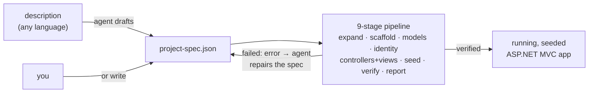

<!-- last-verified: f624752 -->
<p align="center"></p>

# ДПС-НН (dps-nn)

**Describe a web app in a paragraph — get a complete, seeded, verified ASP.NET Core 10 MVC application.**

[](https://github.com/StefanMarinkov05/genesis_v6/actions/workflows/ci.yml)
[](LICENSE)


ДПС-НН generates full-stack ASP.NET Core 10 MVC + EF Core (SQL Server) applications with a
Bulgarian-only UI — models, Identity with roles, admin and client areas, controllers, views, seed
data with images — from one declarative `project-spec.json`. You can write that spec yourself, or
paste a plain-language description and let Claude write it: the agent runs the generator, reads
what failed, fixes the spec and tries again.

It was built as a sample-project factory for a university software course: every generated app
must build, migrate, boot, log in, and show no leftover English on the pages it fetches — or the run
fails. The internal name is still Genesis, the project's original name: source folders `src/Genesis.*`, namespaces `GenesisV6.*` (see ADR-009).



## Highlights

- **An agent with a narrow lever.** In agent mode the LLM's only output is the spec; the
  generator's validation, build and verify failures are what it observes. It never edits generated
  code, so every app stays pure template output. Requests the generator can't express are reported
  (`meta.unsupportedRequests`) instead of hallucinated, and machine problems (missing SDK, no
  LocalDB) stop the loop instead of burning tokens. → [ADR-013](docs/adr/adr-013-agent-mode-spec-only-repair.md)
- **"Done" means verified, not "it compiled".** The `verify` stage builds, applies migrations,
  boots the app, logs in through the real form as the seeded admin, fetches every public and
  authenticated route, and scans every rendered page for English text.
- **Resumable, idempotent pipeline.** Every stage checkpoints to `state.json`, every code-emitting
  stage ends in a `dotnet build` gate, and `--from <stage>` re-runs from any point.
- **LLMs behind a file contract.** Every LLM exchange is a request/response file pair, so it works
  with an API key (automatic) or without one (paste into any chat), is schema-validated with
  retries, hash-logged, and replayable as a test fixture. → [ADR-005](docs/adr/adr-005-llm-file-contract.md)
- **Deterministic variation.** A variation seed resolves code-style axes (DI style, naming, role
  names, comment density…) and a design overlay picks the visual tokens, so many apps from the
  same features don't read like clones — while the same seed always resolves the same way.
  → [ADR-004](docs/adr/adr-004-variation-profile.md), [ADR-008](docs/adr/adr-008-design-overlay.md)
- **Desktop GUI over the same CLI.** An Electron shell spawns the unchanged CLI and reconstructs
  live progress from its log — no second implementation of the pipeline. → [ADR-010](docs/adr/adr-010-gui-electron-cli-child.md)
- **Documented decisions.** 15 ADRs, a Diátaxis docs tree, 190+ automated tests (.NET + GUI) in CI.

## Install (Windows)

Download `DPS-NN-Setup-<version>.exe` from [Releases](https://github.com/StefanMarinkov05/genesis_v6/releases)
and run it (it is unsigned — SmartScreen: *More info* → *Run anyway*). The installer brings the GUI
and the generator; it cannot bring the .NET toolchain the generated apps are built with. On first
launch the GUI checks for it and prints what's missing, with the command to fix it, in the debug
terminal (**Debug** toggle) — the same report as `dps-nn doctor`. You need the first four rows of
the prerequisites table below; Node.js is only for building from source.

The FaceNote sample is preselected, so **Start** generates a complete app without an API key.
Your generated projects and logs live in `Documents\DPS-NN\`; uninstalling never deletes them.

This installer is ~1 GB because it includes the music (see [below](#the-music)). The
[lite edition](https://github.com/StefanMarinkov05/genesis_v6-lite/releases) is the same app without it.

## Quick start (Windows, from source)

**Get the code.** This repo stores ~1 GB of music in **Git LFS** (see [the music](#the-music)).
Install Git LFS once — it ships with Git for Windows; otherwise `winget install GitHub.GitLFS` —
then clone:

```powershell
git lfs install                       # once per machine: registers the LFS filters
git clone https://github.com/StefanMarinkov05/genesis_v6.git
cd genesis_v6
git lfs pull                          # only if the clone ran before `git lfs install`
```

- **Without the music:** `$env:GIT_LFS_SKIP_SMUDGE=1` before `git clone` (bash:
  `GIT_LFS_SKIP_SMUDGE=1 git clone …`). Everything builds and runs; the music player finds no
  tracks. Fetch it later with `git lfs pull`.
- **Updating:** a plain `git pull` brings code, docs and the LFS files together once
  `git lfs install` has run. If the music folder holds small text files starting with
  `version https://git-lfs…`, LFS was not active: run `git lfs install`, then `git lfs pull`.
- **Or skip LFS entirely** with the [lite edition](https://github.com/StefanMarinkov05/genesis_v6-lite)
  (no music, English handbook only).
- The handbook PDFs in `dist/` are ordinary git files, not LFS — they come with every clone.

**Prerequisites**

| Tool | Why | Install |
|---|---|---|
| .NET 10 SDK | builds the generator and every generated app | [dotnet.microsoft.com](https://dotnet.microsoft.com/download/dotnet/10.0) |
| SQL Server Express LocalDB | the generated apps' database | Visual Studio installer or the SQL Server Express installer |
| `dotnet-ef` 10.x | migrations | `dotnet tool install -g dotnet-ef --version 10.0.*` |
| `dotnet-aspnet-codegenerator` | Identity + controller scaffolding | `dotnet tool install -g dotnet-aspnet-codegenerator` |
| Node.js 24 | the GUI only | [nodejs.org](https://nodejs.org) |
| Anthropic API key | optional; required for agent mode | [console.anthropic.com](https://console.anthropic.com) |

> An outdated `dotnet-ef` builds the generated project and *then* fails with "the specified
> deps.json does not exist" — update it with `dotnet tool update -g dotnet-ef --version 10.0.*`.

`dotnet run --project src/Genesis.Cli -- doctor` checks all of these and prints the fix for anything missing.

**Build and test the generator** (or double-click `1-build-and-check.bat`)

```powershell
dotnet build
dotnet test
```

**Generate the sample app — no API key needed.** The repo ships a sample spec (FaceNote — a social shop with
posts, catalogues, follows, cart and orders) and matching seed data; putting the seed where the LLM response would go lets the
whole pipeline run offline (images still download on first run).

```powershell
mkdir prompts\in -Force; copy seeds\facenote-rich-seed.json prompts\in\seed-response.json
dotnet run --project src/Genesis.Cli -- run --all --spec fixtures/project-spec.facenote.json --out out
```

The run ends with a banner: the URL, the seeded admin login, and the command to start the app.

**Or describe your own app** (needs `ANTHROPIC_API_KEY`):

```powershell
$env:ANTHROPIC_API_KEY = "sk-ant-..."
dotnet run --project src/Genesis.Cli -- create --describe "Онлайн книжарница: книги, автори, отзиви, количка и поръчки"
```

**Or use the GUI**

```powershell
cd gui; npm ci; npm run dev
```

All commands, options, exit codes and environment variables: [`docs/reference/cli.md`](docs/reference/cli.md).

## How it works

| # | Stage | Produces |
|---|---|---|
| 1 | `spec-build` | spec drafted from notes by the LLM (the separate `spec build` command — `run --all` starts at stage 2) |
| 2 | `spec-expand` | `project-spec.lock.json` — features expanded, variation resolved |
| 3 | `scaffold` | `dotnet new mvc` + packages + connection string |
| 4 | `emit-models` | models, DTOs, `DbContext`, validation attributes (Scriban templates) |
| 5 | `identity` | ASP.NET Identity scaffold, Bulgarian error describer and pages, roles, seed users |
| 6 | `emit-controllers-views` | scaffolded + templated controllers and views, declarative deviations |
| 7 | `seed` | seed rows (LLM or file) with symbolic references, images, migrations |
| 8 | `verify` | build → migrate → boot → declared routes → anonymous refusal → login → English-leak scan |
| 9 | `report` | `wwwroot/output/project-summary.json` with code pointers |

Diagram, gate order and resume semantics: [`docs/reference/control-flow.md`](docs/reference/control-flow.md).

## Repository layout

```
src/Genesis.Core/     pipeline engine: spec model, stages, LLM bridge, agent loop
src/Genesis.Cli/      the dps-nn command line
tests/Genesis.Tests/  xUnit suite
templates/            Scriban templates rendered into generated apps
templates/features/   reusable feature fragments (cart, posts, catalogues, orders, rating, follows…)
templates/static/     fallback avatar/product images copied into every generated app
fixtures/             the FaceNote sample spec;  seeds/  its seed data
spec.schema.json      JSON Schema for project-spec.json (source of truth)
utils/claude-skills/  the two authoring skills (spec + seed) for manual work in a chat
gui/                  Electron desktop app over the CLI
docs/                 tutorial, reference, how-to, explanation, ADRs; handbook/ = handbook sources
dist/                 the built Architecture Handbook PDFs (every edition and language)
design/               GUI themes, backgrounds, icon, music (LFS)
plan/  changelogs/    working history: session log, decisions, one entry per change
prompts/  out/  logs/ created by runs: LLM exchanges + spec/seed archive, generated apps, logs
```

## The music

`design/music/` holds ~1 GB of recordings by Veselin Marinov — songs, concert audio and concert
video — stored with Git LFS. The GUI's IMPERATOR theme plays them (*Play Veselin Marinov*); the
generator never touches them, and the full installer bundles them.

- A `git clone` with Git LFS installed downloads all of it; how to skip it or fetch it later is
  under [Get the code](#quick-start-windows-from-source).
- Or use **[genesis_v6-lite](https://github.com/StefanMarinkov05/genesis_v6-lite)**: the same code
  without the music (~60 MB, no LFS), mirrored automatically from this repo, with its own installer.

## Personalization

The GUI is made to be re-skinned: wallpapers, colors, logos, music and the footer are all files you
can swap. Changes under `gui/src/` show up in `npm run dev` (in `gui/`); build your own installer
with `npm run dist`. Music and the footer are read at runtime, so they need no rebuild at all.

**Wallpapers and themes.** A wallpaper is a theme (colors, fonts, panel style) plus an optional skin
and a background image. Five themes ship — NOVA, IMPERATOR, VEIL, FORGE, ENCHANT — with ten
wallpapers. To add your own:

1. Put the image in `gui/src/renderer/public/backgrounds/` (`design/backgrounds/` keeps the originals).
2. In `gui/src/renderer/styles.css`, add a skin that points at it and, if you like, recolors the accent:
   ```css
   [data-theme="nova"][data-skin="mine"] {
     --canvas-image: url("/backgrounds/mine.png");
     --accent: #ff7a3f; --accent-2: #ffa070; --glow: #ff7a3faa;
   }
   ```
3. Register it in `WALLPAPERS` in `gui/src/renderer/themes.ts`
   (`{ id: 'nova-mine', theme: 'nova', skin: 'mine', labelKey: 'novaMine' }`), add `'novaMine'` to
   the `labelKey` type, and give it a label in each language table under `gui/src/renderer/i18n/` —
   `npm run typecheck` lists any table you missed.

A whole new theme is a new `ThemeId` with its own `[data-theme="…"]` token block; the token set and
the rules every theme keeps (contrast floors, shared geometry) are in
[`design/design-specs.md`](design/design-specs.md).

**Logos and icons.** Replace the file, keep the name — all in `gui/src/renderer/public/logo/`:

| File | Shows as |
|---|---|
| `logo.png` | the watermark behind the main panel (hidden on IMPERATOR, whose art brands itself) |
| `logo-hell.png` | the watermark on FORGE |
| `icon.png` | the small titlebar icon |
| `loading.png` | the boot splash |

The window, taskbar and installer icon is `gui/resources/icon.ico`. `design/app-icon/` keeps the
originals. `logo.png` is also the logo at the top of this README and on the handbook's cover.

**Music.** The IMPERATOR wallpapers show a music picker that plays whatever is in `design/music/`:
`.mp3` files in `songs-audio/` and `concerts-audio/`, `.mp4` / `.webm` / `.mov` in
`concerts-video/`. The folder is read each time you pick, so new files appear without a restart.
In an installed copy the same folders are under
`%LOCALAPPDATA%\Programs\DPS-NN\resources\genesis\design\music\` (the default per-user install
location) — an update replaces that folder, so keep your own copies. In the repo these folders are
Git LFS; commit only recordings you have the right to share. The picker's button text is
`music.button` in the language tables.

**Footer.** `design/footer.md` is the text at the bottom of the window, read at runtime; edit it, or
empty it to show nothing. Installed: `resources\genesis\design\footer.md` in the install folder.

## Documentation

Start with the [tutorial](docs/tutorial/genesis.md). Then, by need:

- **Reference** — [CLI](docs/reference/cli.md) · [pipeline & control flow](docs/reference/control-flow.md) · [components](docs/reference/components.md) · [spec format](docs/reference/spec-format.md) · [seed format](docs/reference/seed-format.md) · [file map](docs/reference/file-map.md)
- **Overview** — [the project at a glance](docs/explanation/project-overview.md): the two input JSONs, specs, decisions, and a briefing for agents
- **Explanation** — [architecture decisions](docs/explanation/architecture-decisions.md) (indexes all 15 [ADRs](docs/adr/)) · [generated app anatomy](docs/explanation/generated-app-anatomy.md) · [agent mode](docs/explanation/agent-mode.md) · [GUI architecture](docs/explanation/gui-architecture.md) · [image pipeline](docs/explanation/image-pipeline.md) · [techniques & traps](docs/explanation/techniques.md) · [testing policy](docs/explanation/testing-policy.md)
- **How-to** — [add a stage](docs/how-to/add-a-stage.md) · [add a template](docs/how-to/add-a-template.md) · [build the installer](docs/how-to/build-the-installer.md) · [the lite mirror](docs/how-to/mirror-the-lite-edition.md)

The same docs are built into a single **Architecture Handbook PDF** by CI (`scripts/build-handbook.py`).
A second, re-authored edition is under review: `docs/handbook/`, built by `scripts/build-handbook2.py`
— a single narrative from overview to components to limits. It is not yet the project's source of
truth; the preface lists which docs each chapter would replace. Every built edition-2 PDF is committed in
[`dist/`](dist/): English (`dps-nn-handbook-v2.pdf`),
Bulgarian, German, a "galactic" transliteration, and the English and Bulgarian Trump retellings.
Contributors and AI agents: `CLAUDE.md` routes each task to the right doc; `plan/` holds the
working history.

## Tech stack

C# / .NET 10 · ASP.NET Core MVC · EF Core (SQL Server) · ASP.NET Identity · Scriban ·
System.CommandLine · JsonSchema.Net · xUnit · Anthropic Messages API · Electron · TypeScript ·
Vite · xterm.js · GitHub Actions

## License

Code and documentation: [MIT](LICENSE) © 2026 Stefan Marinkov.
The recordings under `design/music/` are third-party works and are **not** covered by the MIT
license; all rights remain with their respective owners.
