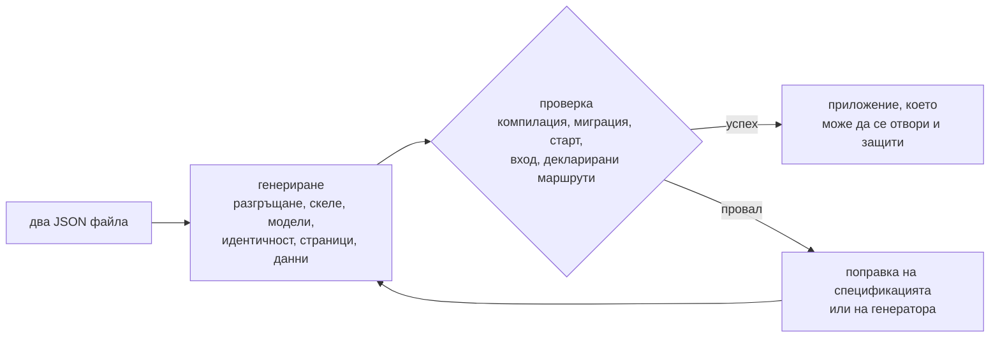

# Едно генериране, от високо

Преди механиката — един проект от задание до работещо приложение.

## Заданието

Студент донася четири страници: *„Онлайн книжарница“*. Има читатели и администратори. Книгите имат автори, категории, цени и корици; читателите разглеждат, търсят, пишат отзиви, пазят списък с желания и правят поръчки; администраторите управляват каталога и потребителите. Интерфейсът трябва да е изцяло на български и да се демонстрира на лаптоп.

Това е нормално задание — и същевременно спецификация: описва същности, връзки, роли, страници и правила. Не описва код.

## Решението: какво става примерно приложение

Първата работа е **ограничаване на обхвата**. Три собствени модела, не тридесет: Book, Author, Category. Отзивите, списъкът с желания и поръчките идват от три готови функции — `rating`, `catalogues` (личен списък с книги, какъвто е списъкът с желания) и `orders` (количка, поръчка, история на поръчките) — и всяка носи свои модели. Всички могат да влизат; администраторите получават управление; читателите — витрината. Плащане с карта, изпращане на имейл и препоръчваща система се назовават и отпадат, защото генераторът не ги изразява, а полуготова функция е по-лоша от честно пропускане.

## Два файла вместо кодова база

Обхватът става два JSON документа:

- **спецификация** — трите модела с българските им надписи, правилата за валидация, двете роли, двете области, кои страници съществуват и от какъв вид са, трите функции и колко реда демо данни иска всеки модел;
- **seed** — самите редове: четиридесет книги с реални заглавия, дванадесет автора, шест категории, отзиви с правдоподобен текст, две поръчки с редове.

Нито един от двата файла не съдържа C#. Това е централният избор на системата: входът описва приложение, а не недовършено приложение.

## Генерирането

- **Разгръщане** слива трите функции, избира стила на проекта и извежда паролите на демо потребителите.
- **Скеле** създава обикновен MVC проект и го компилира веднъж — базова линия, която всеки следващ етап пази зелена.
- **Модели** пише същностите — трите, които спецификацията декларира, и тези, които функциите добавят — атрибутите за валидация с български съобщения и контекста на EF Core.
- **Идентичност** създава ролите, българските страници за вход, регистрация и профил, администратор и читател.
- **Контролери и изгледи** строят двете области: витрина с търсене и сортиране, административни таблици и страниците, които функциите изискват: отзиви, лични списъци, количка и поръчки.
- **Данни** пълни базата: книги с изтеглени корици, отзиви и поръчки, свързани по име, и миграцията, която създава схемата.
- **Проверка** компилира, мигрира, стартира приложението на случаен порт, влиза през истинската форма като администратор, изтегля всяка страница, която спецификацията декларира, и сканира изобразения текст за английски. Един изтекъл „Add to cart“ проваля генерирането. Началната страница и входът трябва да успеят безусловно; декларирана страница, която не отговори, се записва в лога и се пропуска.
- **Доклад** записва машинно четим резултат.

## Какво вижда студентът

Приложение, което тръгва на лаптоп, с пълен каталог, работещ вход, административна област и страници, които изглеждат проектирани. Данните за вход се отпечатват в края на генерирането.

## Какво вижда проверяващият

Три неща, които трудно се фалшифицират: изпълнението е документирано — по време на генерирането приложението е компилирано, мигрирано, стартирано и е влизано в него, а логът казва кои страници са отговорили; това е файл, а не твърдение; българското изискване е проверено механично; кодът е обикновен — ако студентът не може да обясни ред, вината е в генератора.

## Когато се обърка

Ако модел е сгрешен, валидацията назовава модела и свойството преди да е генерирано каквото и да е. Ако функция не може да се прикачи към основния модел на проекта, генерирането спира при разгръщането. Ако липсва файл, който спецификацията е обещала, проверката на манифеста в `verify` го назовава, преди приложението да бъде стартирано. Ако приложението не стартира, проверката се проваля преди сканирането. Във всеки случай генерирането е **възобновяемо от провалилия се етап**, а артефактите за диагностика са на диска.

Обещанието в едно изречение: задание влиза, проверено и обяснимо приложение излиза, а при провал — провалът е локализиран.

| Въпрос | Глава |
|---|---|
| Как изглежда приложението отвътре? | [3](03-what-a-generated-app-is.md), после [10](10-generated-app-architecture.md) |
| Как да го пусна сам? | [4](04-first-run.md) |
| Как да превърна *моето* задание в спецификация? | [5](05-paper-to-spec.md) |
| Откъде идват демо данните? | [6](06-spec-to-seed.md) |
| Може ли моделът да свърши цялата работа? | [7](07-agent-mode.md) |
| Какво точно е всеки етап и къде може да спре? | [9](09-workflow.md) |
