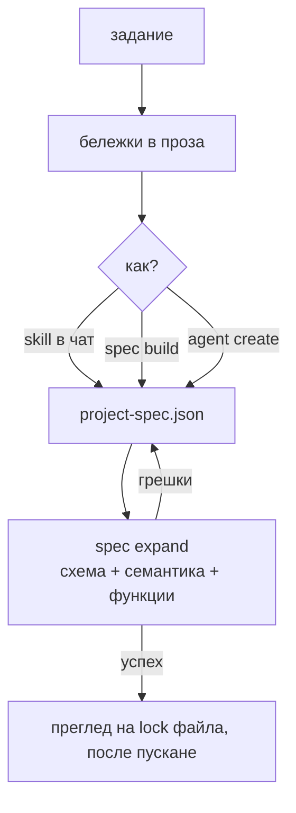

# От задание към спецификация

Това е главата, заради която инструментът съществува: идва задание и трябва да излезе спецификация. Спецификацията не е резюме на заданието, а **запис на решения**, които генераторът може да изпълни. Всичко, което не може, се оставя навън изрично.

## Какво дава заданието и къде отива

| В заданието | Става | Внимание |
|---|---|---|
| Цел, домейн, потребители | `meta.projectName`, `meta.domainHint`, `meta.domainHintBg` | назовете домейна, не технологията |
| Актьори, роли, права | `identity.roles` и по една област в `areas[]` | „админ + потребител“ обикновено значи две области |
| Списък същности и атрибути | `models[]` с `properties[]` и `relations[]` | всяко видимо свойство иска български `displayName` |
| Правила за полетата | `validations[]` с българско съобщение; дати чрез `customValidationAttributes` | правило, което не се изразява, се отчита като граница |
| Екрани („списък с търсене“, „админ таблица“) | `views.pages[]` с вид `landing`, `contactFormStatic`, `cardGrid`, `adminTable` | търсенето и сортирането се конфигурират на контролера |
| „CRUD за X“ | `controllers[]` с `generatedBy` | излишните действия се махат с `removedActions` |
| Готови парчета (количка, поръчки, публикации, отзиви) | `features.<name>.enabled` | включвайте само поисканото |
| „Да има демо данни“ | `seeding.rowsPerModel` | скромни бройки (5–20), различни за модел |
| Дати и меко изтриване | `conventions.timestamps`, `conventions.deleteBehavior` | питайте; те променят формата на кода |

## Работният процес



| Начин | Кога | Цена |
|---|---|---|
| **Skill в чат** | заданието е двусмислено и искате въпроси преди JSON | безплатно, с човек |
| **`spec build --notes`** | имате чисти бележки; работи и без ключ чрез файлов договор | един обмен |
| **`create --describe`** | искате цикълът да пуска генератора и да поправя спецификацията | API ключ, ограничени рундове |

### Валидирайте, преди да генерирате

```bash
dotnet run --project src/Genesis.Cli -- spec expand --spec project-spec.json
```

Това пуска двуслойната проверка, слива фрагментите на функциите, замества `$variation:` и пише `project-spec.lock.json`. Ако мине, структурният риск е в шаблоните, не във входа.

## Правилата, които решават формата

1. **Обхват за примерно приложение: 5–10 модела.** Задание с 30 същности е сигнал да се отреже ядрото, а останалото да се отчете като извън обхват.
2. **Всяко видимо свойство има български `displayName`.** Това е твърдото изискване: семантичната валидация на спецификацията отхвърля видимо свойство без такова, преди да е генерирано каквото и да е, защото голото C# име на страницата е точно изтичане на английски.
3. **Български по подразбиране.** `meta.language` е `bg`; всички четими низове са на кирилица. Марките остават в оригинал.
4. **Малките референтни модели се обединяват.** Модел само с име и без изходяща връзка е `isSpecification`; свързващ ред е `isLookup`. Двата отиват на страницата „Спецификации“.
5. **Махайте безсмислените действия.** Модел с ≤1 видимо свойство не иска Details; `Order` не се създава ръчно от администратор.
6. **`ownership` за всичко притежавано от потребител.** Публикации, отзиви, каталози, количка — сървърно owner-or-admin.
7. **Блокът `images` е само за основно съдържание.** Второстепенна снимка е обикновен `ImagePath`.
8. **Без пароли в `seedUsers`.** Само имейл и роля; паролите се извеждат.
9. **`generatedBy` е една от три стойности**: `scaffold`, `template`, `writtenFromScratch`. Първите две покриват повечето нужди; третата е за контролера на потребителите и страницата „Спецификации“.

## Колко от резултата контролира спецификацията

| Решение | Къде в спецификацията |
|---|---|
| Кои същности съществуват, с какви свойства и надписи | `models[]` |
| Кои контролери съществуват, как се създават, кои действия отпадат | `controllers[]` |
| Състав на страниците и вид на всяка | `views` |
| Роли, области, кои страници за вход, seed потребители | `identity`, `areas[]` |
| Кои фрагменти се сливат (и с тях модели, DTO, контролери) | `features` |
| Съставни модели за четене | `dtos[]` |
| Колко реда и откъде идват снимките | `seeding` |
| Тема, дизайн-пресет и закачени оси на разнообразието | `meta.style`, `variationProfile` |
| Какво да сочи докладът | `outputReport` |

Практическият резултат: **две приложения от едно и също задание може да не делят нито едно име**. Продавачът сменя речника на домейна, избира функции, решава кои модели се обединяват, преименува контролери и страници, пише различни съобщения и закача друга тема и стил. Постоянна остава машината отдолу — MVC конвенциите, CRUD формата и проверките.

## Когато заданието иска невъзможното

Кажете го в спецификацията:

```json
"meta": {
  "unsupportedRequests": [
    { "request": "календар за резервации на читалнята",
      "reason": "няма функция за график; генераторът не моделира повтарящо се време" }
  ]
}
```

Агентният режим ги пише сам; при ръчно писане ги пишете вие. Конвейерът игнорира секцията, хората — не. Записано, това разделя „инструментът не може“ от „инструментът тихо направи друго“.

## Контролен списък

- [ ] `spec expand` минава без схематични и семантични грешки.
- [ ] Всеки модел има точно едно ключово свойство и всяка връзка сочи съществуващ модел.
- [ ] Всяко видимо свойство има български `displayName`.
- [ ] Всяка област има роля (или `$variation:` заместител).
- [ ] Всеки шаблонен контролер с `Index` има страница.
- [ ] `seeding.rowsPerModel` покрива всеки модел, който искате зареден.
- [ ] Функциите са включени само за поисканото.
- [ ] Невъзможното е в `meta.unsupportedRequests`.
