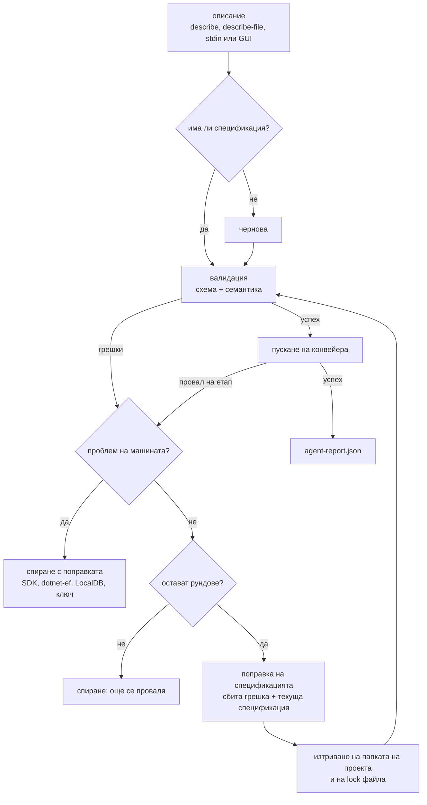

# Агентен режим

Агентният режим (`dps-nn create`) е единствената част, която е агент в строгия смисъл: наблюдава резултата от действията си и решава какво следва. Всичко останало е конвейер; тази глава е цикълът отгоре.

## Защо е агент и защо лостът е тесен

Работен поток изпълнява фиксирани стъпки. Тук стъпките са фиксирани, но *входът на следващата* се избира по доказателства: моделът чете провала на генератора и редактира спецификацията. Доверието идва не от цикъла, а от **лоста**: моделът може да променя само спецификацията. Той никога не редактира генериран C#. Затова всяко приложение остава чист шаблонен резултат — обяснимо, сравнимо и възпроизводимо.

## Цикълът



Три решения носят тежестта:

- **Проблемите на средата спират цикъла.** Липсващ SDK, стар `dotnet-ef`, недостъпен LocalDB, отхвърлен ключ — никоя поправка на спецификацията не помага, затова цикълът връща решението вместо да гори рундове.
- **Грешките се сбиват.** Провалът на компилацията носи целия изход; над 6000 знака остават първият ред плюс различимите редове с грешки (до 60).
- **Поправката нулира резултата.** Старата папка и lock файлът се изтриват, за да не продължи следващият опит полупостроен проект от лошата спецификация.

Бюджетът е `--max-repairs` (по подразбиране 3). Всеки опит, етапът му и сбитата грешка отиват в `agent-report.json` Екранът за грешка в GUI показва причината за спирането, която чете от реда `agent: stopped - <reason>` в стандартния изход на CLI; пълният списък с опити остава в доклада.

## Доклад за липсващи възможности

Когато описанието иска нещо, което схемата не изразява — календар за резервации, плащания, чат в реално време — моделът трябва да го **остави навън и да го запише**:

```json
"meta": {
  "unsupportedRequests": [
    { "request": "календар за резервации на читалнята",
      "reason": "няма възможност за графици" }
  ]
}
```

Списъкът не е украса: отпечатва се, записва се в доклада и става беклог за нови фрагменти на функции. Инструмент, който тихо изхвърля изисквания, е по-лош от такъв, който ги назовава.

## Пускане

```bash
export ANTHROPIC_API_KEY=sk-ant-...
dotnet run --project src/Genesis.Cli -- create \
  --describe "Онлайн книжарница: книги, автори, отзиви, количка и поръчки"
```

| Опция | Значение |
|---|---|
| `--describe` / `--describe-file` / stdin | текстът на изискванията, на произволен език |
| `--max-repairs` | рундове поправка преди отказ (3) |
| `--out` | корен на резултата; по подразбиране `out/agent_<timestamp>` |
| `--spec` | къде се пише черновата; при съществуващ файл се преизползва |
| `--image-pack`, `--image-provider` | както при нормално пускане |

Кодове: `0` генерирано, `1` спряно (причината се отпечатва), `2` грешно извикване, `3` чакащ LLM обмен.

**Ключът е задължителен.** Ръчно поставяне на всеки рунд би обезсмислило цикъла; без ключ използвайте класическия път от [глава 5](05-paper-to-spec.md).

## Как се тества без ключ

Цикълът приема трите си странични ефекта като делегати — автор, конвейер, валидатор — затова `AgentTests.cs` минава през всеки клон с фалшиви реализации: успех, една поправка, спиране по среда, изчерпан бюджет, провал на черновата, чакащ обмен. От край до край `ANTHROPIC_BASE_URL` сочи локален stub, който отговаря на трите обмена.
