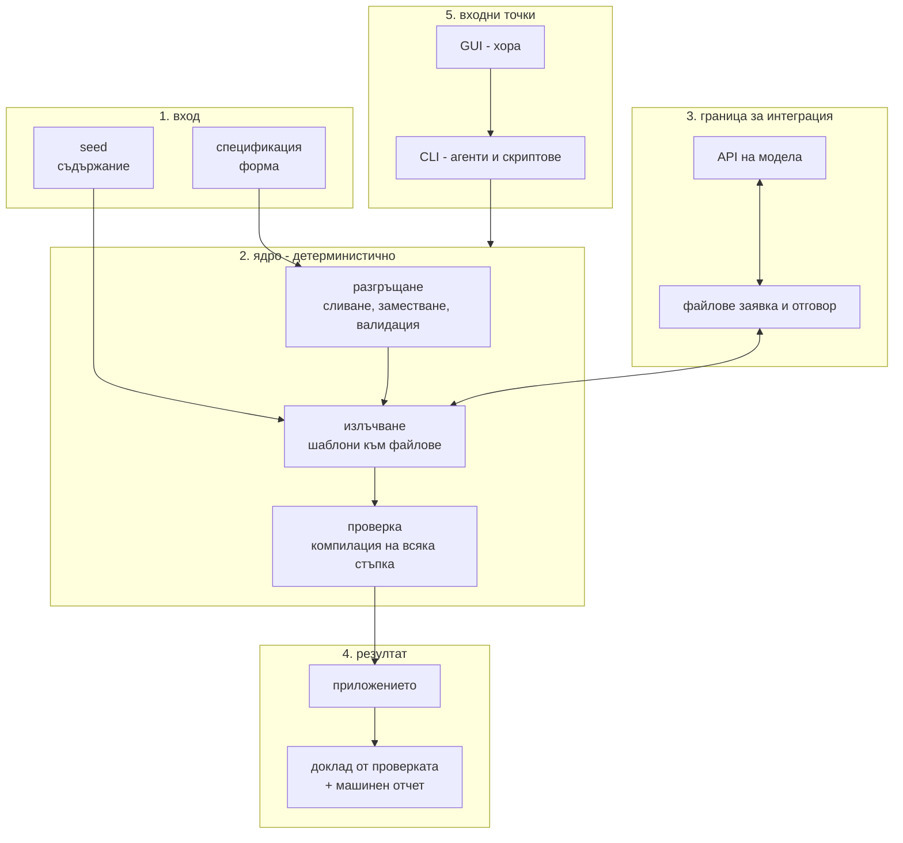

# Архитектурата на една картина

Досега книгата описваше какво прави системата. Тази глава описва как е сглобена — стил, граници, шаблони и инструменти — за да има останалото рамка.

## Едно изречение, после картината

ДПС-НН е **компилатор с проверяващ**: влиза декларативно описание, излиза работещо приложение и нищо не се счита за произведено, докато резултатът не бъде компилиран, стартиран и прочетен обратно. Около ядрото има две входни точки и една задължителна граница: всеки обмен с езиков модел е файл на диска.

Следвайте стрелките от входа към резултата и ще получите гаранцията: единственият път към резултата минава през проверките, а единственият път към модела — през файлове.

## Стилът, назован

| Свойство | Как е изразено | Защо не алтернативата |
|---|---|---|
| **Етапен конвейер** | девет именувани етапа, по един `IStage`; runner-ът води седем от тях в твърд ред след `spec-expand`, а `spec-build` се пуска сам | монолитът не може да се възобновява; разпределена опашка иска инфраструктура |
| **Форма на компилатор** | спецификацията е изходник, lock файлът — междинно представяне, шаблоните — backend, `verify` — тестов набор | „генерирай и се надявай“ няма къде да поправи грешен превод |
| **Външни отметки** | завършеността е списък от имена в JSON файл | генерирането трябва да преживее срив и рестарт |
| **Портове и адаптери** | ядрото не знае за HTTP, Electron или терминал | отделянето прави ядрото тестваемо без десктоп |
| **Файлове като договор** | prompt/response, спецификация/seed, логове и доклади | извикването в паметта прави LLM пътя неодитируем |
| **Детерминистично ядро** | хеширане за разнообразието; миграциите и отговорите на модела са в края | случайност в шаблоните прави всеки бъг невъзпроизводим |

## Шаблоните и къде живеят

| Шаблон | Къде | Какво дава | Къде спира |
|---|---|---|---|
| **Pipeline / филтри** | `PipelineRunner` над `IStage` | възобновяване, времена, локализация на провала | етапите не вървят паралелно, освен ако са независими |
| **Междинно представяне** | `project-spec.lock.json` | разгръщането става веднъж | lock е надмножество на изходника |
| **Strategy + Template Method** | `IStage.RunAsync`, `ISpecAuthor`, произход на контролерите | поведение без разклоняване на runner-а | всяка стратегия дължи идемпотентност и компилационна проверка |
| **Adapter** | `LlmBridge`, `Proc` | два различни механизма зад един интерфейс | счупен адаптер изглежда като провал на етап |
| **Facade** | `TemplateEngine` | една повърхност за рендиране | нова възможност минава през фасадата |
| **Memento** | `StateStore`, `DbLifecycleRecord` | спиране и продължаване без повторна работа | състоянието е плосък списък |
| **Registry** | оси на разнообразието, кодови указатели, бройки по подразбиране | нов случай е редакция на данни | регистрите се поддържат ръчно |
| **Command** | дървото на `System.CommandLine` | една операция е и команда, и обект | обработчиците могат да натрупат оркестрация |
| **Builder** | `scaffold` → модели → идентичност → страници → данни | строеж в ред на зависимости | провал по средата оставя частичен проект (възобновяем) |
| **Преписване с котви** | отклонения по regex върху резултата от scaffold | евтино и шумно при промяна | чупливо при нов SDK (ADR-006) |
| **Конвенция пред конфигурация** | MVC маршрути, откриване на контролери и изгледи | обикновен ASP.NET без специално окабеляване | конвенциите се документират |
| **Инжектиране на зависимости** | `Program.cs` на приложението; делегатите в агента | услуги само когато са нужни; цикълът е тестваем | DI в генерирания код трябва да остане малък |
| **Fail-fast** | `Proc.ThrowIfFailed`, котви, които хвърлят | грешката се хваща там, където е родена | шумно при проблем в средата — затова има `doctor` |

### Съзнателно отсъстващи

Няма repository слой над EF Core, няма CQRS, няма шина за събития, няма service слой между контролер и `DbContext`, няма DI контейнер в самия генератор. Всяка абстракция, която читателят срещне, трябва да си изкара мястото в учебен артефакт.

## Стил на кода

**Генераторът:** .NET 10, nullable и implicit usings, `LangVersion latest` само в ядрото; file-scoped namespace-и във всеки файл на ядрото (`Program.cs` на CLI използва top-level изрази); `sealed` по подразбиране; записи за стойности (`StageContext`, `ResolvedVariation`); primary constructors; една публична входна точка на модул, вътрешностите — само през `InternalsVisibleTo`; изключения отвътре, кодове за изход само на CLI границата; инвариантна култура при логове; хеширане, не `GetHashCode()`; шаблоните са данни, без строене на C# извън `TemplateEngine`; по един ред `// FILE-MAP:` на файл; коментарите носят *защо*, отхвърлената алтернатива и капана.

Посоката на зависимостите се налага по конвенция, а не с анализатор: `Spec` и `Llm` не зависят от нищо в ядрото, `Variation` и `Util` — само от страната на спецификацията; `Stages` може да ползва всички тях; никой не импортира `Stages`, освен CLI, а агентът стига до конвейера само през делегат. Границите на модулите са изброени в [глава 13](13-components.md).

**Генерираното приложение:** конвенционален MVC — същности с атрибути и български съобщения, контролери директно към `DbContext`, Razor изгледи с partial-и, inline JavaScript за дребните взаимодействия, Bootstrap за оформление. Услуги се появяват само когато спецификацията ги оправдава.

## Проблемите и механизмите

| Проблем | Механизъм |
|---|---|
| Ръчното строителство отнема седмици | декларативен вход и шаблонно излъчване |
| Демо данните идват късно или никога | seed-ът е вход, приложението се зарежда само |
| Локализацията се добавя последна | българският е твърдо изискване, езиковата проверка не пуска изтичане |
| „Работи на моята машина“ | конвейерът компилира, мигрира, стартира и обхожда |
| Два опита изглеждат несвързани | детерминистично разнообразие от seed |
| Провален опит изяжда цялото генериране | отметки по етап и идемпотентни етапи |
| LLM резултатът е неодитируем | файлов договор, схемна валидация, хеширани логове |
| Моделът поправя собствените си грешки в кода | лостът е спецификацията |
| Купувачът не може да докаже какво е получил | доклад, архив на спецификацията и seed-а, лог |

## Инструментите и срещу какво са избрани

| Инструмент | За | Защо този | Не този |
|---|---|---|---|
| **Scriban** | излъчване на C#, Razor и текст | малък стабилен синтаксис без хостинг модела на ASP.NET | Razor за генериране |
| **System.CommandLine** | дървото от команди | една декларация на команди, опции и помощ | ръчно парсене |
| **JsonSchema.Net** | валидация | стандарт, отчита всички нарушения | ad-hoc проверки, които се разминават със схемата |
| **EF Core + SQL Server** | данните | миграции и LINQ, познати на аудиторията | micro-ORM, документна база |
| **ASP.NET Identity** | акаунти и роли | стандартно и разширяемо | собствена автентикация |
| **xUnit** | .NET тестове | прости твърдения, без библиотека за mock обекти | тестове на взаимодействия |
| **Electron + TypeScript** | десктоп | уеб умения, Windows, пуска CLI | нативен интерфейс |
| **electron-vite** | build на GUI | бърз цикъл и трите цели за build (main, preload, renderer) от една конфигурация | ръчен bundler |
| **xterm.js** | терминал в GUI | истински ANSI изход | преправен изглед на лог |
| **NSIS** | инсталатор | малък и скриптуем | MSI |
| **GitHub Actions (Windows)** | CI | продуктът се доставя за Windows: инсталаторът е NSIS и се строи на същия образ на runner-а | само Linux CI, който никога не вижда платформата, на която потребителите инсталират |
| **Git LFS** | музиката | 1 GB медия извън нормалните клонирания | медия в историята |
| **Mermaid + pandoc + XeLaTeX** | тази книга | диаграми като изходник, един Markdown към PDF | текстов процесор |

## С какво се отличава

Шест твърдения, всяко проверимо в тази книга:

1. **„Готово“ е проверено пускане**, а не компилиран проект. Компилация, миграция, манифест, стартиране, вход,
   декларираните маршрути, език — в този ред, от най-евтиното ([глава 9](09-workflow.md), която посочва и къде проверката е снизходителна).
2. **Езиковият модел е ограничен лост.** Той пише JSON; никога не пише приложението. Всяка грешка,
   която вижда, е истинска грешка на генератора, а всяка заявка е файл, който някой може да прочете
   по-късно.
3. **Една и съща спецификация е възпроизводима, а различните не са клонинги.** Детерминизмът и
   разнообразието са проектирани, а не оставени на случайност ([глава 12](12-principles.md)).
4. **Един конвейер, два интерфейса.** Графичният интерфейс няма собствена логика за генериране, така
   че двата не могат да се разминат ([глава 18](18-gui-architecture.md)).
5. **Генерираният код е обикновен.** Няма собствена среда за изпълнение, няма измислени абстракции —
   авторът може да обясни всеки ред, което е и смисълът на дипломния продукт.
6. **Документацията е част от архитектурата.** Файл-рутер, записи за решения, changelog и дневник на
   решенията означават, че нова сесия може да възстанови разсъжденията, без да пита
   ([глава 15](15-how-the-project-is-built.md)).

## Как да четете кода оттук

| Въпрос | Глава |
|---|---|
| Какво точно прави всеки етап и къде може да спре? | [Работният поток от край до край](09-workflow.md) |
| Кои файлове излизат и как са слоени? | [Какво се генерира](10-generated-app-architecture.md) |
| Какво всъщност обещават спецификацията и seed-ът? | [Двата договора](11-contracts.md) |
| Кой модул притежава кое поведение? | [Компоненти](13-components.md) |
| Кои инструменти стоят зад CLI и GUI? | [Справочник за CLI](17-cli.md), [Архитектура на GUI](18-gui-architecture.md) |
