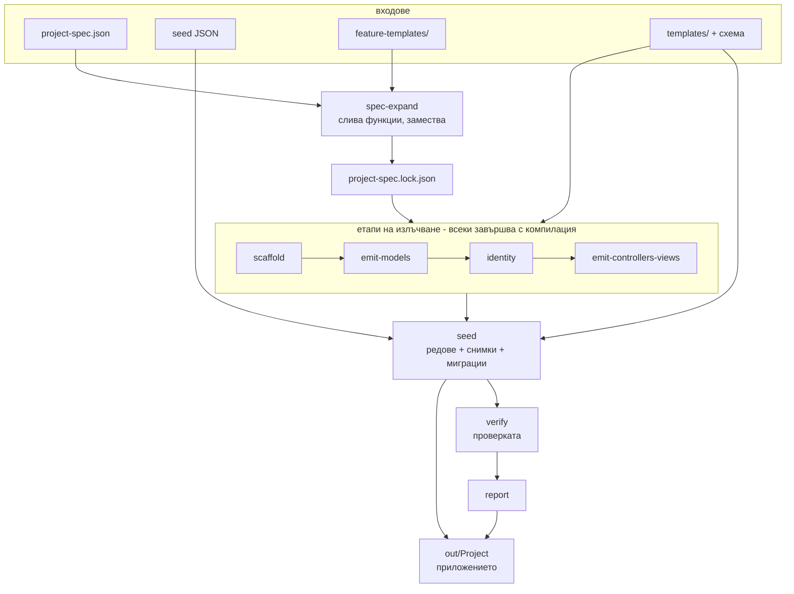

# Работният поток от край до край

Тази глава следва генерирането като машина: кой кого вика, какво чете и пише всеки етап, къде може да спре и какво оцелява след спирането.

## Потокът като данни

`spec-expand` върви преди цикъла. `spec-build` (бележки → спецификация) е отделна команда и нарочно не е на диаграмата — произвежда лявата кутия, не я консумира.

## Етап по етап

| # | Етап | Чете | Пише | Проверка |
|---|---|---|---|---|
| 1 | `spec-build` | бележки, схема | `project-spec.json` | няма — без код |
| 2 | `spec-expand` | спецификация, фрагменти, seed | `project-spec.lock.json` | схема + семантика на входа и на lock |
| 3 | `scaffold` | lock | `.csproj`, решение, база на `Program.cs`, връзка към база | компилация |
| 4 | `emit-models` | lock, шаблони | `Models/`, DTO, контекст, атрибути | компилация |
| 5 | `identity` | lock, шаблони, карта | `ApplicationUser`, `Program.cs`, страници, describer, роли и потребители | компилация |
| 6 | `emit-controllers-views` | lock, шаблони | контролери и изгледи в двете области, услуги, partial-и | codegen + компилация |
| 7 | `seed` | lock, seed, доставчици | `seed-data.json`, `SeedData.cs`, снимки, миграции, база | компилация → миграция → прилагане |
| 8 | `verify` | lock, приложението | езиков доклад | истинската проверка |
| 9 | `report` | lock, `outputReport` | `project-summary.json` | няма — по избор |

**Възобновяване**: всеки успех добавя името на етапа в `{out}/{Project}/plan/state.json`. `run --all` пропуска записаното; `--from <етап>` пуска отново него и следващите. `spec-expand` се пази от собствената си отметка, а `--from` с име извън седемте етапа на runner-а не пуска нищо — лесен начин да загубите час.

## Проверката, която определя продукта

`verify` не е димна проверка накрая; тя е определението за готово. По ред, евтиното първо:

1. чиста компилация в генерирания проект;
2. `dotnet ef database update` върху реалната база;
3. **проверка на манифеста** — всеки обещан файл съществува;
4. приложението стартира на свободен порт;
5. `GET /` — задължителен;
6. всеки открит публичен маршрут (страниците `cardGrid`), анонимно;
7. истински вход през формата със заредения администратор — неуспешен вход проваля `verify` — после всеки открит маршрут, изискващ вход (страниците `adminTable` и всяка страница на включена функция в клиентската област);
8. сканиране на видимия текст за английски върху **всяка страница, изтеглена по-горе и отговорила с 200** — пропуска се изцяло, а не само е нефатално, когато `meta.language` не е `bg`.

Стъпки 3 и 8 хващат това, което unit тестовете не могат: файл, който тихо не е създаден, и низ, който е пропуснал превода.

Проверката е строга там, където е важно, и снизходителна там, където маршрутите се извеждат. Само стъпки 1–5 и входът са твърди: маршрут от стъпки 6–7, който отговори с нещо различно от 200, се записва в лога (`language scan skipping …`) и се изключва от стъпка 8, защото маршрутите се извеждат от спецификацията и един погрешно изведен не бива да потопява иначе добро генериране. Няма и проверка, че анонимна заявка към административна страница се отказва; оторизацията идва от генерираните атрибути `[Authorize]`, а не от `verify`.

## Какво остава след генерирането

| Артефакт | Предназначение | Оцелява ли след `rm -rf out` |
|---|---|---|
| `out/Project/` | приложението | не |
| `plan/state.json` | състояние за възобновяване | не |
| `dps-nn.log.jsonl` | граници на етапи, времена, хешове | не |
| `prompts/out/`, `prompts/in/` | файлов договор | да |
| `prompts/out/schemas/`, `seeds/` | архив на използваното | да |
| `logs/registry.json(l)` | кой проект от какво е произлязъл | да |
| `logs/<Project>/actions.log.jsonl` | подробен лог, пълни изключения | да |
| `logs/<Project>/db.json` | коя база е мигрирана | да |
| `.image-cache/` | изтеглени снимки | да |

`out/` е за изхвърляне, `prompts/` и `logs/` са следата.

## Три състояния

| Ситуация | Какво прави runner-ът |
|---|---|
| **Първо пускане** | минава всички етапи и записва отметки |
| **Възобновяване** | пропуска завършените; пуска провалилия се и следващите |
| **Принудително** | `--from X` игнорира отметките от X нататък; всеки етап трябва да е идемпотентен |

Идемпотентността е задължение на етапа, не на runner-а: след срив етапът трябва да намери свършеното (наличен `.csproj`, валиден seed, приложена миграция) и да го прескочи.

## Провали

| Код | Значение | Какво да правите |
|---|---|---|
| `0` | готово и проверено | отворете приложението |
| `1` | етап е хвърлил | прочетете етапа и грешката; пълното изключение е в `logs/<Project>/actions.log.jsonl` |
| `2` | грешно извикване | поправете командата |
| `3` | LLM обмен чака файл | попълнете `prompts/in/<stage>-response.json`, пуснете с `--resume` |

Код `3` е подаване на щафета, не грешка. Всяко друго ненулево е реален провал и генерирането се възобновява от провалилия се етап.

## Състоянието: три файла, три собственика

| Файл | Кой го пише | Кой го чете | Защо е отделен |
|---|---|---|---|
| `project-spec.json` | вие, `spec build`, агент | само `spec-expand` | това е вашият документ; инструментът не го редактира |
| `project-spec.lock.json` | `spec-expand` | всички етапи от `scaffold` нататък и манифестът | разгърнатата форма движи излъчването |
| `plan/state.json` | runner-ът | runner-ът | възобновяването е свойство на генерирането |

## Инвариантите

1. **Никога не редактирайте генерираното** под `out/`.
2. **Само български интерфейс**: всяко видимо свойство има `displayName`, езиковата проверка не пуска изтичане.
3. **Всеки етап, който пише код, го компилира.**
4. **Етапите са идемпотентни.**
5. **LLM променя JSON, никога код.**
6. **GUI не преписва конвейера** — пуска CLI и чете лога.
7. **`spec.schema.json` притежава формата на спецификацията.**

## Къде живее провалът

| Симптом | Слой | Поправка |
|---|---|---|
| `All values fail against the false schema` (непознат ключ) или `Value is "…" but should be "…"` от схемната валидация | вашият вход | поправете спецификацията спрямо `spec.schema.json` |
| `Model X: relation target 'Y' is not a declared model.` | вашият вход, препратка между модели | декларирайте модела или поправете връзката |
| C# не се компилира | шаблон или етап | поправете `.sbn` или етапа |
| компилира, но страница 500 | окабеляване на страница/маршрут | етапът, който я създава |
| стартира, но езиковата проверка пада | генериран литерал | махнете го от шаблона или добавете `displayName` |
| стартира, но `verify` записва декларирана страница като пропусната (не-200) | регистрация на маршрут/област | проверете областта и `routing.defaultArea`, а не страницата — `verify` не пада заради това, затова прочетете лога |
