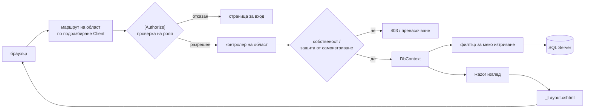

# Какво се генерира

Резултатът е завършено MVC приложение с малка, съзнателно избрана архитектура.

## Слоевете

| Слой | Файлове | Отговорност |
|---|---|---|
| **Представяне** | `Views/`, `Areas/*/Views/`, `_Layout.cshtml` | само Razor разметка |
| **HTTP** | `Areas/{Admin,Client}/Controllers/*.cs` (началната страница на FaceNote е `Areas/Client/Controllers/HomeController.cs`) | маршрути, оторизация, свързване на модел, оркестрация |
| **Домейн модел** | `Models/*.cs` | същности с атрибути и български надписи |
| **Устойчивост** | `{Project}Context.cs`, `Migrations/`, `Data/` | `DbSet`, връзки, филтър за меко изтриване, seed |
| **Услуги** | `ImageService`, `FileUploadService`, `UserProfileService` | единственото място за работа с изображения във файловата система и за агрегиране на профила на потребителя |
| **Композиция** | `Program.cs` | DI, идентичност, маршрути, миграция и зареждане |
| **Инфраструктура** | `Infrastructure/…` | атрибути за валидация, български Identity съобщения |

Няма repository слой, няма service слой над същностите, няма слой за view модели. Контролерите говорят директно с `DbContext`. Тази височина е избор: приложението е учебен артефакт и още една абстракция е още едно нещо за обяснение.

## Пътят на заявката

Оторизацията е атрибутна и по области; правилата за собственост се налагат **в действието**, на сървъра, никога в изгледа. Мекото изтриване е глобален филтър върху типа, така че никоя заявка не може да го забрави.

## Трите произхода на контролери

| `generatedBy` | Как се създава | За какво | Компромис |
|---|---|---|---|
| `scaffold` | `aspnet-codegenerator`, после отклонения с котви | стандартен CRUD | зависи от формата на scaffolder-а (ADR-006) |
| `template` | Scriban шаблони | контролери на функции, начало | всичко се контролира от това хранилище |
| `writtenFromScratch` | отделен шаблон | контролерът на потребителите със сървърни правила и страницата „Спецификации“ | единственото място за специална логика |

Изборът на regex изглежда грешен, докато не се види алтернативата: Roslyn rewriter е голяма зависимост за редакции, стабилни при закачен SDK, и се проваля тихо. Котвите се провалят **шумно**.

## Идентичност: един механизъм на проблем

| Проблем | Механизъм |
|---|---|
| Страниците за акаунт трябва да са български и в стила на приложението | основните страници се излъчват изцяло (ADR-002b) |
| Остатъци от scaffolder-а не бива да изтичат на английски | статична карта EN→BG (ADR-002) |
| Съобщенията на Identity са на български | `BgIdentityErrorDescriber` |
| Демото има работещи входове | `IdentitySeeder`; паролите се извеждат от seed-а |

Правилото се повтаря четири пъти: **превеждай текста там, където се създава, не там, където се показва.**

## Условно излъчване

`ImageService` и контролерите за изображения — при блок `images`; `FileUploadService` — при профилна снимка, рейтинг или публикации; `UserProfileService` — при функция `posts` или `catalogues`; `BgIdentityErrorDescriber` — когато `identity.errorDescriber` е зададен **и** `meta.language = bg`. Затова минималният проект остава минимален, а условието на емитера и условието на манифеста трябва да съвпадат.

## Две области и една обобщена административна страница

**Client** е потребителската област (по подразбиране), с начална и контактна страница, мрежи от карти и по една страница на включена функция. **Admin** е CRUD областта, но не расте с по един запис на модел: `isSpecification` и `isLookup` моделите се обобщават на страница „Спецификации“ (ADR-012), а `spec-expand` инжектира административен CRUD за всеки забравен модел.

## Какво съзнателно липсва

Без тестов проект, без Dockerfile, без CI файл, без JavaScript фреймуърк, без слой за превод по време на работа, без repository абстракция. Всяко от тези е избор за височина и първото, което се проверява, преди да се нарече бъг.
