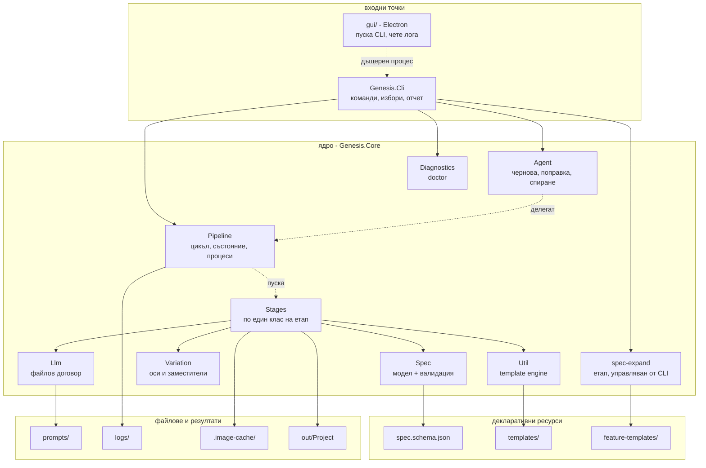

# Компоненти

Картата, която държите отворена, докато работите по кода. Единицата е модулът: за какво отговаря, от какво може да зависи и какво се чупи, ако е грешен.

## Графът



## Отговорности и провали

| Компонент | Притежава | Ключови типове | Ако е грешен |
|---|---|---|---|
| **CLI** | командите, намирането на корена (`GenesisRoot()`), интерактивните избори на спецификация и seed, регистъра и архива, банера в края | `Program.cs` и `InteractiveSelection` (помощниците на изборите, в папката `Cli` на ядрото) | грешни файлове; нищо дълбоко |
| **Pipeline** | цикъла, възобновяването, времената, лога за напредъка, обвивката на външни процеси | `PipelineRunner`, `StateStore`, `StageContext`, `Proc`, `ParallelEmit` | не може да се възобнови |
| **Stages** | всичко, което чете lock и пише файлове | девет `IStage` класа в пет файла | приложението е грешно там, закъдето отговаря етапът |
| **Spec** | модела и двуслойната валидация | `ProjectSpec`, `SpecLoader` | лош вход стига до генериране |
| **Variation** | регистъра на осите, заместването, паролите | `VariationResolver` | проектите си приличат |
| **Util** | единствената Scriban повърхност и помощниците ѝ; извеждане на `DOTNET_ROOT` за стартираните инструменти | `TemplateEngine`, `DotnetHost` | всеки файл се разминава наведнъж |
| **Llm** | файлове, ръчен/автоматичен режим, повторения | `LlmBridge`, `LlmModels` | офлайн пътят се чупи |
| **Agent** | цикъла и условията за спиране | `AgentRunner`, `LlmSpecAuthor` | излишни рундове, загубена гаранция |
| **Diagnostics** | проверките на предпоставките | `Doctor` | липсващ SDK изглежда като бъг |
| **GUI** | представяне, IPC, четене на лога | `gui/src/*` | напредъкът лъже; генерирането не страда |

## Правила за зависимости

```text
Cli         -> Agent, Stages, Diagnostics, Pipeline, Llm, Util, Variation, Spec
Agent       -> Llm, Spec        (pipeline injected as a delegate)
Stages      -> Pipeline, Llm, Util, Variation, Spec
Diagnostics -> Pipeline
Pipeline    -> Variation, Spec
Util        -> Variation, Spec
Variation   -> Spec
Spec, Llm   -> (nothing inside Core)
```

Три правила държат това:

1. **Нищо не внася `Stages` освен `Cli`.** Етапът е листово поведение, а не библиотека; дори агентът вижда конвейера само като делегат.
2. **Шаблоните са данни, а не код.** `Util` ги рендира; етап никога не строи C# с низове извън шаблонния engine.
3. **GUI никога не се свързва с ядрото.** Единственият му договор е процесът на CLI и лог файлът.

## Петте хранилища на данни

| Хранилище | Кой пише | Естество |
|---|---|---|
| спецификация + lock | автор, `spec-expand` | единственият вход, който има значение |
| `out/<Project>/plan/state.json` | runner | състояние за възобновяване, за изхвърляне |
| `prompts/` | мостът към LLM, CLI | следа и тестови фикстури |
| `logs/` | runner, етапи, CLI | регистър, действия, живот на базата |
| `.image-cache/` | `seed` | кеш между пусканията |

## Къде какво се променя

| Цел | Компонент | Какво още се променя |
|---|---|---|
| съдържание на генериран файл | `templates/*.sbn` | компилационната проверка доказва |
| нов файл | шаблон + извикване | очакването в манифеста |
| нова възможност на спецификацията | схема → `ProjectSpec` → семантика → етап | договорът и skill-ът |
| нова повтаряща се функция | `feature-templates/<name>.json` + условно излъчване | списъците с функции в глави 22 и 23 |
| различен резултат между проекти | `VariationResolver` | таблицата с осите |
| ред на етапите | `Pipeline` | глава 9 |
| проверки на предпоставките | `Diagnostics/Doctor` | разделът за `doctor` в [глава 4](04-first-run.md) и [глава 16](16-runtime.md) |

## Мащаб за ориентиране

Ядрото е около 5 200 реда C# в 19 файла под `src/`. Най-големият е етапът за контролери и изгледи,
защото държи и трите произхода на код. Ако една промяна направи някой от тези файлове забележимо
по-голям, въпросът обикновено е „трябва ли това да е шаблон?“ — досега отговорът винаги е бил „да“.
