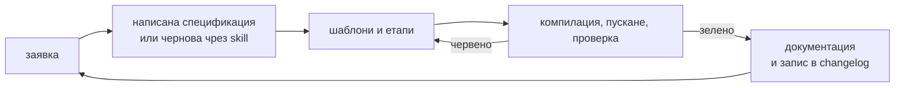

# Как се строи проектът

Генерираните приложения са обикновени. Начинът, по който се появяват, не е: хранилището се пише и поддържа от човек, работещ с агенти — на практика жизнен цикъл на разработка, воден от ИИ (AI-DLC), и то не само като етикет — и процесът е устроен така, че машина да поеме работата без да губи сюжета.

## Цикълът

Всяка стъпка оставя прегледим артефакт: спецификация, diff, доклад от проверка, запис. Никое от тях не е разговор, който изчезва с контекста.

## Документация за двама читатели

Документацията следва Diátaxis — урок, how-to, справочник, обяснение — защото четирите отговарят на различни въпроси и остаряват с различна скорост. Справочната таблица остава вярна месеци; урокът се чупи в седмицата, в която се смени команда.

Две уговорки правят дървото използваемо от агент: **рутер файл** (един кратък документ казва какво е проектът и кой документ да се чете за коя задача) и **записи на решения** (номерирани ADR; замененото решение пази номера си и бележка какво го е заместило). Има и работна история, която документацията не повтаря: changelog и дневник на решенията, включително опитаните и провалени поправки.

## Skill-ове вместо случайни prompt-ове

LLM пътят не започва с „напиши ми спецификация“, а с **skill**: документ, който казва договора, конвенциите извън схемата и грешките, които вече са правени. Хранилището съдържа два — за спецификация и за seed. Skill-ът за спецификация се използва на три места: от човек в чат (разговорно), от агентния цикъл (с махнати стъпки „питай потребителя“) и като договор, срещу който системата се тества. Skill-ът за seed е разговорният близнак на собствения prompt на етапа `seed` и носи същите правила.

Skill е по-евтин от дълъг prompt, повтарян при всяка заявка, и по-надежден от гола схема: моделът научава конвенциите веднъж и ги прилага до края на прозореца. Подобренията се натрупват във файл, вместо да се губят със сесията.

## Маршрутизиране на модели и цена

| Обмен | Модел | Защо |
|---|---|---|
| чернова и поправка на спецификация, преглед при разгръщане | клас Sonnet | преценка за домейн, обхват и последователност |
| редове за seed | клас Haiku | механично генериране по схема, на обем |

И двете се сменят с променлива на средата. Измерено при пусканията на автора, един завършен проект — спецификация плюс seed — струва **под 17 американски цента**. Числото е собствено измерване, не независимо възпроизведен сравнителен тест, и зависи от дължината на описанието и броя модели.

## Тестовете решават какво излиза

Правилото е червено, зелено, отмяна, зелено. Нищо не се слива и не се публикува при червен набор. CI пуска .NET и GUI наборите на Windows при всеки push и pull request, а генерирано приложение се счита за готово само когато `verify` мине — компилация, миграция, стартиране, вход, декларираните маршрути, език. Затова портата за доставка не е увереността на човек, а пускане, което или минава, или не.

## Две входни точки, един двигател

| Входна точка | Аудитория | Договор |
|---|---|---|
| **CLI** (`dps-nn`) | агенти и скриптове | стабилни кодове за изход, JSONL лог, `--no-interactive` |
| **GUI** (Electron) | хора | избори, жив напредък, същите лог и state файлове |

GUI пуска CLI и чете изхода му; не притежава логика за генериране. Новото поведение се пише веднъж, в CLI, и двете входни точки го наследяват. Затова екранът за грешка в GUI може да покаже причината за спирането на самия агент: чете реда, който CLI е отпечатал, а не копие на логиката.

## Какво дава тази уредба

Повторяемост (една спецификация дава същия код — ако закачите дизайн-пресета, [глава 12](12-principles.md) — значи бъгът се възпроизвежда), прегледимост (всяка стъпка оставя файл), оцеляване (нова сесия възстановява защо кодът изглежда така) и контрол на разходите (евтини модели за обем, скъпи за преценка).
