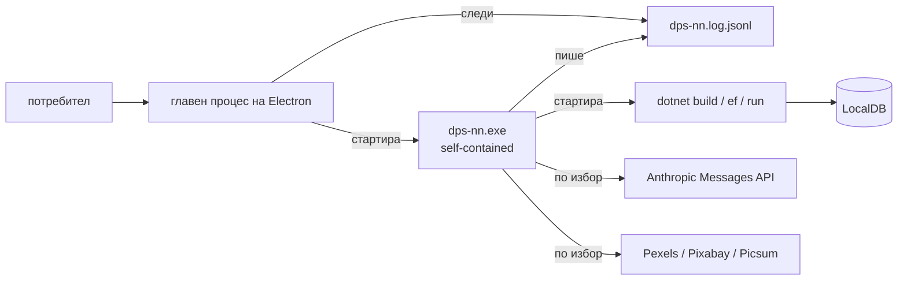

# Среда, разпространение и десктоп приложение

Генераторът има два живота: хранилище, което се строи от изходен код, и инсталирана програма, която се пуска от неразработчик. Различават се в едно отношение — къде може да се пише — и това обяснява повечето странности в CLI кода.

## Две подредби

| | Разработка | Инсталирано |
|---|---|---|
| Програмни файлове | `src/`, `templates/`, `spec.schema.json` | `%LOCALAPPDATA%\Programs\DPS-NN\` — **само за четене** |
| Работна папка | коренът на хранилището | `Documents\DPS-NN\` — **за писане** |
| Генерирани проекти | `out/` | `Documents\DPS-NN\out\` |
| Логове, prompt-ове, кеш | `logs/`, `prompts/`, `.image-cache/` | в същата работна папка |

Правилото: **инсталираната програма никога не пише до себе си.** Затова намирането на ресурси проверява първо папката на инструмента, после текущата — един и същ изпълним файл работи и в двете подредби (ADR-014). Затова `templates/` се копира в инсталатора, вместо да се вгражда.

## Топология на процесите

Следствия: една реализация на конвейера (GUI не може да се размина с CLI); GUI е по избор (всичко е достъпно от CLI); дъщерните процеси са повърхността на провала — затова съществува `doctor`.

### Детайлът с `DOTNET_ROOT`

Self-contained `dps-nn.exe` няма родител `dotnet`, който да зададе `DOTNET_ROOT`, и глобалните инструменти не намират потребителски .NET. CLI извежда `DOTNET_ROOT` от `dotnet` в `PATH` преди всичко останало. Това е истински бъг, който веднъж стигна до потребители; симптомът („инструментът не е намерен“ на машина, където работи в терминал) изглежда като счупена инсталация.

## Разпространение

| Издание | Какво е | Защо съществува |
|---|---|---|
| **Пълно** | NSIS инсталатор: GUI + self-contained CLI + шаблони + музика (~1 GB) | пълното изживяване, включително тематичния музикален плейър |
| **Lite** | същото дърво без музиката, автоматично огледално копирано във второ хранилище | споделяемо без гигабайт чужди записи |

Lite изданието се произвежда от пълното със скрипт — стъпка от компилирането, не отделно разклонение (fork), така че двете не могат да се разминат по код. Версията е с един източник: `VERSION` в корена, щампован в CLI, инсталатора и корицата на тази книга. Инсталаторът е неподписан, затова SmartScreen предупреждава при първо пускане — известна, документирана цена.

## Настолното приложение на една страница

| Част | Отговорност |
|---|---|
| `gui/src/main` | жизнен цикъл на процесите, пътища, IPC, пускане на `doctor`/`run`/`create`, следене на лога |
| `gui/src/renderer` | UI: избор на проект, напредък, терминал (xterm.js), настройки, теми, интерфейс на шест езика плюс Стандартен галактически и шест шеговити режима |
| shared | типове и форми на лог събитията |
| `gui/scripts/` + `gui/electron-builder.yml` | пакетиране: внасяне на CLI и ресурсите му в приложението, NSIS инсталаторът |

Темите са токени плюс кожи и тапети; новото съдържание — тапети, лога, текст на футъра, музика — са файлове, не код.

## Експлоатация

| Въпрос | Къде |
|---|---|
| Готова ли е машината? | `dps-nn doctor` |
| Какво направи последното пускане? | `dps-nn.log.jsonl` и `logs/<Project>/actions.log.jsonl` |
| Коя спецификация е произвела това приложение? | `logs/registry.json` и архивът в `prompts/out/schemas/` |
| Защо базата не се мигрира отново? | `logs/<Project>/db.json` пази името и хеша |
| Работи ли без мрежа? | почти: NuGet пакетите трябва вече да са в локалния кеш, снимките искат доставчик или `--image-pack`, а стъпките с LLM искат ключ или предварително сложени файлове с отговори — а генерираното приложение зарежда Bootstrap и шрифтовете от CDN, затова офлайн изглежда без стилове |

## Сигурност, казана направо

- **Без тайни във входовете.** Паролите на seed потребителите се извеждат, освен ако спецификацията не зададе парола, и никога не се появяват в seed; изведените стойности се записват в lock файла и в `logs/<Project>/seed-credentials.txt`, затова ги третирайте като тайни. API ключовете са само променливи на средата.
- **Без директни връзки към чужди снимки.** Генерираните приложения сервират изтеглените снимки от собствения си `wwwroot`; `.image-cache/` държи заявките към стоковите доставчици до една на фраза.
- **Без превод по време на работа** в генерираните приложения. Единствените отдалечени извиквания са CDN връзките в шаблона на оформлението: Bootswatch/Bootstrap от jsDelivr и Google Fonts на пресета.
- **Чуждото съдържание е отделено.** Музиката не е под лиценза на кода и липсва в Lite изданието.

Какво **не** е заздравено — ограничаване на честота, CSP, по-строго заключване на акаунти — е грижа на [глава 22](22-limits.md). Демо приложението е със сигурност на демо ниво по замисъл и е по-евтино да се каже това, отколкото да се загатва друго.
