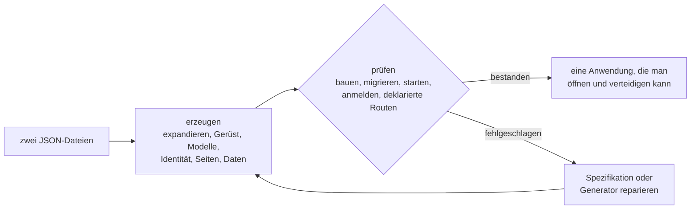

# Eine Erzeugung, aus großer Höhe

Vor aller Mechanik: ein Projekt von der Aufgabenstellung bis zur laufenden Anwendung.

## Die Aufgabe

Eine Studierende kommt mit vier Seiten: *„Online-Buchhandlung“*. Es gibt Leser und Administratoren. Bücher haben Autoren, Kategorien, Preise und Cover; Leser stöbern, suchen, rezensieren, führen eine Wunschliste und bestellen; Administratoren verwalten Katalog und Benutzer. Die Oberfläche soll vollständig bulgarisch sein und sich auf einem Laptop zeigen lassen.

Das ist eine normale Aufgabenstellung — und zugleich eine Spezifikation: Sie beschreibt Entitäten, Beziehungen, Rollen, Seiten und Regeln. Sie beschreibt keinen Code.

## Die Entscheidung: was eine Beispielanwendung wird

Die erste Arbeit ist **Zuschnitt**. Drei eigene Modelle, nicht dreißig: Book, Author, Category. Rezensionen, Wunschliste und Bestellungen kommen aus drei wiederverwendbaren Funktionen — `rating`, `catalogues` (eine persönliche Liste von Büchern, und genau das ist eine Wunschliste) und `orders` (Warenkorb, Bestellung, Bestellhistorie) —, und jede bringt ihre eigenen Modelle mit. Alle dürfen sich anmelden; Administratoren bekommen die Verwaltung; Leser den Schaufensterbereich. Kartenzahlung, E-Mail-Versand und eine Empfehlungsmaschine werden benannt und gestrichen, weil der Generator sie nicht ausdrückt und eine halbfertige Funktion schlechter ist als ein ehrliches Weglassen.

## Zwei Dateien statt einer Codebasis

Der Umfang wird zu zwei JSON-Dokumenten:

- **Spezifikation** — die drei Modelle mit ihren bulgarischen Bezeichnungen (Titel, Autor, Preis), die Validierungsregeln („der Preis muss positiv sein“), die zwei Rollen, die zwei Bereiche, welche Seiten existieren und welcher Art sie sind, die drei Funktionen und wie viele Demozeilen jedes Modell bekommt;
- **Seed** — die Zeilen selbst: vierzig Bücher mit echten Titeln, zwölf Autoren, sechs Kategorien, Rezensionen mit glaubwürdigem Text, zwei Bestellungen mit Positionen.

Keine der beiden Dateien enthält C#. Das ist die zentrale Entscheidung: Die Eingabe beschreibt eine Anwendung, keine unfertige Anwendung.

## Der Lauf

- **Expandieren** mischt die drei Funktionen ein, wählt den Stil des Projekts und leitet die Passwörter der Demo-Nutzer ab.
- **Gerüst** legt ein gewöhnliches MVC-Projekt an und kompiliert es einmal.
- **Modelle** schreibt die Entitäten — die drei, die die Spezifikation deklariert, und die, die die Funktionen hinzugefügt haben —, Validierungsattribute mit bulgarischen Meldungen und den EF-Core-Kontext.
- **Identität** erzeugt Rollen, bulgarische Anmelde-, Registrierungs- und Profilseiten, einen Administrator und einen Leser.
- **Controller und Views** bauen die zwei Bereiche: Schaufenster mit Suche und Sortierung, Admin-Tabellen und die Seiten, die die Funktionen brauchen: Rezensionen, persönliche Listen, Warenkorb und Bestellungen.
- **Daten** füllen die Datenbank: Bücher mit heruntergeladenen Covern, Rezensionen und Bestellungen, symbolisch verknüpft, und die Migration.
- **Prüfen** baut, migriert, startet auf einem freien Port, meldet sich über das echte Formular als Administrator an, ruft jede Seite ab, die die Spezifikation deklariert, und durchsucht den gerenderten Text nach Englisch. Ein durchgerutschtes „Add to cart“ lässt den Lauf scheitern. Startseite und Anmeldung müssen ohne Einschränkung gelingen, jede deklarierte Seite muss antworten, und jede Admin- oder anmeldepflichtige Seite muss einen anonymen Besucher abweisen.
- **Bericht** schreibt ein maschinenlesbares Ergebnis.

## Was die Studierende sieht

Eine Anwendung, die auf einem Laptop startet, mit gefülltem Katalog, funktionierender Anmeldung, Admin-Bereich und Seiten, die gestaltet aussehen. Die Zugangsdaten stehen am Ende des Laufs.

## Was der Prüfer sieht

Drei Dinge, die schwer zu fälschen sind:

1. **Der Lauf ist protokolliert.** Die Anwendung wurde während der Erzeugung gebaut, migriert, gestartet und angemeldet, und das Log nennt, welche Seiten geantwortet haben. Es ist eine Datei, keine Behauptung.
2. **Die bulgarische Anforderung ist mechanisch geprüft.** Der Sprachbericht listet jeden englischen Text auf, ob bestanden oder nicht.
3. **Der Code ist gewöhnlich.** Die erzeugte Anwendung enthält kein Laufzeit-Framework — kann die Studierende eine Zeile nicht erklären, liegt der Fehler beim Generator, nicht bei ihr.

## Wenn es schiefgeht

Ist ein Modell fehlerhaft, nennt die Validierung Modell und Eigenschaft, bevor etwas erzeugt wird. Kann sich eine Funktion nicht an das Hauptmodell des Projekts anhängen, stoppt die Erzeugung beim Expandieren. Fehlt eine Datei, die die Spezifikation zugesagt hat, nennt sie die Manifestprüfung von `verify`, bevor die Anwendung gestartet wird. Startet die Anwendung nicht, scheitert die Prüfung vor dem Scan. Der Lauf ist **an der fehlgeschlagenen Stufe wiederaufnehmbar**, und die Diagnoseartefakte liegen auf der Platte.

Das Versprechen in einem Satz: Eine Aufgabe geht hinein, eine geprüfte und erklärbare Anwendung kommt heraus, und wenn etwas scheitert, ist der Fehler lokalisiert.

| Frage | Kapitel |
|---|---|
| Wie sieht die Anwendung innen aus? | [3](03-what-a-generated-app-is.md), dann [10](10-generated-app-architecture.md) |
| Wie starte ich sie selbst? | [4](04-first-run.md) |
| Wie wird aus *meiner* Aufgabe eine Spezifikation? | [5](05-paper-to-spec.md) |
| Woher kommen die Demodaten? | [6](06-spec-to-seed.md) |
| Kann das Modell alles übernehmen? | [7](07-agent-mode.md) |
| Was genau ist jede Stufe, und wo kann sie anhalten? | [9](09-workflow.md) |
