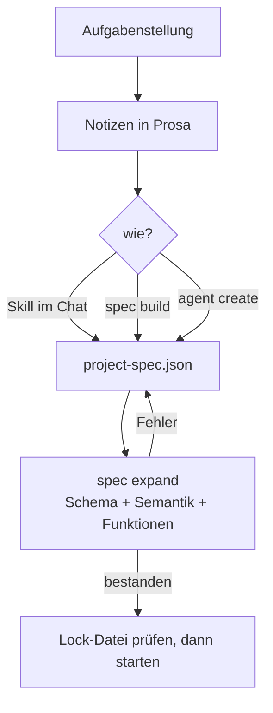

# Von der Aufgabenstellung zur Spezifikation

Dies ist das Kapitel, für das das Werkzeug existiert: Eine Aufgabe kommt, eine Spezifikation muss entstehen. Eine Spezifikation ist keine Zusammenfassung, sondern ein **Beschlussprotokoll**, das der Generator ausführen kann. Was er nicht ausführen kann, wird ausdrücklich weggelassen.

## Was die Aufgabe liefert und wohin es geht

| In der Aufgabe | Wird zu | Achtung |
|---|---|---|
| Zweck, Domäne, Nutzer | `meta.projectName`, `meta.domainHint`, `meta.domainHintBg` | die Domäne benennen, nicht die Technik |
| Akteure, Rollen, Rechte | `identity.roles`, je ein Bereich in `areas[]` | „Admin + Nutzer“ sind meist zwei Bereiche |
| Entitäten und Attribute | `models[]` mit `properties[]`, `relations[]` | jede sichtbare Eigenschaft braucht einen bulgarischen `displayName` |
| Feldregeln | `validations[]` mit bulgarischer Meldung; Datumsregeln über `customValidationAttributes` | was nicht ausdrückbar ist, wird als Grenze gemeldet |
| Bildschirme | `views.pages[]` mit Art `landing`, `contactFormStatic`, `cardGrid`, `adminTable` | Suche und Sortierung werden am Controller konfiguriert |
| „CRUD für X“ | `controllers[]` mit `generatedBy` | unnötige Aktionen über `removedActions` entfernen |
| Wiederverwendbare Teile | `features.<name>.enabled` | nur aktivieren, was verlangt ist |
| „Demodaten“ | `seeding.rowsPerModel` | bescheidene Zahlen (5–20) |
| Zeitstempel, Soft Delete | `conventions` | fragen; sie ändern die Codeform |

## Der Arbeitsablauf



| Weg | Wann | Kosten |
|---|---|---|
| **Skill im Chat** | die Aufgabe ist mehrdeutig und soll Rückfragen auslösen | kostenlos, Mensch nötig |
| **`spec build --notes`** | klare Notizen liegen vor; funktioniert ohne Schlüssel | ein Austausch |
| **`create --describe`** | die Schleife soll den Generator fahren und die Spezifikation reparieren | API-Schlüssel, begrenzte Runden |

### Vor dem Erzeugen validieren

```bash
dotnet run --project src/Genesis.Cli -- spec expand --spec project-spec.json
```

Das prüft zweistufig, mischt die Funktionsfragmente, ersetzt `$variation:` und schreibt `project-spec.lock.json`. Besteht es, liegt das strukturelle Risiko in den Vorlagen, nicht in der Eingabe.

## Die Regeln, die die Form bestimmen

1. **Umfang einer Beispielanwendung: 5–10 Modelle.** Eine Aufgabe mit 30 Entitäten heißt: auf den Kern schneiden, den Rest als außerhalb des Umfangs melden.
2. **Jede sichtbare Eigenschaft bekommt einen bulgarischen `displayName`.** Die semantische Validierung der Spezifikation weist eine sichtbare Eigenschaft ohne `displayName` ab, bevor etwas erzeugt wird, denn ein nackter C#-Eigenschaftsname auf einer Seite ist genau ein englisches Leck.
3. **Bulgarisch als Vorgabe.** Alle lesbaren Zeichenketten in Kyrillisch; Markennamen bleiben in ihrer Schrift.
4. **Kleine Referenzmodelle werden zusammengefasst** (`isSpecification`), Verknüpfungszeilen ebenso (`isLookup`) — beide auf der Seite „Spezifikationen“.
5. **Sinnlose Aktionen entfernen** (`removedActions`).
6. **`ownership` für alles, was eine Person besitzt** — serverseitig: nur Eigentümer oder Admin.
7. **Der `images`-Block gilt nur für Hauptinhalte**; ein Nebenbild ist ein einfaches `ImagePath`.
8. **Keine Passwörter in `seedUsers`** — nur E-Mail und Rolle, Passwörter werden abgeleitet.
9. **`generatedBy` ist einer von genau drei Werten**: `scaffold`, `template`, `writtenFromScratch`. Die ersten beiden decken die meisten Bedürfnisse ab; der dritte ist für den Users-Controller und die Seite „Spezifikationen“ gedacht.

## Wie viel die Spezifikation steuert

| Entscheidung | Ort in der Spezifikation |
|---|---|
| Welche Entitäten mit welchen Eigenschaften und Bezeichnungen | `models[]` |
| Welche Controller existieren und wie sie entstehen | `controllers[]` |
| Seitenzusammensetzung und Art jeder Seite | `views` |
| Rollen, Bereiche, Identitätsseiten, Seed-Nutzer | `identity`, `areas[]` |
| Welche Fragmente einfließen (samt Modelle, DTOs, Controller) | `features` |
| Zusammengesetzte Lesemodelle | `dtos[]` |
| Zeilenzahlen und Bildquelle | `seeding` |
| Theme, Design-Preset, festgelegte Achsen | `meta.style`, `variationProfile` |
| Was der Bericht zeigen soll | `outputReport` |

Praktisch heißt das: **Zwei Anwendungen aus derselben Aufgabe müssen keinen einzigen Namen teilen.** Der Verkäufer ändert die Domänensprache, wählt Funktionen, entscheidet über die Zusammenfassung, benennt Controller und Seiten um, schreibt andere Meldungen und legt ein anderes Theme und einen anderen Codestil fest. Konstant bleibt die Maschinerie darunter.

## Wenn die Aufgabe Unmögliches verlangt

In der Spezifikation festhalten:

```json
"meta": {
  "unsupportedRequests": [
    { "request": "Belegungskalender für den Lesesaal",
      "reason": "keine Terminfunktion; der Generator modelliert keine wiederkehrende Zeit" }
  ]
}
```

Der Agentenmodus schreibt diese Einträge selbst; bei Handarbeit schreiben Sie sie. Die Pipeline ignoriert den Abschnitt, Menschen nicht.

## Checkliste

- [ ] `spec expand` läuft ohne Schema- und Semantikfehler.
- [ ] Jedes Modell hat genau eine Schlüsseleigenschaft; jede Beziehung zeigt auf ein existierendes Modell.
- [ ] Jede sichtbare Eigenschaft hat einen bulgarischen `displayName`.
- [ ] Jeder Bereich hat eine Rolle (oder einen `$variation:`-Platzhalter).
- [ ] Jeder Template-Controller mit `Index` hat eine Seite.
- [ ] `seeding.rowsPerModel` deckt jedes gewünschte Modell.
- [ ] Funktionen sind nur für Verlangtes aktiv.
- [ ] Unmögliches steht in `meta.unsupportedRequests`.
