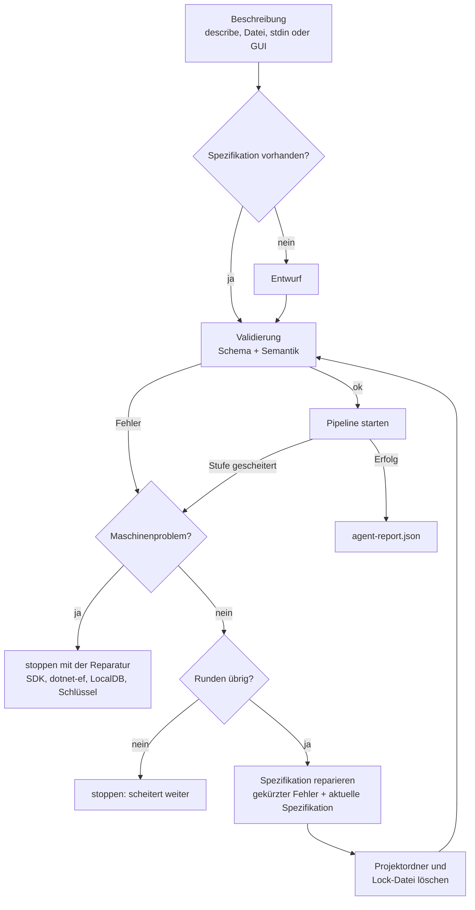

# Agentenmodus

Der Agentenmodus (`dps-nn create`) ist der einzige Teil, der im strengen Sinn ein Agent ist: Er beobachtet das Ergebnis seiner Handlungen und entscheidet, was folgt. Alles andere ist Pipeline.

## Warum es ein Agent ist und warum der Hebel schmal bleibt

Ein Workflow führt feste Schritte aus. Hier sind die Schritte fest, aber die *Eingabe des nächsten* wird aus Evidenz gewählt: Das Modell liest den Fehler des Generators und ändert die Spezifikation. Vertrauen entsteht nicht durch die Schleife, sondern durch den **Hebel**: Das Modell darf nur die Spezifikation ändern, niemals erzeugtes C#. Jede Anwendung bleibt damit reines Template-Ergebnis — erklärbar, vergleichbar, reproduzierbar.

## Die Schleife



Drei Entscheidungen tragen: Umgebungsfehler stoppen sofort (kein Spezifikationswechsel behebt einen fehlenden SDK); Fehler werden vor dem Senden gekürzt (über 6000 Zeichen bleiben erste Zeile plus verschiedene Fehlerzeilen, max. 60); eine Reparatur löscht Projektordner und Lock-Datei, damit der nächste Versuch nicht ein halbfertiges Projekt aus der schlechten Spezifikation fortsetzt.

Budget: `--max-repairs` (Standard 3). Jeder Versuch, seine Stufe und der gekürzte Fehler landen in `agent-report.json`. Der Fehlerbildschirm der GUI zeigt den Stoppgrund, den er aus der Zeile `agent: stopped - <reason>` der CLI auf der Standardausgabe liest; die vollständige Liste der Versuche bleibt im Bericht.

## Der Bericht über fehlende Fähigkeiten

Verlangt die Beschreibung etwas, das das Schema nicht ausdrückt — Buchungskalender, Zahlungen, Echtzeit-Chat —, muss das Modell es **weglassen und festhalten**:

```json
"meta": {
  "unsupportedRequests": [
    { "request": "Belegungskalender für den Lesesaal",
      "reason": "keine Terminfähigkeit" }
  ]
}
```

Die Liste wird gedruckt, im Bericht gespeichert und ist der Backlog für neue Feature-Fragmente. Ein Werkzeug, das Anforderungen still verwirft, ist schlechter als eines, das sie benennt.

## Starten

```bash
export ANTHROPIC_API_KEY=sk-ant-...
dotnet run --project src/Genesis.Cli -- create \
  --describe "Online-Buchhandlung: Bücher, Autoren, Rezensionen, Warenkorb und Bestellungen"
```

| Option | Bedeutung |
|---|---|
| `--describe` / `--describe-file` / stdin | der Anforderungstext, beliebige Sprache |
| `--max-repairs` | Reparaturrunden vor dem Abbruch (3) |
| `--out` | Ergebniswurzel; Standard `out/agent_<timestamp>` |
| `--spec` | wohin der Entwurf geschrieben wird; vorhandene Datei wird wiederverwendet |
| `--image-pack`, `--image-provider` | wie beim normalen Lauf |

Codes: `0` erzeugt, `1` gestoppt (Grund wird gedruckt), `2` Fehlbedienung, `3` wartender LLM-Austausch.

**Der Schlüssel ist Pflicht.** Manuelles Einfügen pro Runde würde die Schleife entwerten; ohne Schlüssel den klassischen Weg aus [Kapitel 5](05-paper-to-spec.md) nutzen.

## Testen ohne Schlüssel

Die Schleife nimmt ihre drei Seiteneffekte als Delegates — Autor, Pipeline, Validator —, daher fährt `AgentTests.cs` jeden Zweig mit Fälschungen: Erfolg, eine Reparatur, Umgebungsstopp, erschöpftes Budget, Entwurfsfehler, wartender Austausch. End-to-End zeigt `ANTHROPIC_BASE_URL` auf einen lokalen Stub, der die drei Austausche beantwortet.
