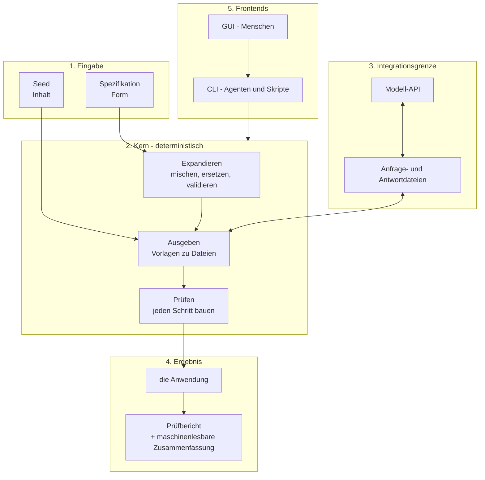

# Die Architektur in einem Bild

Bisher beschrieb das Buch, was das System tut. Dieses Kapitel beschreibt, wie es zusammengesetzt ist — Stil, Grenzen, Muster und Werkzeuge —, damit der Rest einen Rahmen hat.

## Ein Satz, dann das Bild

Genesis ist ein **Compiler mit Prüfer**: Eine deklarative Beschreibung geht hinein, eine lauffähige Anwendung kommt heraus, und nichts gilt als erzeugt, bevor das Ergebnis gebaut, gestartet und zurückgelesen wurde. Um den Kern liegen zwei Frontends und eine Pflichtgrenze: Jeder Austausch mit einem Sprachmodell ist eine Datei auf der Platte.

Folgt man den Pfeilen von der Eingabe zum Ergebnis, ergibt sich die Garantie: Der einzige Weg zum Ergebnis führt durch die Prüfungen, der einzige Weg zum Modell durch Dateien.

## Der Stil, benannt

| Eigenschaft | Ausdruck | Warum nicht die Alternative |
|---|---|---|
| **Stufenpipeline** | neun benannte Stufen, je ein `IStage`; der Runner treibt sieben davon nach `spec-expand` in fester Reihenfolge, `spec-build` läuft für sich allein | ein Monolith kann nicht fortsetzen; eine verteilte Queue braucht Infrastruktur |
| **Compilerförmig** | Spezifikation als Quelle, Lock-Datei als Zwischendarstellung, Vorlagen als Backend, `verify` als Prüfstand | „erzeugen und hoffen“ hat keinen Ort für eine falsche Übersetzung |
| **Extern gespeicherter Fortschritt** | Abschluss ist eine Namensliste in einer JSON-Datei | ein Lauf muss Absturz und Neustart überleben |
| **Ports und Adapter** | der Kern kennt weder HTTP noch Electron noch Terminal | Trennung macht den Kern ohne Desktop testbar |
| **Dateien als Vertrag** | Prompt/Antwort, Spezifikation/Seed, Logs und Berichte | ein Aufruf im Speicher macht den LLM-Weg unprüfbar |
| **Deterministischer Kern** | Hashing für Vielfalt; Migrationen und Modellantworten am Rand | Zufall in Vorlagen macht jeden Fehler unreproduzierbar |

## Die Muster und wo sie leben

| Muster | Ort | Was es bringt | Wo es endet |
|---|---|---|---|
| **Pipeline / Filter** | `PipelineRunner` über `IStage` | Fortsetzen, Zeiten, Fehlerzuordnung | Stufen laufen nicht parallel |
| **Zwischendarstellung** | `project-spec.lock.json` | Expandieren geschieht einmal | Lock ist Obermenge der Quelle |
| **Strategy + Template Method** | `IStage.RunAsync`, `ISpecAuthor`, Controller-Herkunft | Verhalten ohne Verzweigung im Runner | jede Strategie schuldet Idempotenz und Baugate |
| **Adapter** | `LlmBridge`, `Proc` | zwei Mechanismen hinter einem Interface | ein Defekt wirkt als Stufenfehler |
| **Facade** | `TemplateEngine` | eine Rendering-Oberfläche | neue Fähigkeit geht durch die Fassade |
| **Memento** | `StateStore`, `DbLifecycleRecord` | Stoppen und Fortsetzen ohne Doppelarbeit | Zustand ist eine flache Liste |
| **Registry** | Variationsachsen, Codepointer, Standardzeilen | neuer Fall ist eine Datenänderung | Register werden von Hand gepflegt |
| **Command** | `System.CommandLine`-Baum | eine Operation ist Kommando und Objekt | Handler können Orchestrierung anhäufen |
| **Builder** | `scaffold` → Modelle → Identität → Seiten → Daten | Aufbau in Abhängigkeitsreihenfolge | Fehler mittendrin hinterlässt Teilprojekt (fortsetzbar) |
| **Ankerbasiertes Umschreiben** | Abweichungen per Regex auf Gerüstausgabe | billig und laut bei Änderung | spröde bei SDK-Wechsel (ADR-006) |
| **Konvention vor Konfiguration** | MVC-Routen, Controller-/View-Erkennung | gewöhnliches ASP.NET ohne Sonderverdrahtung | Konventionen müssen dokumentiert werden |
| **Dependency Injection** | `Program.cs` der Anwendung; Delegates im Agenten | Dienste nur bei Bedarf; Schleife testbar | DI im erzeugten Code bleibt klein |
| **Fail-fast** | `Proc.ThrowIfFailed`, werfende Anker | Fehler dort gefangen, wo er entsteht | laut bei Umgebungsproblemen — dafür `doctor` |

### Bewusst abwesend

Kein Repository-Layer über EF Core, kein CQRS, kein Event-Bus, kein Service-Layer zwischen Controller und `DbContext`, kein DI-Container im Generator selbst. Jede Abstraktion muss ihren Platz in einem Lehrartefakt verdienen.

## Codestil

**Der Generator:** .NET 10, nullable und implicit usings, `LangVersion latest` nur im Kern; file-scoped Namespaces in jeder Quelldatei des Kerns (die `Program.cs` der CLI verwendet Top-Level-Anweisungen); `sealed` als Vorgabe; Records für Werte (`StageContext`, `ResolvedVariation`); Primary Constructors; ein öffentlicher Einstieg pro Modul, Interna nur über `InternalsVisibleTo`; Ausnahmen innen, Exitcodes nur an der CLI-Grenze; invariante Kultur in Logs; Hashing statt `GetHashCode()`; Vorlagen sind Daten, kein C#-Bauen außerhalb des `TemplateEngine`; eine `// FILE-MAP:`-Zeile pro Datei; Kommentare tragen das *Warum*, die verworfene Alternative und die Falle.

Die Abhängigkeitsrichtung wird durch Konvention erzwungen, nicht durch einen Analyzer: `Spec` und `Llm` hängen von nichts im Kern ab, `Variation` und `Util` nur von der Spezifikationsseite; `Stages` darf alle verwenden; nichts importiert `Stages` außer der CLI, und der Agent erreicht die Pipeline nur über einen Delegate. [Kapitel 13](13-components.md) listet die Modulgrenzen.

**Die erzeugte Anwendung:** konventionelles MVC — Entitäten mit Attributen und bulgarischen Meldungen, Controller direkt am `DbContext`, Razor-Views mit Partials, Inline-JavaScript für kleine Interaktionen, Bootstrap für das Layout. Dienste entstehen nur, wenn die Spezifikation sie rechtfertigt.

## Probleme und Mechanismen

| Problem | Mechanismus |
|---|---|
| Handarbeit kostet Wochen | deklarative Eingabe, Vorlagenausgabe |
| Demodaten kommen spät oder nie | Seed als Eingabe, Selbstbefüllung beim Start |
| Lokalisierung kommt zuletzt | Bulgarisch ist harte Anforderung, Sprachgate verhindert Lecks |
| „Läuft auf meiner Maschine“ | die Pipeline baut, migriert, startet, ruft ab |
| Zwei Versuche sehen unverbunden aus | deterministische Vielfalt aus dem Seed |
| Ein Fehllauf kostet den ganzen Lauf | Checkpoints je Stufe, idempotente Stufen |
| LLM-Ergebnis ist unprüfbar | Dateivertrag, Schema-Validierung, gehashte Logs |
| Das Modell repariert eigenen Code | der Hebel ist die Spezifikation |
| Käufer können das Erhaltene nicht belegen | Bericht, Archiv, Log |

## Die Werkzeuge und was jeweils verworfen wurde

| Werkzeug | Wofür | Warum dieses | Nicht jenes |
|---|---|---|---|
| **Scriban** | C#, Razor und C#-nahen Text ausgeben | Text-Templating mit kleiner, stabiler Syntax, das auch außerhalb von ASP.NET rendert | Razor zum Erzeugen (braucht ein Hosting-Modell, zieht MVC mit) |
| **System.CommandLine** | der Befehlsbaum | eine Deklaration für Befehle, Optionen und Hilfe | selbstgebauter Argumentparser |
| **JsonSchema.Net** | Prüfung von Spezifikation und Modellantworten | standardbasiert, meldet jede Verletzung statt nur der ersten | eigene Prüfung, die vom Schema abdriftet |
| **EF Core + SQL Server** | die Datenschicht der erzeugten App | Migrationen, LINQ und das, was die Zielgruppe kennt | ein Micro-ORM (weniger lehrreich), ein Dokumentenspeicher (falsche Form) |
| **ASP.NET Identity** | Konten und Rollen | Standard, erweiterbar, Prüfern vertraut | eine eigene Auth-Schicht |
| **xUnit** | die .NET-Suite | schlichte Zusicherungen, kein Mocking nötig, weil die Nahtstellen Delegates sind | eine mock-lastige Suite, die Interaktionen statt Ergebnisse prüft |
| **Electron + TypeScript** | die Desktop-Hülle | nutzt Web-Kenntnisse, läuft unter Windows, startet die CLI | eine native Oberfläche (doppelte Fläche ohne Gewinn) |
| **electron-vite** | GUI-Build | schneller Entwicklungszyklus und die drei Build-Ziele (main, preload, renderer) aus einer Konfiguration | ein selbstgebautes Bundler-Setup |
| **xterm.js** | das Terminal in der GUI | echte ANSI-Ausgabe der CLI | eine nachgebaute Log-Ansicht |
| **NSIS** | der Windows-Installer | klein, skriptbar, Installation pro Benutzer | MSI (schwerer, hier weniger skriptbar) |
| **GitHub Actions unter Windows** | CI | das Produkt wird unter Windows ausgeliefert: Der Installer ist NSIS und wird auf demselben Runner-Image gebaut | reine Linux-CI, die die Plattform, auf der Anwender installieren, nie sieht |
| **Git LFS** | die Musik-Assets | hält einen 1-GB-Medienordner aus normalen Klons | Medien in die Historie committen |
| **Mermaid + pandoc + XeLaTeX** | dieses Buch | Diagramme als diffbare Quelle, ein Markdown-Baum für ein gesetztes PDF | ein Textverarbeitungsprogramm oder Bilder von Diagrammen |

## Was sie auszeichnet

Sechs Behauptungen, jede in diesem Buch nachprüfbar:

1. **„Fertig“ heißt geprüfter Lauf**, nicht kompiliertes Projekt. Build, Migration, Manifest, Start, Anmeldung,
   die deklarierten Routen, anonyme Abweisung, Sprache — in dieser Reihenfolge, das Billigste zuerst ([Kapitel 9](09-workflow.md)).
2. **Das Sprachmodell ist ein begrenzter Hebel.** Es schreibt JSON; die Anwendung schreibt es nie.
   Jeder Fehler, den es sieht, ist ein echter Generatorfehler, und jede Anfrage ist eine Datei, die
   später jemand lesen kann.
3. **Dieselbe Spezifikation ist reproduzierbar, verschiedene sind keine Klone.** Determinismus und
   Vielfalt sind konstruiert, nicht dem Zufall überlassen ([Kapitel 12](12-principles.md)).
4. **Eine Pipeline, zwei Oberflächen.** Die GUI hat keine eigene Erzeugungslogik, also können beide
   nicht auseinanderlaufen ([Kapitel 18](18-gui-architecture.md)).
5. **Der erzeugte Code ist gewöhnlich.** Keine eigene Laufzeitumgebung, keine erfundenen Abstraktionen —
   der Besitzer kann jede Zeile erklären, und genau das ist der Sinn eines Diplomartefakts.
6. **Die Dokumentation gehört zur Architektur.** Router-Datei, Entscheidungsakten, Changelog und
   Entscheidungsprotokoll sorgen dafür, dass eine neue Sitzung die Begründung rekonstruieren kann, ohne
   zu fragen ([Kapitel 15](15-how-the-project-is-built.md)).

## Wie man den Code von hier aus liest

| Frage | Kapitel |
|---|---|
| Was tut jede Stufe genau, und wo kann sie anhalten? | [Der Ablauf von Ende zu Ende](09-workflow.md) |
| Welche Dateien entstehen, und wie sind sie geschichtet? | [Was erzeugt wird](10-generated-app-architecture.md) |
| Was versprechen Spezifikation und Seed wirklich? | [Die zwei Verträge](11-contracts.md) |
| Welches Modul besitzt welches Verhalten? | [Komponenten](13-components.md) |
| Welche Werkzeuge stecken hinter CLI und GUI? | [CLI-Referenz](17-cli.md), [GUI-Architektur](18-gui-architecture.md) |
