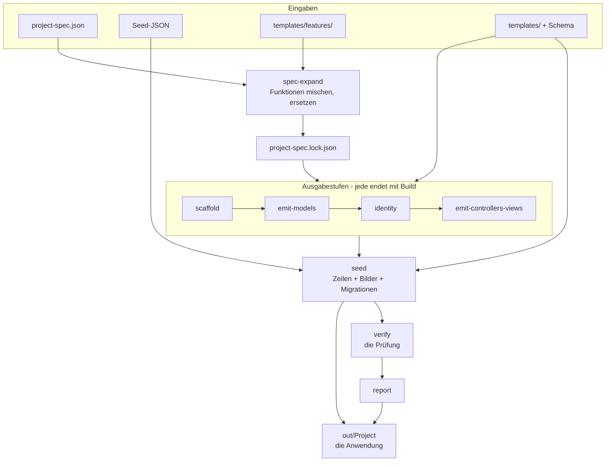

# Der Ablauf von Ende zu Ende

Dieses Kapitel folgt dem Lauf als Maschine: wer wen ruft, was jede Stufe liest und schreibt, wo sie stoppen kann und was den Stopp überlebt.

## Der Ablauf als Daten

`spec-expand` läuft vor der Schleife. `spec-build` (Notizen → Spezifikation) ist ein eigenes Kommando und absichtlich nicht im Bild — es erzeugt die linke Box, es konsumiert sie nicht.

## Stufe für Stufe

| # | Stufe | Liest | Schreibt | Gate |
|---|---|---|---|---|
| 1 | `spec-build` | Notizen, Schema | `project-spec.json` | keins |
| 2 | `spec-expand` | Spezifikation, Fragmente, Seed | `project-spec.lock.json` | Schema + Semantik |
| 3 | `scaffold` | Lock | `.csproj`, Solution, `Program.cs`-Basis, Verbindungszeichenfolge | Build |
| 4 | `emit-models` | Lock, Vorlagen | `Models/`, DTOs, Kontext, Attribute | Build |
| 5 | `identity` | Lock, Vorlagen, Karte | `ApplicationUser`, `Program.cs`, Seiten, Describer, Rollen, Nutzer | Build |
| 6 | `emit-controllers-views` | Lock, Vorlagen | Controller und Views beider Bereiche, Dienste, Partials | Codegen + Build |
| 7 | `seed` | Lock, Seed, Anbieter | `seed-data.json`, `SeedData.cs`, Bilder, Migrationen, DB | Build → Migration → Update |
| 8 | `verify` | Lock, Anwendung | Sprachbericht | die eigentliche Prüfung |
| 9 | `report` | Lock, `outputReport` | `project-summary.json` | keins |

**Fortsetzen:** Jeder Erfolg hängt den Stufennamen an `{out}/{Project}/plan/state.json`. `run --all` überspringt Bekanntes; `--from <Stufe>` wiederholt sie und die folgenden. `spec-expand` hat einen eigenen Eintrag, und `--from` mit einem Namen außerhalb der sieben Runner-Stufen startet gar nichts.

## Die Prüfung, die das Produkt definiert

`verify` ist kein angehängter Smoke-Test am Ende; sie ist die Definition von fertig. In Reihenfolge, billig zuerst:

1. sauberer `dotnet build` im erzeugten Projekt;
2. `dotnet ef database update` gegen die echte Datenbank;
3. **Manifestprüfung** — jede zugesagte Datei existiert;
4. die Anwendung startet auf einem freien Port;
5. `GET /` — Pflicht;
6. jede öffentliche Route anonym;
7. jede geschützte Route (Admin-Seiten und anmeldepflichtige Funktionsseiten) anonym — jede muss mit 401/403 antworten oder zur Anmeldung umleiten;
8. echte Formularanmeldung als geseedeter Admin — eine gescheiterte Anmeldung lässt `verify` scheitern —, dann jede entdeckte geschützte Route (`adminTable`-Seiten und jede aktivierte Funktionsseite des Client-Bereichs);
9. Sichttext-Scan auf Englisch über **jede oben abgerufene Seite, die mit 200 geantwortet hat** — entfällt ganz (nicht bloß ohne Folgen), wenn `meta.language` nicht `bg` ist.

Schritte 3 und 9 fangen, was Unit-Tests nicht können: eine still nicht erzeugte Datei und eine durchgerutschte Zeichenkette.

Jeder Schritt ist hart. Die Schritte 6–8 sammeln ihre Fehler und melden sie gemeinsam, sodass ein Lauf jede deklarierte Seite auflistet, die nicht mit 200 antwortete, und jede geschützte Seite, die eine anonyme Anfrage öffnen konnte. (Bis Changelog 141 wurde eine Route mit anderem Status nur protokolliert und übersprungen, und anonymer Zugriff wurde nicht geprüft.) Die `[Authorize]`-Attribute, die Schritt 7 prüft, erzeugt `emit-controllers-views`: die Admin-Rolle an jedem Controller des Admin-Bereichs und Anmeldepflicht an Controllern des Client-Bereichs außer ihren lesenden `Index`/`Details`.

## Was ein Lauf hinterlässt

| Artefakt | Zweck | Überlebt `rm -rf out` |
|---|---|---|
| `out/Project/` | die Anwendung | nein |
| `plan/state.json` | Fortsetzungszustand | nein |
| `dps-nn.log.jsonl` | Stufengrenzen, Zeiten, Hashes | nein |
| `prompts/` | Dateivertrag | ja |
| `prompts/out/schemas/`, `seeds/` | Archiv des Verwendeten | ja |
| `logs/registry.json(l)` | Projekt ← Spezifikation und Seed | ja |
| `logs/<Project>/actions.log.jsonl` | ausführliches Log, volle Ausnahmen | ja |
| `logs/<Project>/db.json` | welche Datenbank migriert wurde | ja |
| `.image-cache/` | heruntergeladene Bilder | ja |

## Drei Zustände

| Situation | Verhalten |
|---|---|
| **Erstlauf** | alle Stufen laufen, jede setzt ihren Checkpoint |
| **Fortsetzen** | erledigte werden übersprungen, die gescheiterte und alle folgenden laufen |
| **Erzwungen** | `--from X` ignoriert Checkpoints ab X; jede Stufe muss idempotent sein |

Idempotenz ist Pflicht der Stufe, nicht des Runners: Nach einem Absturz muss die Stufe ihre eigene Arbeit finden (vorhandenes `.csproj`, gültiger Seed, angewandte Migration) und überspringen.

## Fehler

| Code | Bedeutung | Vorgehen |
|---|---|---|
| `0` | fertig und geprüft | Anwendung öffnen |
| `1` | eine Stufe warf | Stufe und Fehler lesen; volle Ausnahme in `logs/<Project>/actions.log.jsonl` |
| `2` | Fehlbedienung | Aufruf korrigieren |
| `3` | LLM-Austausch wartet auf Datei | `prompts/in/<stage>-response.json` füllen, mit `--resume` starten |

Code `3` ist eine Übergabe, kein Fehler. Jeder andere Wert ungleich null ist ein echter Fehler, und der Lauf setzt an der gescheiterten Stufe fort.

## Der Zustand: drei Dateien, drei Eigentümer

| Datei | Schreibt | Liest | Warum getrennt |
|---|---|---|---|
| `project-spec.json` | Sie, `spec build`, der Agent | nur `spec-expand` | Ihr Dokument; das Werkzeug ändert es nicht |
| `project-spec.lock.json` | `spec-expand` | alle Stufen ab `scaffold` und das Manifest | die expandierte Form treibt die Ausgabe |
| `plan/state.json` | der Runner | der Runner | Fortsetzen ist Eigenschaft des Laufs |

## Die Invarianten

1. **Erzeugtes nie bearbeiten** unter `out/`.
2. **Nur bulgarische Oberfläche**: jede sichtbare Eigenschaft hat einen `displayName`.
3. **Jede codeerzeugende Stufe baut ihr Ergebnis.**
4. **Stufen sind idempotent.**
5. **Das LLM ändert JSON, nie Code.**
6. **Die GUI implementiert die Pipeline nicht neu.**
7. **`spec.schema.json` besitzt die Form der Spezifikation.**

## Wo ein Fehler lebt

| Symptom | Schicht | Behebung |
|---|---|---|
| `All values fail against the false schema` (ein unbekannter Schlüssel) oder `Value is "…" but should be "…"` aus der Schema-Validierung | Ihre Eingabe | Spezifikation gegen `spec.schema.json` korrigieren |
| `Model X: relation target 'Y' is not a declared model.` | Ihre Eingabe, Querverweis | Modell deklarieren oder die Beziehung korrigieren |
| C# kompiliert nicht | Vorlage oder Stufe | `.sbn` oder Stufe korrigieren |
| kompiliert, aber eine Seite liefert 500 | Seiten-/Routenverdrahtung | die semantische Regel „der `Index` eines Template-Controllers braucht eine Seite“ fängt den häufigen Fall |
| startet, Sprachgate scheitert | ein ausgegebenes Literal | aus der Vorlage entfernen oder `displayName` ergänzen |
| startet, aber `verify` meldet eine deklarierte Seite als nicht 200 | Routen-/Bereichsregistrierung | Bereich und `routing.defaultArea` prüfen, nicht die Seite |
| startet, aber `verify` meldet, dass eine anonyme Anfrage nicht abgewiesen wurde | fehlendes `[Authorize]` an einem handgeschriebenen Controller | geschützte Seiten müssen eine Anmeldung verlangen; die erzeugten Controller bekommen sie automatisch |
