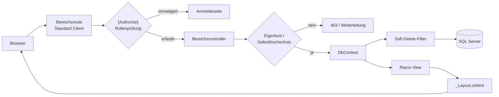

# Was erzeugt wird

Das Ergebnis ist eine vollständige MVC-Anwendung mit einer kleinen, bewusst gewählten Architektur.

## Die Schichten

| Schicht | Dateien | Verantwortung |
|---|---|---|
| **Präsentation** | `Views/`, `Areas/*/Views/`, `_Layout.cshtml` | nur Razor-Markup |
| **HTTP** | `Areas/{Admin,Client}/Controllers/*.cs` (die Startseite von FaceNote ist `Areas/Client/Controllers/HomeController.cs`) | Routing, Autorisierung, Modellbindung |
| **Domänenmodell** | `Models/*.cs` | Entitäten mit Attributen und bulgarischen Bezeichnungen |
| **Persistenz** | `{Project}Context.cs`, `Migrations/`, `Data/` | `DbSet`s, Beziehungen, Soft-Delete-Filter, Seed |
| **Dienste** | `ImageService`, `FileUploadService`, `UserProfileService` | der einzige Ort für Bildarbeit im Dateisystem und für die Aggregation der Profildaten pro Benutzer |
| **Komposition** | `Program.cs` | DI, Identität, Routen, Migration und Befüllung |
| **Infrastruktur** | `Infrastructure/…` | Validierungsattribute, bulgarische Identity-Meldungen |

Kein Repository-Layer, kein Service-Layer über den Entitäten, keine View-Model-Schicht. Controller sprechen direkt mit dem `DbContext`. Diese Höhe ist eine Wahl: Die Anwendung ist ein Lehrartefakt, und eine weitere Abstraktion wäre ein weiteres Stück Erklärung.

## Der Weg einer Anfrage

Autorisierung ist attributbasiert und bereichsbezogen: Jeder Controller des Admin-Bereichs trägt `[Authorize(Roles = "<Admin-Rolle>")]`, jeder Controller des Client-Bereichs `[Authorize]` mit `[AllowAnonymous]` an seinen lesenden `Index`/`Details` — von der Stufe erzeugt, ob gescaffoldet oder aus Vorlage, und von `verify` mit anonymen Anfragen geprüft. Eigentumsregeln werden **in der Action** geprüft, serverseitig, nie in der View. Soft Delete ist ein globaler Filter auf dem Typ, sodass keine Abfrage ihn vergessen kann.

## Die drei Herkünfte von Controllern

| `generatedBy` | Entsteht durch | Für | Kompromiss |
|---|---|---|---|
| `scaffold` | `aspnet-codegenerator`, dann Anker-Abweichungen | Standard-CRUD | hängt an der Gerüstform (ADR-006) |
| `template` | Scriban-Vorlagen | Funktions-Controller, Start | vollständig in diesem Repository kontrolliert |
| `writtenFromScratch` | eigene Vorlage | der Users-Controller mit Serverregeln und die Seite „Spezifikationen“ | der einzige Ort, an dem eigens geschriebene Autorisierungslogik liegt |

Die Regex-Wahl wirkt falsch, bis man die Alternative sieht: Ein Roslyn-Rewriter ist eine große Abhängigkeit für Änderungen, die bei gepinntem SDK stabil sind, und scheitert leise. Anker scheitern **laut**.

## Identität: ein Mechanismus pro Problem

| Problem | Mechanismus |
|---|---|
| Kontoseiten bulgarisch und im Stil der Anwendung | Kernseiten werden vollständig ausgegeben (ADR-002b) |
| Gerüstreste dürfen nicht englisch durchsickern | statische EN→BG-Karte (ADR-002) |
| Identity-Meldungen bulgarisch | `BgIdentityErrorDescriber` |
| Die Demo braucht funktionierende Logins | `IdentitySeeder`; Passwörter abgeleitet |

Die Regel wiederholt sich viermal: **Übersetze den Text dort, wo er entsteht, nicht dort, wo er gezeigt wird.**

## Bedingte Ausgabe

`ImageService` und Bild-Controller bei einem `images`-Block; `FileUploadService` bei Profilbild, Rating oder Beiträgen; `UserProfileService` (samt `UserProfileViewModel` und öffentlicher Profilseite) bei der Funktion `posts` oder `catalogues`; `BgIdentityErrorDescriber`, wenn `identity.errorDescriber` gesetzt ist **und** `meta.language = bg`. So bleibt ein minimales Projekt minimal — und die Bedingung des Emitters muss mit der des Manifests übereinstimmen.

## Zwei Bereiche und eine Sammelseite

**Client** ist der Nutzerbereich (Standard), mit Start- und Kontaktseite, Kartenrastern und einer Seite je aktiver Funktion. **Admin** ist der CRUD-Bereich, wächst aber nicht um einen Eintrag pro Modell: `isSpecification` und `isLookup` wandern auf die Seite „Spezifikationen“ (ADR-012), und `spec-expand` injiziert Administrations-CRUD für jedes vergessene Modell.

## Was bewusst fehlt

Kein Testprojekt, kein Dockerfile, keine CI-Datei, kein JavaScript-Framework, keine Laufzeitübersetzung, keine Repository-Abstraktion. Jedes ist eine Höhenentscheidung und das Erste, was man prüft, bevor man es einen Fehler nennt.
