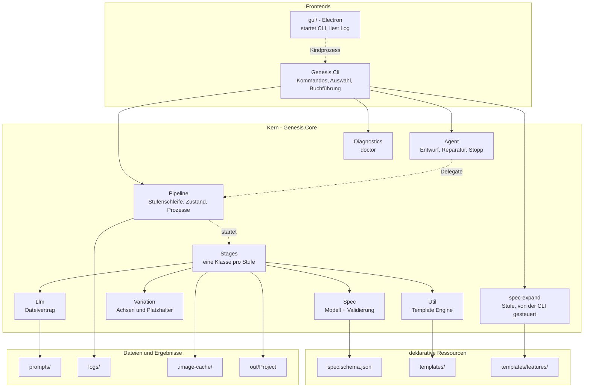

# Komponenten

Die Karte, die man beim Arbeiten am Code offen hält. Die Einheit ist das Modul: wofür es zuständig ist, wovon es abhängen darf und was bricht, wenn es falsch ist.

## Der Graph



## Verantwortlichkeiten und Fehlerbilder

| Komponente | Besitzt | Schlüsseltypen | Wenn falsch |
|---|---|---|---|
| **CLI** | Kommandos, Wurzelfindung, Auswahl, Buchführung, Banner | `Program.cs` sowie `InteractiveSelection` (Hilfsklassen der Auswahldialoge, im Ordner `Cli` des Kerns) | falsche Dateien; nichts Tiefes |
| **Pipeline** | Schleife, Fortsetzen, Zeiten, Log, Prozess-Wrapper | `PipelineRunner`, `StateStore`, `StageContext`, `Proc`, `ParallelEmit` | kein Fortsetzen möglich |
| **Stages** | alles, was Lock liest und Dateien schreibt | neun `IStage`-Klassen in fünf Dateien | die Anwendung ist falsch, wo die Stufe zuständig ist |
| **Spec** | Modell und zweistufige Validierung | `ProjectSpec`, `SpecLoader` | schlechte Eingabe erreicht die Ausgabe |
| **Variation** | Achsenregister, Ersetzung, Passwörter | `VariationResolver` | Projekte ähneln sich |
| **Util** | die einzige Scriban-Oberfläche und ihre Helfer; Ableitung von `DOTNET_ROOT` für gestartete Werkzeuge | `TemplateEngine`, `DotnetHost` | jede Datei driftet zugleich |
| **Llm** | Dateien, manuell/automatisch, Wiederholungen | `LlmBridge`, `LlmModels` | der Offline-Weg bricht |
| **Agent** | Schleife und Stoppbedingungen | `AgentRunner`, `LlmSpecAuthor` | unnötige Runden, verlorene Garantie |
| **Diagnostics** | Voraussetzungsprüfungen | `Doctor` | fehlendes SDK wirkt wie ein Fehler |
| **GUI** | Darstellung, IPC, Loglesen | `gui/src/*` | Fortschritt lügt; Erzeugung unberührt |

## Abhängigkeitsregeln

```
Cli         -> Agent, Stages, Diagnostics, Pipeline, Llm, Util, Variation, Spec
Agent       -> Llm, Spec        (pipeline injected as a delegate)
Stages      -> Pipeline, Llm, Util, Variation, Spec
Diagnostics -> Pipeline
Pipeline    -> Variation, Spec
Util        -> Variation, Spec
Variation   -> Spec
Spec, Llm   -> (nothing inside Core)
```

Drei Regeln halten das zusammen:

1. **Nichts importiert `Stages` außer `Cli`.** Eine Stufe ist ein Blattverhalten, keine Bibliothek; selbst der Agent sieht die Pipeline nur als Delegate.
2. **Vorlagen sind Daten.** `Util` rendert sie; eine Stufe baut kein C# außerhalb der Engine.
3. **Die GUI bindet den Kern nicht ein.** Ihr Vertrag sind Prozess und Logdatei.

## Die fünf Datenspeicher

| Speicher | Schreibt | Wesen |
|---|---|---|
| Spezifikation + Lock | Autor, `spec-expand` | die einzige Eingabe, die zählt |
| `out/<Project>/plan/state.json` | Runner | Fortsetzungszustand, entbehrlich |
| `prompts/` | LLM Bridge, CLI | Prüfspur und Test-Fixtures |
| `logs/` | Runner, Stufen, CLI | Register, Aktionen, DB-Lebenszyklus |
| `.image-cache/` | `seed` | Cache über Läufe hinweg |

## Wo was geändert wird

| Ziel | Komponente | Zusätzlich |
|---|---|---|
| Inhalt einer erzeugten Datei | `templates/*.sbn` | das Baugate beweist es |
| neue Datei | Vorlage + Aufruf | Manifest-Erwartung |
| neue Spezifikationsfähigkeit | Schema → `ProjectSpec` → Semantik → Stufe | Vertrag und Skill |
| neue Funktion | Fragment + bedingte Ausgabe | die Funktionslisten in den Kapiteln 22 und 23 |
| anderes Ergebnis zwischen Projekten | `VariationResolver` | Achsentabelle |
| Stufenreihenfolge | `Pipeline` | Kapitel 9 |
| Voraussetzungsprüfungen | `Diagnostics/Doctor` | der Abschnitt zu `doctor` in [Kapitel 4](04-first-run.md) und [Kapitel 16](16-runtime.md) |

## Größenordnung zur Orientierung

Der Kern sind rund 5 200 Zeilen C# in 19 Dateien unter `src/`. Die größte ist die Stufe für Controller
und Views, weil sie alle drei Herkünfte des Codes hält. Macht eine Änderung eine dieser Dateien deutlich
größer, lautet die Frage meist „sollte das eine Vorlage sein?“ — die Antwort war bisher immer ja.
