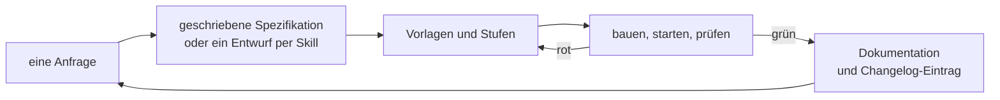

# Wie das Projekt gebaut wird

Die erzeugten Anwendungen sind gewöhnlich. Wie sie entstehen, nicht: Das Repository wird von einer Person mit Agenten geschrieben und gepflegt — ein AI-driven development lifecycle (AI-DLC) in der Praxis, nicht als Etikett — und der Prozess ist so eingerichtet, dass eine Maschine die Arbeit übernehmen kann, ohne den Faden zu verlieren.

## Die Schleife

Jeder Schritt hinterlässt ein prüfbares Artefakt: Spezifikation, Diff, Prüfbericht, Eintrag. Keines ist ein Gespräch, das mit dem Kontext verschwindet.

## Dokumentation für zwei Leser

Die Dokumentation folgt Diátaxis — Tutorial, How-to, Referenz, Erklärung —, weil die vier verschiedene Fragen beantworten und unterschiedlich schnell veralten. Eine Referenztabelle bleibt Monate wahr; ein Tutorial bricht in der Woche, in der sich ein Kommando ändert.

Zwei Konventionen machen den Baum für Agenten nutzbar: eine **Router-Datei** (ein kurzes Dokument sagt, was das Projekt ist und welche Datei für welche Aufgabe zu lesen ist) und **Entscheidungsaufzeichnungen** (nummerierte ADRs; eine ersetzte Entscheidung behält ihre Nummer und erhält einen Hinweis). Dazu kommt eine Arbeitshistorie, die die Dokumentation nicht wiederholt: Changelog und Entscheidungsprotokoll samt versuchter und gescheiterter Reparaturen.

## Skills statt Ad-hoc-Prompts

Der LLM-Weg beginnt nicht mit „schreib mir eine Spezifikation“, sondern mit einem **Skill**: einem Dokument, das den Vertrag, die Konventionen außerhalb des Schemas und die tatsächlich gemachten Fehler festhält. Das Repository liefert zwei — eines für Spezifikationen, eines für Seed-Daten. Der Spezifikations-Skill wird an drei Orten verwendet: bei einem Menschen im Chat (gesprächsorientiert: erst fragen, JSON ausgeben, wenn die Entscheidungen feststehen), in der Agentenschleife (`dps-nn create`; derselbe Leitfaden ohne die Schritte „frag den Nutzer“) und in der eigenen Dokumentation des Repositorys (der Vertrag, gegen den der Rest des Systems getestet wird). Der Seed-Skill ist der gesprächsorientierte Zwilling des eigenen Prompts der Stufe `seed` und trägt dieselben Regeln.

Ein Skill ist billiger als ein pro Anfrage wiederholter langer Prompt und verlässlicher als ein nacktes Schema: Das Modell lernt die Konventionen einmal und wendet sie im Fenster weiter an. Verbesserungen sammeln sich in einer Datei statt mit der Sitzung zu verschwinden.

## Modellrouting und Kosten

| Austausch | Modell | Warum |
|---|---|---|
| Spezifikationsentwurf und -reparatur, Expansionsprüfung | Sonnet-Klasse | Urteil über Domäne, Umfang, Konsistenz |
| Seed-Zeilen | Haiku-Klasse | mechanische Erzeugung nach Schema, in Mengen |

Beide sind per Umgebungsvariable änderbar. Gemessen bei den Läufen des Autors kostet ein vollständiges Projekt — Spezifikation plus Seed — **unter 17 US-Cent**. Die Zahl ist eine eigene Messung, kein unabhängig reproduzierter Benchmark, und hängt von Länge der Beschreibung und Modellzahl ab.

## Tests entscheiden, was ausgeliefert wird

Die Regel ist rot, grün, zurücknehmen, grün. Nichts wird bei roter Suite gemergt oder deployt. CI fährt die .NET- und GUI-Suiten unter Windows bei jedem Push und Pull Request, und eine erzeugte Anwendung gilt erst als auslieferbar, wenn `verify` besteht — Build, Migration, Start, Anmeldung, die deklarierten Routen, Sprache.

## Zwei Frontends, eine Engine

| Frontend | Zielgruppe | Vertrag |
|---|---|---|
| **CLI** (`dps-nn`) | Agenten und Skripte | stabile Exitcodes, JSONL-Log, `--no-interactive` |
| **GUI** (Electron) | Menschen | Auswahl, Live-Fortschritt, dieselben Log- und State-Dateien |

Die GUI startet die CLI und liest ihre Ausgabe; sie besitzt keine Erzeugungslogik. Neues Verhalten entsteht einmal, in der CLI, und beide erben es. Deshalb kann der Fehlerbildschirm der GUI den Stoppgrund des Agenten selbst zeigen: Er liest die Zeile, die die CLI gedruckt hat, und keine Kopie der Logik.

## Was das bringt

Wiederholbarkeit (gleiche Spezifikation → gleicher Code, Kapitel 12), Prüfbarkeit (jeder Schritt hinterlässt eine Datei), Überlebensfähigkeit (eine neue Sitzung rekonstruiert das Warum) und Kostenkontrolle (billige Modelle für Mengen, teure für Urteile).
