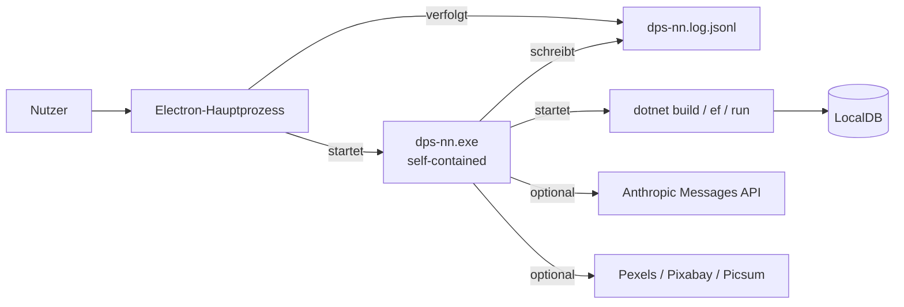

# Laufzeit, Auslieferung und Desktop-Anwendung

Der Generator hat zwei Leben: ein Repository, das aus Quellcode gebaut wird, und ein installiertes Programm für Nicht-Entwickler. Sie unterscheiden sich in einem Punkt — wohin geschrieben werden darf —, und das erklärt die meisten Merkwürdigkeiten im CLI-Code.

## Zwei Anordnungen

| | Entwicklung | Installiert |
|---|---|---|
| Programmdateien | `src/`, `templates/`, `spec.schema.json` | `%LOCALAPPDATA%\Programs\DPS-NN\` — **schreibgeschützt** |
| Arbeitsordner | Repository-Wurzel | `Documents\DPS-NN\` — **beschreibbar** |
| Erzeugte Projekte | `out/` | `Documents\DPS-NN\out\` |
| Logs, Prompts, Cache | `logs/`, `prompts/`, `.image-cache/` | im selben Arbeitsordner |

Die Regel: **Das installierte Programm schreibt nie neben sich.** Deshalb prüft die Ressourcensuche zuerst den Programmordner und dann den aktuellen — eine Binärdatei funktioniert in beiden Anordnungen (ADR-014). Deshalb wird `templates/` in den Installer kopiert statt eingebettet.

## Prozesstopologie

Folgen: eine Pipeline-Implementierung (die GUI kann nicht abdriften); die GUI ist optional (alles ist über die CLI erreichbar); die Kindprozesse sind die Fehlerfläche — dafür gibt es `doctor`.

### Das `DOTNET_ROOT`-Detail

Eine self-contained `dps-nn.exe` hat keinen `dotnet`-Elternteil, der `DOTNET_ROOT` setzt, und globale Tools finden ein benutzerlokales .NET nicht. Die CLI leitet `DOTNET_ROOT` aus dem `dotnet` im `PATH` ab, bevor sie irgendetwas tut. Ein echter Fehler, der einmal ausgeliefert wurde; das Symptom („Tool nicht gefunden“ auf einer Maschine, auf der es im Terminal läuft) sieht wie eine kaputte Installation aus.

## Auslieferung

| Ausgabe | Was | Warum |
|---|---|---|
| **Voll** | NSIS-Installer: GUI + CLI + Vorlagen + Musik (~1 GB) | das vollständige Erlebnis inklusive Themen-Musikplayer |
| **Lite** | dasselbe ohne Musik, automatisch in ein zweites Repository gespiegelt | teilbar ohne ein Gigabyte fremder Aufnahmen |

Die Lite-Ausgabe entsteht per Skript aus der vollen — ein Build-Schritt, kein Fork, sodass beide im Code nicht auseinanderlaufen können. Die Version hat eine Quelle: `VERSION` im Wurzelverzeichnis, gestempelt in CLI, Installer und Buchtitel. Der Installer ist unsigniert, daher warnt SmartScreen beim ersten Start — eine bekannte, dokumentierte Kostenentscheidung.

## Die Desktop-Anwendung auf einer Seite

| Teil | Verantwortung |
|---|---|
| `gui/src/main` | Prozesslebenszyklus, Pfade, IPC, Start von `doctor`/`run`/`create`, Logverfolgung |
| `gui/src/renderer` | UI: Projektauswahl, Fortschritt, Terminal (xterm.js), Einstellungen, Themes und eine Oberfläche in sechs Sprachen sowie Standard Galactic und sechs Scherzmodi |
| shared | Typen und Formen der Logereignisse |
| `gui/scripts/` + `gui/electron-builder.yml` | Packaging: die CLI und ihre Ressourcen in die Anwendung legen, der NSIS-Installer |

Themes sind Tokens plus optionale Skins und Hintergründe; neue Inhalte — Hintergründe, Logos, Footertext, Musik — sind Dateien, kein Code.

## Betrieb

| Frage | Ort |
|---|---|
| Ist die Maschine bereit? | `dps-nn doctor` |
| Was tat der letzte Lauf? | `dps-nn.log.jsonl` und `logs/<Project>/actions.log.jsonl` |
| Welche Spezifikation erzeugte diese Anwendung? | `logs/registry.json` und das Archiv unter `prompts/out/schemas/` |
| Warum migriert die Datenbank nicht erneut? | `logs/<Project>/db.json` merkt Name und Hash |
| Läuft es ohne Netz? | größtenteils: Die NuGet-Pakete müssen bereits im lokalen Cache liegen, Bilder brauchen einen Anbieter oder `--image-pack`, LLM-Schritte brauchen einen Schlüssel oder vorab abgelegte Antwortdateien — und die erzeugte Anwendung lädt Bootstrap und Schriften von CDNs, sieht offline also ungestaltet aus |

## Sicherheit, klar gesagt

- **Keine Geheimnisse in den Eingaben.** Die Passwörter der Seed-Nutzer werden abgeleitet, sofern die Spezifikation keines setzt, und stehen nie im Seed; die abgeleiteten Werte werden in die Lock-Datei und in `logs/<Project>/seed-credentials.txt` geschrieben, behandeln Sie diese also als Geheimnisse. API-Schlüssel sind ausschließlich Umgebungsvariablen.
- **Kein Hot-Linking.** Erzeugte Anwendungen liefern heruntergeladene Bilder aus ihrem eigenen `wwwroot`; der `.image-cache/` hält die Anfragen an Stockanbieter auf eine pro Phrase.
- **Keine Übersetzung zur Laufzeit** in erzeugten Anwendungen. Die einzigen Fernaufrufe sind die CDN-Links im Layout: Bootswatch/Bootstrap von jsDelivr und die Google Fonts des Presets.
- **Fremde Inhalte sind getrennt.** Die Musik steht nicht unter der Code-Lizenz und fehlt in der Lite-Ausgabe.

Was **nicht** gehärtet ist — Rate Limiting, CSP, strengeres Lockout — steht in [Kapitel 22](22-limits.md).
