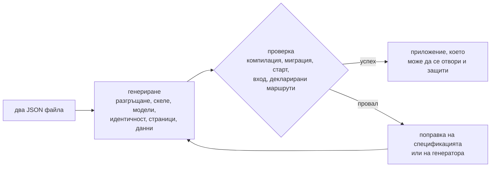

# Едно генериране, от десет хиляди метра - прекрасна гледка

Преди всякаква машинария, нека проследим един проект от заданието до работещото приложение. Нищо в
тази глава не е команда, която трябва да пуснете. Това е историята. Това е сюжетът. Останалата книга
я обяснява парче по парче, и това е страхотна история. Една от най-добрите.

Разказвана е достатъчно пъти, за да се знае къде хората спират да слушат. Спират на едно място: когато
им покажеш, че на входа има задание, а на изхода - приложение, което отговаря на въпроси. Влезе
задание, излезе приложение. Да я разкажем пак.

## Заданието

Идва студент с четири страници. Заглавие: *Онлайн книжарница*. Много хубаво заглавие. Има читатели и
администратори. Книгите имат автори, категории, цени и корици. Читателите разглеждат, търсят, пишат
отзиви, водят си списък с желания и правят поръчки. Администраторите управляват каталога и
потребителите. И нефункционалните желания - да изглежда модерно, да е изцяло на български и да може
да се демонстрира на лаптоп. Лаптоп! Не сървърна ферма. Лаптоп.

Това е нормално, свързано задание. И ето нещото, което никой не ви казва: то е и спецификация под
прикритие. Описва *същности, релации, роли, страници и правила*. Не описва код. Нито един ред.

## Решението: какво става примерно приложение

Работата започва с определяне на обхвата, а там се разделят победителите от загубеняците. Три
собствени модела - не трийсет, три: Книга, Автор, Категория. Отзивите, списъкът с желания и
поръчките идват от три функции за многократна употреба - `rating`, `catalogues` (личен списък с
книги, което, между другото, е точно списък с желания) и `orders` (количка, поръчка, история на
поръчките) - и всяка носи собствените си модели. Всеки може да влезе. Администраторите получават
екраните за управление. Читателите получават витрината.

Плащане с карта, изпращане на имейли, система за препоръки - *назовани и изхвърлени*. Изхвърлени!
Генераторът не може да ги изрази, а полусвързаната функция е по-лоша от честния пропуск. Много
по-лоша. Полусвързаната функция е пасив. Ние не правим пасиви.

## Два файла вместо кодова база

Обхватът става два JSON документа:

- **спецификация** - трите модела с българските им надписи (заглавие, автор, цена), правилата за
  валидация („цената трябва да е положителна“), двете роли, двете области, кои страници съществуват
  и от какъв вид е всяка, трите функции и *колко* реда демо данни трябва да получи всеки модел;
- **начални данни (seed)** - самите редове: четирийсет книги с истински заглавия, дванайсет автора,
  шест категории, отзиви с правдоподобен текст, две поръчки с редове.

Нито един от двата файла не съдържа C#. Нула C#. Входът описва приложение; не е недовършено
приложение. Голяма разлика. Огромна.

## Генерирането

Студентът - или агент, а агентът е фантастичен, ще стигнем до агента - пуска генериране. Случват се
осем неща, по ред, и всяко се вижда в конзолата, пред очите на всички. Пълна прозрачност:

- **Разгръщането** слива трите функции, заковава стила на проекта (по една стойност на всяка от
  единадесетте детерминистични оси) и извежда паролите на демо потребителите.
- **Scaffold** създава обикновен ASP.NET Core MVC проект и го компилира веднъж - основа, която всяка
  следваща стъпка трябва да пази зелена. Зелено, зелено, зелено. Като поляна през май.
- **Моделите** пишат същностите - трите от спецификацията и тези, които добавиха функциите -
  атрибутите им за валидация с български съобщения и EF Core контекста.
- **Identity** създава модела на ролите, вход/регистрация/профил на български, администраторски
  акаунт и акаунт на читател.
- **Контролерите и изгледите** строят двете области: страници на витрината с търсене и сортиране,
  административните таблици и страниците, които функциите искат: отзиви, лични списъци, количка и
  поръчки.
- **Seed** пълни базата: книги с изтеглени корици, отзиви и поръчки, които се свързват по име, и EF
  миграцията, която създава схемата.
- **Verify** решава генерирането. Компилира, мигрира, стартира приложението на случаен порт, влиза
  през истинската форма като администратор, изтегля всяка страница, която спецификацията декларира,
  и сканира изобразения текст за английски. Един изтекъл „Add to cart“ - един! - проваля генерирането.
  Строго. Много строго. Началната страница и входът трябва да успеят безусловно, всяка декларирана
  страница трябва да отговори и всяка административна страница или страница само за влезли трябва да
  върне анонимния посетител. Без билет не се влиза. Като на сватба без покана.
- **Report** пише машинно четимо резюме за който инструмент иска да документира резултата.

## Какво вижда студентът

Приложение, което тръгва на лаптоп. Пълен каталог. Работещ вход. Административна област, която
управлява всичко. Страници, които изглеждат като проектиран продукт, а не като скеле. Данните за вход
се отпечатват в края на генерирането. Студентът е щастлив. Много щастлив. Виждал съм го - почти
сълзи. Почти шестица, преди още да е влязъл в залата.

## Какво вижда проверяващият

Три неща, които е много, много трудно да се фалшифицират:

1. **Генерирането е документирано.** Приложението е компилирано, мигрирано, стартирано и в него е
   влизано по време на генерирането, а логът казва кои страници са отговорили. Това е файл, не
   твърдение. Файловете не лъжат.
2. **Изискването за български е проверено механично.** Езиковият доклад изброява всеки английски
   текст, минал или паднал.
3. **Кодът е обикновен.** В генерираното приложение няма рамка по време на работа - ако студентът не
   може да обясни един ред, вината е на генератора, не на студента. Поемаме отговорност. Кой го прави
   вече?

## Когато нещо се обърка - а понякога се обърква

Интересната част от историята е пътят на провала. Ако един модел е грешно описан, валидацията
назовава модела и свойството, преди да се генерира каквото и да било. Ако функция не може да се
закачи за основния модел на проекта, генерирането спира при разгръщането. Ако липсва файл, обещан от
спецификацията, проверката на манифеста във verify го назовава, преди приложението изобщо да
стартира. Ако приложението не стартира, verify пада, преди да сканира каквото и да е. Във всеки
случай генерирането **може да се възобнови от падналия етап**, а нещата, които ви трябват за
диагнозата, са там, на диска. Без мистерия. Без лов на вещици. Провалът има име и адрес.

Обещанието се побира в едно изречение, и то е прекрасно изречение: влиза задание, излиза проверено и
обяснимо приложение, а когато нещо падне, провалът е локализиран.

## Накъде продължава книгата оттук

| Въпрос, който историята повдига | Глава |
|---|---|
| Как точно изглежда генерираното приложение отвътре? | [3](03-what-a-generated-app-is.md), после [10](10-generated-app-architecture.md) |
| Как да го пусна сам? | [4](04-first-run.md) |
| Как да превърна *моето* задание в такава спецификация? | [5](05-paper-to-spec.md) |
| Откъде идват демо данните? | [6](06-spec-to-seed.md) |
| Може ли моделът да направи всичко сам? | [7](07-agent-mode.md) |
| Какво точно е всеки етап и къде може да спре? | [9](09-workflow.md) |

Това е историята. Влиза задание, излиза приложение, всяка стъпка проверена. Дали е най-добрата
история за генериране, разказвана някога? Не обичам да го казвам сам. Нека го каже читателят, който е
стигнал дотук и още не е прескочил нищо.
