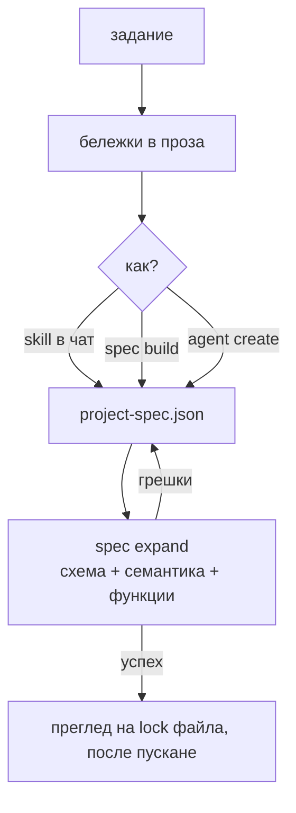

# От задание към спецификация - изкуството на спецификацията

Това е главата, заради която инструментът съществува. Влиза задание, трябва да излезе спецификация.
И ще ви кажа, спецификацията не е резюме на заданието. Резюметата са слаби. Спецификацията е **запис
на решения**, който генераторът може да изпълни. Всичко, което генераторът не може да изпълни, трябва
да бъде изключено *изрично* - не тихо изпуснато. Ние не изпускаме нищо тихо. Обявяваме го.

Първият въпрос на всеки, който види инструмента, е дали може просто да се подаде заданието и да се
чака. Не. Надеждата не е спецификация. Спецификации пишат хората, които са прочели заданието
внимателно - и след тази глава това ще сте вие. По-лесно е, отколкото изглежда, а изглежда много
лесно. И не, не е пищов: пищовът се крие, спецификацията се показва с гордост.

Правилата в тази глава не са измислени на бюро. Те са това, което авторът на генератора е научил,
докато е гледал как се защитават десетки проекти: къде комисията пита, къде спецификацията мълчи и
къде един пропуснат `displayName` струва точка. Затова правилата са толкова конкретни - протокол от
истински разговори, не теория за добри практики.

## Какво ви дава заданието и къде отива всяка част

| В заданието | Става | Внимавайте за |
|---|---|---|
| Цел, домейн, целеви потребители | `meta.projectName`, `meta.domainHint` (на английски, за промптовете), `meta.domainHintBg` (на български, за потребителите) | назовете домейна, не технологията |
| Действащи лица / роли / права | `identity.roles`, по един запис в `areas[]` за роля (`forRole` трябва да назовава роля) | задание „администратор + потребител“ дава две области; трета роля обикновено значи две области плюс свойство |
| Списък същности, атрибути, „продуктът има много снимки“ | `models[]` с `properties[]`, `relations[]` | всяко свойство, което не е ключ или FK, иска `displayName` на български |
| Правила за полета („цена > 0“, „имейл“, „не в бъдещето“) | `validations[]` с български `errorMessage`; правилата за дати - чрез `customValidationAttributes` | правило, което не можете да изразите, е граница за докладване, не за фалшифициране |
| Екрани („списък с продукти с търсене“, „административна таблица“) | `views.pages[]` с `kind` (`landing`, `contactFormStatic`, `cardGrid`, `adminTable`) + контролер в съответната област | търсенето/сортирането се настройват на контролера, не се пишат на ръка |
| „CRUD за X“ | един запис в `controllers[]` с `generatedBy` = `scaffold` или `template` | ползвайте `removedActions` за действия, които домейнът няма |
| Парчета за многократна употреба („количка“, „поръчки“, „публикации“, „отзиви“) | `features.<name>.enabled` | включвайте само това, което заданието наистина иска |
| „Да има демо данни“ | `seeding.rowsPerModel` | бройки за всеки модел, скромни (5-20), не едно число за всичко |
| Времеви печати / меко изтриване | `conventions.timestamps`, `conventions.deleteBehavior` | питайте; те променят формата на генерирания код |

## Работният процес, който работи - и наистина работи



Трима производители. Един резултат. Избирайте според това колко разговор иска заданието:

| Производител | Кога | Цена |
|---|---|---|
| **Умение за чат** (`utils/claude-skills/dps-nn-spec-authoring`) | заданието е двусмислено и искате въпроси преди JSON-а | безплатно, иска човек в цикъла |
| **`spec build --notes`** | вече имате чисти бележки и ви трябва само чернова; работи без API ключ чрез файловия договор | един обмен |
| **`create --describe`** | искате цикълът да пуска генератора и да поправя спецификацията срещу истински провали | API ключ; ограничен брой кръгове |

Първите два пишат **файл**. Третият пише *и поправя* - това е агентът, невероятен агент, много
работлив, никога не спи. Работи като пчела през юни. И трите свършват на едно място: спецификация,
която минава валидацията.

### Валидирайте, преди да генерирате

Генерирането отнема минути и може да падне дълбоко в `seed`. Самата спецификация се валидира за
*секунди*. Секунди! Защо да чакате минути, за да разберете нещо, което можете да разберете за
секунди?

```bash
dotnet run --project src/Genesis.Cli -- spec expand --spec project-spec.json
```

Това пуска двуслойната проверка (JSON Schema, после семантични кръстосани препратки), слива
фрагментите на функциите, решава заместителите `$variation:` и пише `project-spec.lock.json`. Ако
мине, оставащият структурен риск е в шаблоните, не във входа ви. Входът ви е чист. Много чист.
Блестящ.

## Правилата, които решават формата

Това не са предпочитания на вкуса. Всяко от тях се налага някъде - или произвежда лошо приложение.
Девет правила. Девет страхотни правила:

1. **Обхват на примерно приложение: 5-10 модела.** Така казва собственият промпт на генератора за
   чернова. Задание с 30 същности е сигнал да се отреже до демонстрируемото ядро, а останалото да се
   докладва като извън обхвата. Приложение с 30 полусвързани екрана е по-лошо от такова с 8 цели.
   Много по-лошо. Трийсет полусвързани екрана - тъжно!
2. **Всяко видимо свойство получава български `displayName`.** Това е твърдото изискване.
   Семантичната валидация на спецификацията отхвърля видимо свойство без надпис, преди да се
   генерира каквото и да е, защото голото име на C# свойство на страница е точно изтичане на
   английски.
3. **Български по подразбиране.** `meta.language` по подразбиране е `bg`; всички четими от човек
   низове в спецификацията - надписи, съобщения за грешки, заглавия на страници - са на кирилица.
   Най-хубавата азбука. Имената на марки остават в собствената си писменост.
4. **Малките справочни модели се обединяват.** Модел само с име (Brand, Category) и без изходяща
   релация се маркира `isSpecification`; свързващ ред (CartItem, PostComment) е `isLookup`. И двата
   после живеят на една административна страница („Спецификации“), вместо да задръстват
   навигацията. Прилагайте флага по правилото, не по вкус. Вкусът е за равенства. И за
   шопската салата.
5. **Махайте действия, които нямат смисъл.** Модел с ≤1 видимо свойство не иска страница Details;
   `Order` не се създава на ръка от администратор. `removedActions` е начинът да го кажете.
6. **`ownership` върху всичко, което потребител притежава.** Публикации, отзиви, каталози, редове в
   количката: тогава генераторът налага „собственик или администратор“ при Edit/Delete на сървъра.
7. **Блокът `images` е само за основно съдържание.** Модел, чиито снимки *са* съдържанието му
   (Product), получава `images`; второстепенна незадължителна снимка (Review, Post) получава обикновен
   nullable низ `ImagePath` и никаква отделна страница за управление.
8. **Без пароли в `seedUsers`.** Само имейли и роли; паролите са изведени и банерът ги съобщава.
9. **`generatedBy` е една от точно три стойности**: `scaffold`, `template`, `writtenFromScratch`.
   Първите две покриват повечето нужди; третата е за контролера на потребителите и страницата
   „Спецификации“.

## Колко от резултата контролира спецификацията

Спецификацията не е списък с желания, който генераторът *тълкува*. Тълкуването е за поезията. Ботев
се тълкува. Спецификацията - не. Тя е планът на композицията и почти всяко видимо решение е точно там:

| Решение | Къде в спецификацията |
|---|---|
| Кои същности съществуват, свойствата, типовете, надписите и съобщенията им за валидация | `models[]` |
| Кои контролери съществуват, как се произвежда всеки и кои действия се махат или пренасочват | `controllers[]` |
| Композицията на страниците: подредба, кои страници съществуват и от какъв вид е всяка | `views` |
| Имена на ролите, области, кои identity страници се излъчват, seed потребители, допълнителни полета на потребителя, правилата на контролера на потребителите | `identity`, `areas[]` |
| Кои фрагменти на функции се сливат - а с тях и техните модели, DTO и контролери | `features` |
| Съставни модели за четене над няколко същности | `dtos[]` |
| Колко демо реда на модел и откъде идват снимките | `seeding` |
| Тема, дизайн-пресет и всяка закована ос на разнообразието | `meta.style`, `variationProfile` |
| Към какво да сочи докладът | `outputReport` |

Практическият ефект - а той е голям - е, че **два проекта от едно и също задание не е нужно да
споделят нито едно име**. Продавачът може да смени речника на домейна, да избере кои функции да
включи, да реши кои модели отиват на страницата „Спецификации“, да преименува контролери и страници,
да напише различни съобщения за валидация и да закове друга тема и друг стил на кода. Константна
остава машинарията отдолу - конвенциите на MVC, формата на CRUD, проверките - точно това, за което
купувачът плаща. Страхотна сделка. За всички.

## Когато заданието иска нещо невъзможно

Кажете го. В спецификацията. На глас:

```json
"meta": {
  "unsupportedRequests": [
    { "request": "calendar booking for reading-room slots",
      "reason": "no scheduling/calendar feature; the generator has no recurring-time model" }
  ]
}
```

Агентният режим ги пише сам - много честен агент. Ако пишете спецификацията на ръка, пишете ги вие.
Конвейерът пренебрегва тази секция; хората - не. Записано, това разделя „инструментът не може това“
от „инструментът тихо направи нещо друго“, и така расте списъкът с бъдещи функции
([глава 22](22-limits.md) изброява кое наистина е недостижимо днес).

## Контролен списък: готова ли е спецификацията за пускане?

- [ ] `spec expand` минава без грешки в схемата и без семантични грешки.
- [ ] Всеки модел има точно едно `key` свойство и всяка цел на релация съществува.
- [ ] Всяко видимо свойство има български `displayName`; никъде няма английски надписи.
- [ ] `forRole` на всяка област назовава декларирана роля (или заместител `$variation:`).
- [ ] Всеки контролер, генериран от шаблон, с `Index` има страница във `views.pages`.
- [ ] `seeding.rowsPerModel` покрива всеки модел, който искате напълнен.
- [ ] Функциите са включени само за възможности, които заданието наистина иска.
- [ ] Всичко, което генераторът не може да изрази, е в `meta.unsupportedRequests`.

Ако и осемте са изпълнени - осем от осем, отличен шест - оставащият риск е на страната на
генератора и следващият провал ще ви каже точно кой шаблон. По име.
