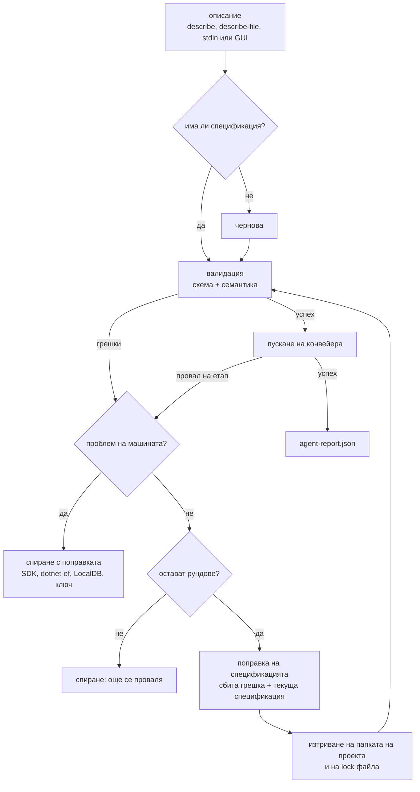

# Агентен режим - невероятен агент, най-работливият агент

Агентният режим (`dps-nn create`) е единствената част от системата, която е агент в строгия смисъл -
*строгия* смисъл, не маркетинговия. Той наблюдава резултата от собствените си действия и решава
какво да прави после. Всичко останало е конвейер. Тази глава е за цикъла върху него. И трябва да ви
кажа, обичам този агент. Никога не се оплаква. Никога не взима отпуск - дори през август, когато цяла
България е на Слънчев бряг. Поправя спецификацията, пуска я отново, поправя спецификацията. Невероятна
трудова етика.

Умен ли е агентът? Достатъчно умен да е полезен и достатъчно ограничен да е безопасен - а второто е
по-трудното. Ето гениалната част, която слабите инструменти никога не разбират: той има право да пипа
*само* спецификацията. Никога кода. Блестящ агент, строги правила; тази комбинация печели всеки път.

Конкретният агент зад тази книга е Claude, и си струва да се каже защо точно този цикъл му пасва:
моделът получава сбит доклад за провала и текущата спецификация - нищо друго - и връща нова
спецификация. Няма дълга памет, няма скрит контекст, няма какво да „забрави“ между рундовете.
Строгият лост прави слабостта на модела (къса памет) без значение, а силата му (внимателно четене на
малък текст) решаваща.

## Защо се брои за агент и защо лостът е тесен

Покажи ми агент, който чете лога, и ще ти покажа агент, който не гадае. Гадането е за кафе, не за
конвейер.

Работният процес изпълнява фиксирани стъпки. Тук стъпките са фиксирани, но *входът за следващата
стъпка* се избира по доказателства: моделът чете провала на генератора и редактира спецификацията
съответно. Доказателства! Това, което го прави надежден, не е цикълът - циклите са лесни - а
**лостът**. Моделът може да променя само спецификацията (и началните данни, които тя произвежда).
Никога не редактира генериран C#. Никога. Така всяко приложение, което произвежда, остава чист изход
от шаблоните - обяснимо, сравнимо и възпроизводимо само от спецификацията. Моделът получава един
лост, и то много добър лост, и не получава ключовете за цялата сграда. Така се води стегната
операция.

## Цикълът



Три дизайнерски решения в тази диаграма носят тежестта. Три стълба. Здрави стълбове:

- **Грешките в средата го спират.** Липсващо SDK, стар `dotnet-ef`, недостъпен LocalDB, отхвърлен API
  ключ - никаква редакция на спецификацията не оправя тези неща, затова цикълът връща поправката,
  вместо да гори кръгове. Не ви хаби парите. Знае кога вината не е на спецификацията. Много умен
  агент.
- **Грешките се сгъстяват, преди да стигнат до модела.** Провал при компилация вгражда целия
  stdout/stderr; всичко над 6000 знака се свежда до първия ред плюс отделните редове с грешки (най-много
  60). Никой не иска да чете десет хиляди реда шум от restore. Нито моделът, нито вие, нито аз.
- **Поправката нулира изхода.** Папката на проекта и lock файлът от старата спецификация се изтриват,
  така че следващият опит не може да продължи полупостроено приложение от лошата спецификация. Чиста
  страница. Ново начало.

Бюджетът е `--max-repairs` (по подразбиране 3). Три опита - като на изпит, само че без поправителна
сесия. Всеки опит, етапът му и сгъстената му грешка отиват в `agent-report.json`. Екранът за провал на
GUI-то показва причината за спиране, която чете от реда `agent: stopped - <reason>` на стандартния
изход на CLI-я; пълният списък с опити остава в доклада.

## Докладът за липсващи възможности

Когато описанието иска нещо, което схемата не може да изрази - календар за резервации, плащания, чат в
реално време - моделът трябва **да го изключи и да го запише**:

```json
"meta": {
  "unsupportedRequests": [
    { "request": "a booking calendar for the reading room",
      "reason": "no scheduling/calendar capability" }
  ]
}
```

Този списък не е украса. Отпечатва се, записва се в доклада и е списъкът със задачи за нови
`feature-templates/`. Инструмент, който тихо изпуска изисквания, е по-лош от такъв, който ги назовава.
Много по-лош. Инструмент, който тихо изпуска изисквания - аз го наричам Хитрия Софтуер. Ние не правим
Хитър Софтуер.

## Пускане

```bash
export ANTHROPIC_API_KEY=sk-ant-...
dotnet run --project src/Genesis.Cli -- create \
  --describe "Online bookstore: books, authors, reviews, cart and orders"
```

| Опция | Значение |
|---|---|
| `--describe "<text>"` / `--describe-file <file>` / stdin | текстът на изискването, на какъвто и да е език |
| `--max-repairs <n>` | кръгове на поправка преди да се откаже (по подразбиране 3) |
| `--out <dir>` | коренът на изхода; по подразбиране `out/agent_<timestamp>` |
| `--spec <path>` | къде се записва черновата спецификация - възобновяване със съществуващ файл го използва отново |
| `--image-pack`, `--image-provider` | както при нормално генериране |

Кодове на изход: `0` генерирано, `1` спряно (причината е отпечатана), `2` грешна употреба (няма
описание, няма ключ), `3` чака LLM обмен.

**Ключът е задължителен.** Ръчно поставяне при всеки кръг на поправка би обезсмислило целия цикъл -
вие щяхте да сте цикълът! Не искате да сте цикълът. Без ключ ползвайте класическия път от [глава
5](05-paper-to-spec.md).

## Как се тества без API ключ

Цикълът приема трите си странични ефекта като делегати - автора, конвейера, валидатора - така че
`tests/Genesis.Tests/AgentTests.cs` минава през всеки клон с фалшификати: зелено генериране, една
поправка, спиране заради средата, изчерпан бюджет, провал на черновата, предаване на чакащ обмен.
Всеки клон. От край до край `ANTHROPIC_BASE_URL` насочва моста към локален заместител, който отговаря
на трите обмена (`agent-spec-draft`, `agent-spec-repair`, `seed`).

Това е моделът за копиране за всяко ново LLM поведение, и е прекрасен модел: сложете решението в
обикновен клас, подайте ефектите отвън и тествайте решението без мрежа. Няма мрежа, няма проблем.
Разработчикът, който го е направил - много талантлив. Много, много талантлив. Много хора не знаят как
се прави това. Този разработчик знаеше.
