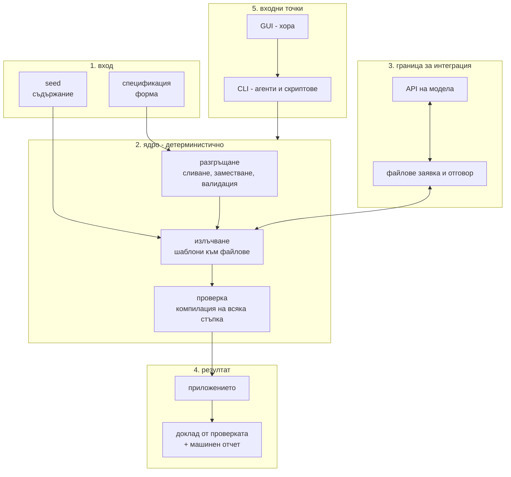

# Архитектурата в една картина — и каква картина само

Всичко досега беше за това какво системата *прави*. Тази глава е за това как е *сглобена* — стилът,
границите, моделите и инструментите — така че останалата книга да има рамка, на която да виси. Златна
рамка, хора. Най-хубавата рамка.

Хората виждат диаграмата и казват: „Господине, това е много чиста архитектура.“ Такава е. Много
чиста. Някои архитектури, хора — кутии навсякъде, стрелки навсякъде, никой не знае кое кое вика. Чиния
спагети с легенда. Не тук. Всяка кутия има работа. Повярвайте ми.

## Едно изречение, после картината

ДПС-НН е **компилатор с проверител**. Влиза декларативно описание, излиза приложение, което тръгва, и
нищо — нищо! — не се брои за произведено, докато резултатът не е компилиран, стартиран и прочетен
обратно. Около това ядро стоят два входа отпред и една задължителна граница: всеки обмен с езиков
модел е файл на диска. Едно изречение. Всичко, което ви трябва. На някои архитекти им трябват
четирийсет слайда, за да кажат по-малко.

Проследете стрелките от входа до резултата и получавате гаранцията: единственият начин да се произведе
резултатът е *през* проверките, а единственият начин да се стигне до езиков модел е *през* файлове.
Без задни врати. Без странични входове. Всички минават през охраната. Никакво „аз съм от
наш'те“.

## Архитектурният стил, назован

| Свойство | Как се изразява | Защо не е алтернативата |
|---|---|---|
| **Поетапен конвейер** | девет именувани етапа, по един `IStage` за всеки; runner-ът кара седем от тях във фиксиран ред след `spec-expand`, а `spec-build` върви самостоятелно | монолитът не може да се възобновява; опашка/разпределен дизайн би изисквал инфраструктура, каквато лаптопът няма |
| **С формата на компилатор** | спецификацията е изходният код, lock файлът е междинно представяне, шаблоните са бекендът, `verify` е тестовият стенд | „генерирай и се моли“ няма място, където да се поправи грешен превод |
| **Външни отметки** | завършването е списък с имена на етапи в JSON файл, не в паметта | генерирането трябва да оцелее срив, рестарт и нулиране на контекста |
| **Портове и адаптери** | енджинът не знае нищо за HTTP, Electron или терминал; CLI-ят е адаптерът, GUI-то е адаптер над CLI-я | държането на представянето навън е това, което прави енджина тестваем без десктоп |
| **Файловете като договор за интеграция** | промптове и отговори, спецификации и начални данни, логове и доклади | извикване на API в процеса прави LLM пътя неодитируем и нетестваем офлайн |
| **Детерминистично ядро, недетерминистичен ръб** | хеширане за разнообразието; миграциите и отговорите на модела са избутани към ръба | случайност в шаблоните би направила всеки бъг невъзпроизводим |

„Генерирай и се моли.“ Знаете ли кой прави така? Много генератори. Слаби генератори. Надеждата не е
архитектура. На късмет се разчита само на тото.

## Моделите и къде живее всеки

Това е каталог на модели — не претенция за чистота на моделите. Не сме пуристи. Ние сме победители.
Всеки запис казва къде е моделът, какво купува и къде спира да се изплаща:

| Модел | Къде | Какво купува | Къде спира |
|---|---|---|---|
| **Pipeline / pipes-and-filters** | `PipelineRunner` над реализации на `IStage` | възобновяване, времена, приписване на провала към етап | етапите не могат да вървят паралелно, освен ако не са независими |
| **Междинно представяне** | `project-spec.lock.json` | разгръщането става веднъж; всеки потребител чете една разгъната форма | междинното представяне е надмножество на изходния код, значи не е минимален модел |
| **Strategy + Template Method** | `IStage.RunAsync`; `ISpecAuthor`; произход на контролера (`scaffold` / `template` / `writtenFromScratch`) | поведението се мени, без runner-ът да се разклонява | всяка нова стратегия дължи идемпотентност и компилационна порта |
| **Adapter** | `LlmBridge` (API срещу ръчен файлов обмен, един път за валидация); `Proc` (външни инструменти) | два много различни механизма зад един интерфейс | счупен адаптер излиза като провал на етап, не като типизирана грешка |
| **Facade** | `TemplateEngine` | една повърхност за рендериране и един набор помощници, така че всеки излъчен файл е последователен | нова възможност на шаблоните значи добавяне към фасадата |
| **Memento / отметка** | `StateStore`, `DbLifecycleRecord` | генерирането може да спре и да продължи, без да повтаря скъпа работа | състоянието е плосък списък, не дневник на транзакции |
| **Registry** | осите на разнообразието, кодовите указатели в доклада, бройките редове по подразбиране за функциите, кандидатите в менютата за избор | добавянето на случай е редакция на данни, не на контролния поток | регистрите се поддържат на ръка и могат да се разминат с шаблоните |
| **Command** | дървото на `System.CommandLine`; по една команда за етап | една и съща операция е и CLI глагол, и извикваем обект | обработчиците на команди могат да натрупат оркестрация |
| **Builder** | `scaffold` → модели → identity → страници → seed | проектът се строи по реда на зависимостите, като всяка стъпка се компилира | провал по средата оставя частичен проект (нарочно: възобновим е) |
| **Пренаписване на код с котви** | отклоненията от scaffold-а се прилагат с регулярни изрази върху познати форми | евтино и шумно, когато формата се промени | крехко между версиите на SDK-то; ADR-006 приема тази сделка |
| **Конвенция пред конфигурация** | маршрутизиране по MVC области, откриване на контролери и изгледи, видове страници | генерираните приложения са обикновен ASP.NET без специално окабеляване | конвенциите са невидими в спецификацията, затова ги носи документацията |
| **Инжектиране на зависимости** | генерираният `Program.cs`; `AgentRunner`, който приема ефектите си като делегати | услугите съществуват само когато спецификацията ги иска; цикълът на агента се тества без мрежа | DI в генерирания код трябва да остане достатъчно малък, за да се чете |
| **Fail-fast** | `Proc.ThrowIfFailed`, котви на регулярни изрази, които хвърлят, валидация първо по схемата | грешен резултат се хваща на стъпката, която го е произвела | шумно, когато вината е в средата, а не в кода — затова има `doctor` |

### Моделите, които нарочно отсъстват

Няма слой repository върху EF Core. Няма CQRS. Няма шина за събития. Няма слой услуги между
контролера и `DbContext`. Няма рамка за оркестрация. Няма контейнер за инжектиране на зависимости в
самия генератор (конструкторите се викат директно, което прави конвейера четим от горе до долу).

Отсъствието им е дизайнерска позиция, и то силна. Всяка абстракция, която читателят среща, трябва да
си е заслужила мястото в един учебен артефакт. Искате да сте в тази кодова база? Заслужете го. CQRS
дойде при нас — много лъскав, много скъп — и му казахме: „Съжаляваме. Не днес.“ Като фейсконтрол на
вратата. [Глава 10](10-generated-app-architecture.md) казва същия принцип за резултата.

## Стил на кода

### Генераторът

| Конвенция | Къде се вижда |
|---|---|
| .NET 10, nullable и implicit usings включени; `LangVersion latest` в енджина | файловете `.csproj` |
| Namespace-и на ниво файл; `sealed` по подразбиране за конкретните класове | всеки изходен файл на енджина (`Program.cs` на CLI-я ползва top-level statements) |
| Records за стойности, които пътуват заедно (`StageContext`, `ResolvedVariation`, `AgentFailure`) | конвейерът и агентът |
| Primary constructors за услуги, които само държат зависимостите си | `PipelineRunner`, `AgentRunner`, `TemplateEngine` |
| Една публична входна точка за модул; вътрешностите са видими за тестовете само чрез `InternalsVisibleTo` | `Spec`, `Stages`, `Util` |
| Изключения вътре, кодове на изход само на границата на CLI-я | `Proc`, `Program.cs` |
| Културно-независимо форматиране за всичко, което лог или доклад показва | времена, версии |
| Хеширане, никога `GetHashCode()`, там където възпроизводимостта има значение | разнообразието |
| Шаблоните са данни: никакво сглобяване на C# низове извън `TemplateEngine` | всеки етап |
| Едноредов хедър `// FILE-MAP:` на всеки файл, генериран в картата на файловете | цялото `src/` |
| Коментарите носят *защо*, отхвърлената алтернатива и капана — не преразказ | по-тежките етапи |

Последното — обичам го. Коментари, които казват *защо*. Не „това увеличава i“. Знаем, че увеличава i!
Всички знаят! Скучните коментари са най-лошите. Пълна загуба на ред.

Посоката на зависимостите се налага по конвенция, не от анализатор: `Spec` и `Llm` не зависят от нищо
в енджина, `Variation` и `Util` — само от страната на спецификацията; `Stages` може да ползва всички
тях; нищо не импортира `Stages` освен CLI-я, а агентът стига до конвейера само през делегат.
[Глава 13](13-components.md) изброява границите на модулите.

### Генерираното приложение

Конвенционален MVC, без нищо хитро за обясняване: същности с анотации за данни и български съобщения,
контролери, които говорят директно с `DbContext`, Razor изгледи с общи частични изгледи, вграден
JavaScript за малките взаимодействия, Bootstrap за подредбата. Услугите се появяват само когато
спецификацията ги оправдава. Единственият необичаен елемент е подсистемата за снимки, защото тя
притежава файлове, кеширане и резервни картинки; всичко останало е това, което един способен
разработчик би написал и без генератор.

## Проблемите и механизмът, който отговаря на всеки

| Проблем | Механизъм |
|---|---|
| Ръчното строене на свързано приложение отнема седмици | декларативен вход плюс излъчване от шаблони |
| Демо данните обикновено пристигат късно или никога | началните данни са вход, а приложението се зарежда само при стартиране |
| Локализацията се добавя последна и изпуска половината низове | българският е твърдо изискване и езиковата проверка проваля генериране, което изпуска английски |
| „На моята машина работи“ | конвейерът компилира, мигрира, стартира и изпраща заявки към приложението, преди да го обяви за готово |
| Два опита за един и същи проект изглеждат напълно различно | детерминистично разнообразие от seed стойност |
| Повторното пускане на паднала компилация хаби цялото генериране | отметки за всеки етап и идемпотентни етапи |
| Изходът на LLM е ненадежден и неодитируем | файлови договори, валидация по схема, хеширани логове |
| Моделът оправя собствените си грешки в кода | лостът е спецификацията; генерираният код никога не се редактира |
| Купувачът не може да докаже какво е получил | докладът, архивът на спецификацията и началните данни, и логът на генерирането |

Девет проблема. Девет отговора. Проблем, решение. Проблем, решение. Така се прави.

## Инструментите и пред какво е избран всеки

| Инструмент | За какво | Защо точно този | Не този |
|---|---|---|---|
| **Scriban** | излъчване на C#, Razor и текст около C# | текстово шаблониране с малък, стабилен синтаксис, който рендерира извън ASP.NET | Razor за генериране (иска хостинг модел, влачи MVC) |
| **System.CommandLine** | дървото на командите | една декларация на команди, опции и помощ | ръчно писан парсер на аргументи |
| **JsonSchema.Net** | валидация на спецификацията и на LLM отговорите | по стандарт, докладва всяко нарушение, не само първото | импровизиран код за валидация, който се разминава със схемата |
| **EF Core + SQL Server** | генерираният слой с данни | миграции, LINQ и това, което от публиката се очаква да знае | micro-ORM (по-трудно за преподаване), документна база (грешна форма) |
| **ASP.NET Identity** | акаунти и роли | стандартен, разширяем и познат на проверяващия | собствен слой за автентикация |
| **xUnit** | .NET тестовете | обикновени проверки, не трябва рамка за мокове, защото шевовете са делегати | тестове, пълни с мокове, които проверяват взаимодействия вместо резултати |
| **Electron + TypeScript** | десктоп обвивката | преизползва уеб уменията, върви на Windows, пуска CLI-я | нативен интерфейс (двойна повърхност без полза) |
| **electron-vite** | компилацията на GUI-то | бърз цикъл при разработка и трите цели (main, preload, renderer) от една конфигурация | ръчно сглобен бъндлър |
| **xterm.js** | терминалът в GUI-то | истински ANSI изход от CLI-я | наново написан изглед на лога |
| **NSIS** | Windows инсталаторът | малък, скриптуем, инсталация за един потребител | MSI (по-тежък, по-малко скриптуем тук) |
| **GitHub Actions на Windows** | CI | продуктът се доставя за Windows: инсталаторът е NSIS и се строи на същия образ на runner-а | CI само на Linux, което никога не вижда платформата, на която потребителите инсталират |
| **Git LFS** | музикалните файлове | държи 1 GB папка с медия извън нормалните клонинги | комитване на медия в историята |
| **Mermaid + pandoc + XeLaTeX** | тази книга | диаграми като сравним изходен код, едно Markdown дърво, което захранва набран PDF | текстообработка или картинки на диаграми |

Вижте колоната „Не този“. Ръчно писан парсер на аргументи — бъркотия, винаги бъркотия. Импровизирана
валидация, която се разминава — Плаващата Валидация, така я наричаме. Тестове, пълни с мокове, които
проверяват взаимодействия вместо резултати — само приказки, никакви резултати. Много шум за нищо.
Загубеняци, всичките. Ние избрахме победителите.

## Какво го отличава — шест неща, и всичките са страхотни

Шест твърдения, всяко проверимо в тази книга. Проверете ги! Искаме да ги проверите:

1. **„Готово“ значи проверено генериране**, не компилиран проект. Компилация, миграция, манифест,
   стартиране, вход, декларираните маршрути, отказ за анонимни, език — в този ред, първо най-евтиното
   ([глава 9](09-workflow.md)).
2. **LLM-ът е ограничен лост.** Пише JSON; никога не пише приложението. Всеки провал, който вижда, е
   истински провал на генератора, а всяка заявка, която прави, е файл, който някой може да прочете
   по-късно.
3. **Една и съща спецификация е възпроизводима, а различните спецификации не са клонинги.**
   Детерминизмът и разнообразието са конструирани, не са оставени на случайността
   ([глава 12](12-principles.md)).
4. **Един конвейер, два входа отпред.** GUI-то няма собствена логика за генериране, така че двете не
   могат да се разминат ([глава 18](18-gui-architecture.md)).
5. **Генерираният код е обикновен.** Без рамка по време на работа, без специални абстракции —
   собственикът може да обясни всеки ред, което е целият смисъл на един дипломен артефакт.
6. **Документацията е част от архитектурата.** Файл-маршрутизатор, записи за решения, changelog и
   дневник на решенията значат, че нова сесия може да възстанови мисленето, без да пита
   ([глава 15](15-how-the-project-is-built.md)).

## Как да четете кода оттук

| Въпрос | Глава |
|---|---|
| Какво точно прави всеки етап и къде може да спре? | [Работният процес от край до край](09-workflow.md) |
| Кои файлове излизат и как са наредени? | [Какво се генерира](10-generated-app-architecture.md) |
| Какво всъщност обещават спецификацията и началните данни? | [Двата договора](11-contracts.md) |
| Кой модул притежава кое поведение? | [Компоненти](13-components.md) |
| Кои инструменти стоят зад CLI-я и GUI-то? | [Справочник на CLI](17-cli.md), [Архитектура на GUI](18-gui-architecture.md) |

Една картина. Цялата система. Дръжте я отворена, хора — ще се връщате към нея, повярвайте ми. Всички
се връщат към нея.
