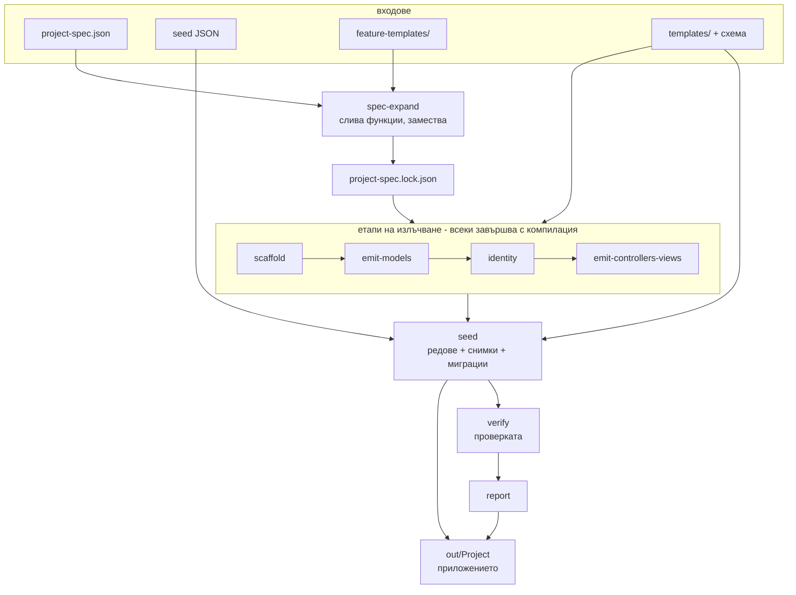

# Работният процес от край до край - машина, каквато не сте виждали

Тази глава проследява генерирането като машина. Кой кого вика, какво чете и пише всяка стъпка, къде
може да спре и какво оцелява след спирането. Прекрасна машина. Върви като швейцарски часовник -
швейцарски часовник, който и компилира. Главите след тази увеличават по една кутия.

Какво става между натискането на Enter и появата на банера? Всичко става: етап след етап, по ред,
всеки проверен - до девет, според потока. Никой не познава тази машина по-добре от хората, които са
я построили, а след около десет страници това ще включва и вас.

## Работният процес като данни

`spec-expand` винаги върви преди цикъла. `spec-build` (бележки → спецификация) е отделна команда и
не е на тази диаграма - нарочно. Той *произвежда* лявата кутия; не я консумира.

## Етап по етап - девет етапа, всичките невероятни

| # | Етап | Чете | Пише | Порта |
|---|---|---|---|---|
| 1 | `spec-build` | `notes.md`, `spec.schema.json` | `project-spec.json` | няма - няма код |
| 2 | `spec-expand` | спецификацията, `feature-templates/`, seed стойността за разнообразие | `project-spec.lock.json` | валидация по схема + семантична на входа **и** на lock файла |
| 3 | `scaffold` | lock | `.csproj`, solution, основата на `Program.cs`, connection string | компилация |
| 4 | `emit-models` | lock, `models/*.sbn` | `Models/`, DTO, `{Project}Context.cs`, атрибути за валидация | компилация |
| 5 | `identity` | lock, `identity/*.sbn`, `identity-bg-map.json` | `ApplicationUser`, `Program.cs`, Identity страници, error describer, роли + seed потребители | компилация |
| 6 | `emit-controllers-views` | lock, `controllers/*.sbn`, `views/*.sbn` | контролерите и изгледите на двете области, услуги, частични изгледи | кодогенерация + компилация |
| 7 | `seed` | lock, начални данни, доставчици на снимки | `Data/seed-data.json`, `Data/SeedData.cs`, `wwwroot/images/`, миграции, базата | компилация → `ef migrations` → `ef database update` |
| 8 | `verify` | lock, приложението | `wwwroot/output/verify-language-report.txt` | истинската порта (по-долу) |
| 9 | `report` | lock, `outputReport` | `wwwroot/output/project-summary.json` | няма - по избор |

**Възобновяването** е на ниво етап: всеки успех добавя името си към `{out}/{Project}/plan/state.json`.
`run --all` пропуска каквото вече е там; `--from <stage>` пуска наново този етап и всичко след него от
седемте на runner-а. `spec-expand` се пази от собствената си отметка.

А сега трябва да ви разкажа за един много лош играч. `--from` с етап, който runner-ът не познава -
`--from spec-build`, `--from spec-expand` - не пуска *абсолютно нищо*. Нищо! Без грешка, без
предупреждение, само тишина. Наричам го Сънливия No-Op. Можете да изгубите час заради Сънливия No-Op.
Хората са губили. Добри хора. [Глава 25](25-decisions.md) предлага да се провали шумно, и трябва.

## Портата, която определя продукта

`verify` не е димен тест, закован в края. Той *е* определението за „готово“. По ред, първо
най-евтиното - защото тук пари не се хабят - никога:

1. чист `dotnet build` в генерирания проект;
2. `dotnet ef database update` срещу истинската база;
3. **проверка на манифеста:** всеки файл, обещан от lock файла (модели, DTO, контролери, identity
   файлове, изгледи, изходът на seed), съществува на диска;
4. приложението стартира на случаен свободен порт;
5. `GET /` - твърдо задължително;
6. всеки открит публичен маршрут (страниците `cardGrid`), анонимно;
7. всеки защитен маршрут (административните страници и страниците на функции само за влезли),
   анонимно - всеки трябва да отговори с 401/403 или да пренасочи към страницата за вход;
8. истински вход през формата като заредения администратор - неуспешен вход проваля `verify` - после
   всеки открит маршрут с автентикация (страниците `adminTable` и всяка включена страница на функция в
   клиентската област);
9. езиковото сканиране на видимия текст върху **всяка изтеглена по-горе страница, отговорила с 200** -
   изцяло пропуснато, а не просто нефатално, когато `meta.language` не е `bg`.

Стъпки 3 и 9 са двете, които хващат това, което модулните тестове не могат: файл, тихо неизлъчен, и
низ, който се е изплъзнал от превода. Два тихи убиеца. Хванати.

Всяка стъпка е твърда. Всяка една. Няма меки стъпки, няма „ще го запишем в лога и продължаваме“.
Стъпки 6-8 събират провалите си и ги докладват заедно, така че едно генериране изброява всяка
декларирана страница, която не е отговорила с 200, и всяка защитена страница, която анонимна заявка е
успяла да отвори - целият списък, наведнъж, вместо да спре при първия. Много ефективно. Оправяте
всичко наведнъж.

И ето една истинска история. До changelog 141 тази порта беше мека. Маршрут, който не
отговаряше с 200, се записваше и се пропускаше, а анонимният достъп изобщо не се тестваше. Тогава я
направиха строга - и в момента, в който добавиха анонимната проверка, какво откриха? Контролерите от
scaffold-а нямаха **никакъв `[Authorize]`**. Никакъв! Анонимен посетител можеше да влезе направо в
административните CRUD страници. Отворено като кръчма на сватба. Никой не знаеше. Строгата порта го
намери от първия ден. Затова се строи строга порта. Сега атрибутите `[Authorize]`, които стъпка 7
тества, се излъчват от `emit-controllers-views`: администраторската роля на всеки контролер в
административната област, и вход на контролерите в клиентската област, освен техните `Index`/`Details`
само за четене. Заключено. Стегнато. Прекрасно.

## Какво оставя едно генериране

| Артефакт | Предназначение | Оцелява ли `rm -rf out`? |
|---|---|---|
| `out/Project/` | приложението | не - генерирайте наново |
| `out/Project/plan/state.json` | състоянието за възобновяване | не |
| `out/Project/dps-nn.log.jsonl` | граници на етапите + времена + хеширани LLM обмени | не |
| `prompts/out/<stage>-request.md`, `prompts/in/<stage>-response.json` | LLM файловият договор, и в двата режима | да |
| `prompts/out/schemas/`, `prompts/out/seeds/` | архив на спецификацията + началните данни, използвани от успешно генериране | да |
| `logs/registry.json(l)` | всеки проект ← неговата спецификация и начални данни | да |
| `logs/<Project>/actions.log.jsonl` | дневникът с нива на действията на този проект, пълни изключения | да |
| `logs/<Project>/db.json` | в коя база е мигриран даден хеш на спецификацията | да |
| `.image-cache/` | изтеглени снимки по доставчик + ключова дума | да |

Разделението е нарочно: `out/` е за еднократна употреба, `prompts/` + `logs/` са одитната следа.
Можете да изхвърлите `out/`. Записите остават. Записите винаги остават. Писаното остава.

## Три състояния в жизнения цикъл

| Ситуация | Какво прави runner-ът |
|---|---|
| **Ново** | пуска всеки етап, пише всяка отметка |
| **Възобновено** | пропуска етапите, записани като готови; пуска наново падналия плюс всичко след него |
| **Принудено** | `--from X` пренебрегва отметките от X нататък; всеки етап пак трябва да е идемпотентен, защото може да намери собствения си предишен резултат |

Идемпотентността принадлежи на етапа, не на runner-а: етап, пуснат отново след срив, трябва да намери
собствената си работа (съществуващ `.csproj`, валидни начални данни, приложена миграция) и да я
пропусне. Всеки етап знае какво е направил. Страхотна памет. Невероятна памет. По-добра от тази на
слон.

## Семантика на провалите

| Изход | Значение | Какво да направите |
|---|---|---|
| `0` | готово, проверено, банерът е отпечатан | отворете приложението |
| `1` | етап е хвърлил изключение | прочетете името на етапа и грешката; `logs/<Project>/actions.log.jsonl` има пълното изключение |
| `2` | грешна употреба (няма описание, няма API ключ, грешна опция) | оправете извикването |
| `3` | LLM обмен чака файл | попълнете `prompts/in/<stage>-response.json`, пуснете отново с `--resume` |

Код `3` е предаване, не грешка. Всеки друг ненулев код значи истински провал, а генерирането се
възобновява от падналия етап, вместо да започва отначало. Отначало - това е за загубеняците.

## Състоянието, което носи едно генериране: три файла, трима собственици

| Файл | Пише го | Чете го | Защо отделно |
|---|---|---|---|
| `project-spec.json` | вие, `spec build` или агентният режим | само `spec-expand` | това е ваш документ; инструментът никога не трябва да го редактира |
| `project-spec.lock.json` | `spec-expand` | всеки етап от `scaffold` нататък и манифестът на `verify` | разгънатата форма е тази, която кара излъчването, така че повторното разгръщане винаги е безопасно |
| `{out}/{Project}/plan/state.json` | runner-ът на етапите | runner-ът на етапите | възобновяването е свойство на *генерирането*, не на спецификацията |

Сливането им в един файл е грешката, която цялата архитектура съществува да предотврати. Един файл не
може да е едновременно вашият непроменим вход, работното копие на инструмента *и* дневникът на
напредъка на генерирането, без писанията на една роля да унищожат другите. Три файла. Трима
собственици. Никой не стъпва никому по пръстите. Много мирно. Като блок с добър домоуправител.

## Инвариантите, на които разчита едно генериране

Седем. Седем заповеди:

1. **Никога не редактирайте генерирания резултат.** Файл под `out/` е резултат; оправете шаблона
   или етапа.
2. **Интерфейс само на български.** Всяко видимо съхранено свойство има `displayName`; езиковата
   проверка проваля проект, чиито страници изпускат английски.
3. **Всеки етап, който излъчва код, компилира собствения си резултат.**
4. **Етапите са идемпотентни:** повторното пускане трябва да открие завършената работа, защото
   възобновяването зависи от това.
5. **LLM-ът мени JSON, никога код.**
6. **GUI-то никога не реализира конвейера наново:** пуска CLI-я и чете лога.
7. **`spec.schema.json` притежава формата на спецификацията:** схемата, зареждащият код и
   документацията се менят заедно.

## Къде живее един провал

Най-бързата диагностика в тази кодова база: назовете слоя, който е произвел симптома. Не гадайте.
Назовете го:

| Симптом | Слой | Поправка |
|---|---|---|
| `All values fail against the false schema` (непознат ключ) или `Value is "…" but should be "…"` от валидацията по схема | вашият вход | оправете спецификацията спрямо `spec.schema.json` |
| `Model X: relation target 'Y' is not a declared model.` | вашият вход, кръстосана препратка | декларирайте модела или оправете релацията |
| генерираният C# не се компилира | шаблон или етап | оправете `.sbn` или етапа, който го рендерира |
| компилира се, но страница дава 500 | окабеляването на страница/маршрут | семантичното правило „`Index` на шаблонен контролер иска страница“ хваща честия случай |
| стартира, езиковата проверка пада | излъчен литерал | махнете го от шаблона или добавете липсващия `displayName` |
| стартира, но `verify` изброява декларирана страница като не-200 | регистрация на маршрут/област | проверете областта и `routing.defaultArea`, не страницата |
| стартира, но `verify` казва, че анонимна заявка не е била отказана | липсващ `[Authorize]` на ръчно писан контролер | защитените страници трябва да искат вход; излъчените контролери го получават автоматично |

Всичко останало е бъг в слоя, към който сочи таблицата - затова името на етапа в съобщението за
грешка е по-важно от текста на изключението. Името на етапа ви казва къде да отидете. Текстът на
изключението ви казва как се чувства. Чувствата не оправят компилации.
