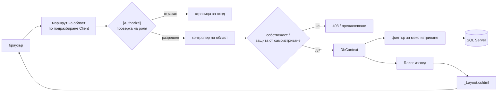

# Какво се генерира — едно прекрасно, прекрасно приложение

Резултатът не е скелет, който чака да бъде напълнен. Това е цяло MVC приложение с нарочно малка
архитектура. Малка! Стегната. Без мазнини. Като добре опечена кюфте — нищо излишно. Тази глава е тази
архитектура — какви са слоевете, защо съществува всеки файл и как една заявка минава през него.

Хората отварят генерирания код и казват: „Господине, къде е магията?“ Няма магия. Това е магията.
Обикновен MVC, точно както учебниците казват, че трябва да се прави — и никой не пише обикновен MVC
по-последователно от един набор шаблони, повярвайте ми. Студентът може да обясни всеки ред. Всеки
един ред.

## Слоевете на генерираното приложение

| Слой | Файлове | Отговорност |
|---|---|---|
| **Представяне** | `Views/`, `Areas/*/Views/`, `Views/Shared/_Layout.cshtml` | само Razor маркировка; без бизнес логика, без превод по време на работа |
| **HTTP** | `Areas/{Admin,Client}/Controllers/*.cs` (началната страница на FaceNote е `Areas/Client/Controllers/HomeController.cs`) | маршрутизиране, оторизация, свързване на модела, оркестрация |
| **Домейнен модел** | `Models/*.cs` | обикновени същности с анотации за данни, които носят българските надписи и съобщения |
| **Съхранение** | `{Project}Context.cs`, `Migrations/`, `Data/` | `DbSet`-ове, релации, филтър за меко изтриване, зареждане на данни |
| **Услуги** | `Services/ImageService.cs`, `FileUploadService.cs`, `UserProfileService.cs` | единственото място, където живеят работата със снимки по файловата система и събирането на профила за всеки потребител |
| **Композиция** | `Program.cs` | DI, identity, маршрути на областите, стартиране „първо миграция, после данни“ |
| **Инфраструктура** | `Infrastructure/Validation/*`, `Infrastructure/Identity/BgIdentityErrorDescriber.cs` | собствени атрибути за валидация; български грешки на Identity |

Няма слой repository, няма слой услуги над същностите и няма слой за съпоставяне на view-модели.
Контролерите говорят директно с `DbContext`. Директно! Без посредници. Тази височина е избор.
Приложението е учебен артефакт и всяка допълнителна абстракция е още едно нещо, което собственикът
му трябва да обосновава пред проверяващ. Случвало ли ви се е да обосновавате generic repository пред
проверяващ? Не е забавно. Изобщо не е забавно. (Единственото изключение — DTO — съществува в схемата
за редкия съставен модел за четене.)

## Пътят на заявката

Следват две последици, и то големи:

- **Оторизацията е с атрибути и по области.** Съответствието област→роля в спецификацията е това,
  което прави „административните страници“ и „клиентските страници“ истински: всеки контролер в
  административната област носи `[Authorize(Roles = "<admin role>")]`, а всеки контролер в
  клиентската област — `[Authorize]` с `[AllowAnonymous]` на своите `Index`/`Details` само за
  четене — излъчени от етапа, все едно дали са от scaffold или от шаблон, и тествани от `verify` с
  анонимни заявки. Правилата за `ownership` на запис се налагат **вътре** в действието, на сървъра,
  никога в изгледа. Никога в изгледа, хора. Правило в изгледа е препоръка. Правило на сървъра е
  закон.
- **Мекото изтриване е филтър на заявките**, приложен върху типа на модела, така че никоя заявка не
  може да го забрави. Модел със `softDelete` (или проект с `conventions.deleteBehavior: "soft"`)
  получава `IsDeleted` от общата база `AuditableEntity` и глобален филтър в контекста.

## Откъде идват контролерите и защо има три начина

Най-необичайната архитектурно част от резултата: контролерите имат **произход**. Имат родословие.
Много добри фамилии:

| `generatedBy` | Произвежда се от | Ползва се за | Компромис |
|---|---|---|---|
| `scaffold` | `aspnet-codegenerator`, после декларативни **отклонения**, приложени с регулярни изрази с котва | стандартен CRUD над модел | съвпада с това, което студент би scaffold-нал, но зависи от формата на изхода на scaffolder-а (ADR-006) |
| `template` | Scriban шаблони | контролери на функции, началната страница | изцяло под контрола на това хранилище, лесно се мени |
| `writtenFromScratch` | отделен шаблон | контролерът на потребителите със сървърни правила и страницата „Спецификации“ | единственото място, където живее специална логика за оторизация |

Изборът на регулярни изрази е този, който изглежда грешен — докато не видите алтернативата. Roslyn
rewriter е голяма зависимост за поддръжка заради редакции, които са стабилни за заковано SDK, и той
се проваля *меко*. Меко! Мекият провал е най-лошият вид. Трансформациите с регулярни изрази се
провалят **шумно**, когато котвата им изчезне, така че ъпгрейд на SDK-то излиза наяве веднага.
Шумното е добро. Шумното е честно. Отклоненията са декларативни полета в спецификацията
(`removedActions`, `redirects`, `sorting`, `pagination`, `ownership`) — спецификацията никога не
държи код.

## Identity: по един механизъм на проблем

| Проблем | Механизъм | Защо не другото |
|---|---|---|
| Страниците на акаунта трябва да са на български и да изглеждат като приложението | основните страници се **излъчват изцяло** от `identity/*.sbn` (ADR-002b) | преводът на маркировка по време на работа поврежда Razor и не може да преоформя |
| Страниците, останали от scaffolder-а, не трябва да изпускат английски | статична карта за замяна EN→BG (`identity-bg-map.json`) (ADR-002) | LLM преводач е недетерминистичен и може да повреди маркировката |
| Собствените низове с грешки на Identity трябва да са на български | `BgIdentityErrorDescriber` | слой за превод по време на работа е `.resx` проблем, решен веднъж при източника |
| Демото трябва да има използваеми акаунти | `IdentitySeeder` създава роли + потребители; паролите са **изведени** от seed стойността за разнообразие | паролите в хранилището са мирис на лоша сигурност и чупят възпроизводимостта |

Едно и също правило се появява четири пъти, а когато правило се появи четири пъти, слушате:
**превеждайте текста там, където се произвежда, не там, където се показва.**

## Условно излъчване

Повечето услуги съществуват само когато спецификацията ги оправдава, а манифестът на `verify` очаква
файл само когато спецификацията казва, че трябва да съществува. Не получавате услуга, която не сте
заслужили:

| Файл | Излъчва се, когато |
|---|---|
| `Services/ImageService.cs` + контролери/частични изгледи за снимки | някой модел декларира блок `images` |
| `Services/FileUploadService.cs` | профилни снимки, функцията rating или функцията posts |
| `Services/UserProfileService.cs` + `UserProfileViewModel` + публична страница на профил | функцията `posts` или `catalogues` |
| `Infrastructure/Identity/BgIdentityErrorDescriber.cs` | `identity.errorDescriber` е зададен **и** `meta.language = bg` |

Това държи минималния проект минимален. И това е частта, която най-вероятно ще се счупи, когато една
спецификация започне да ползва нова възможност: условието на излъчването и условието на манифеста
трябва да са съгласни. Две условия, една истина. Ако не са съгласни — беля. Голяма беля.

## Две области и една обединена административна страница

- **Client** е областта за потребителите (областта на маршрута по подразбиране, когато
  `meta.routing.defaultArea` е зададено), със страници за начало/контакт, мрежи от карти и по една
  страница за всяка включена функция.
- **Admin** е CRUD областта. Тя **не** расте с по една точка в навигацията за модел: моделите
  `isSpecification` и `isLookup` се обединяват на една страница **„Спецификации“** — съответно с CRUD
  раздел и с филтриран раздел само за четене (ADR-012). Всеки друг модел получава нормална
  административна таблица.
- `spec-expand` инжектира административна CRUD повърхност за всеки модел, който спецификацията е
  забравила, така че административната област е цяла, дори когато авторът е описал само клиентската
  страна. Забравили сте модел? ДПС-НН не е забравил. ДПС-НН никога не забравя.

## Какво нарочно отсъства

Няма тестов проект, няма Dockerfile, няма CI файл, няма JavaScript рамка, няма слой за локализация по
време на работа, няма абстракция repository. Приложението е доставката, не платформа. Всеки пропуск е
документиран избор на височина — и е първото нещо, което да проверите, преди да тръгнете да наричате
някой от тях бъг.
