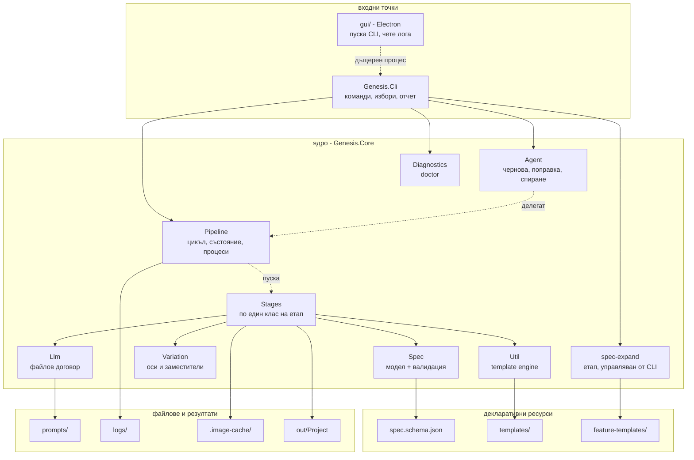

# Компоненти — най-добрите компоненти, топ хора

Това е картата, която да държите отворена, докато работите по кода. Единицата е модулът: за какво
отговаря всяка част, от какво може да зависи и какво се чупи, ако е грешна. Имаме най-добрите хора във
всяка кутия, хора. Подробностите файл по файл живеят в генерираната карта на файловете; тази глава ви
казва в коя кутия принадлежи едно поведение.

Хората ме питат: „Господине, когато нещо се счупи, къде изобщо да гледам?“ Тук. Тази глава. Всеки
модул, какво притежава, какво може да пипа. Никога вече няма да се изгубите. Изгубването е за хора без
карта, а повярвайте ми, това е най-добрата карта. По-добра от навигацията в таксито.

## Графът на компонентите



## Отговорности и видове провал

Всеки има работа. Всеки знае какво става, ако не я свърши:

| Компонент | Притежава | Ключови типове | Ако е грешен |
|---|---|---|---|
| **CLI** | повърхността на командите, решаването на `GenesisRoot()`, интерактивните менюта за избор на спецификация/начални данни, регистъра + архива, банера при завършване | `Program.cs`, плюс `InteractiveSelection` (помощниците на менютата, в папката `Cli` на енджина) | решават се грешни файлове; нищо дълбоко не се чупи |
| **Pipeline** | цикъла на етапите, възобновяването, времената, лога на напредъка, обвивката за външни процеси | `PipelineRunner`, `StateStore`, `StageContext`, `Proc`, `ParallelEmit` | генериранията не могат да продължат; провалите губят етапа си |
| **Stages** | всичко, което чете lock файла и пише файлове | девет класа `IStage` в пет файла | приложението е грешно там, където отговаря този етап |
| **Spec** | POCO модела и двуслойната валидация | `ProjectSpec`, `SpecLoader`, `SpecValidationException` | лош вход стига до генерирането |
| **Variation** | регистъра на осите, замяната на заместителите, изведените пароли | `VariationResolver`, `ResolvedVariation` | проектите си приличат; данните за вход се изместват |
| **Util** | единствената Scriban повърхност и нейните помощници; извеждане на `DOTNET_ROOT` за пуснатите инструменти | `TemplateEngine`, `DotnetHost` | всеки излъчен файл се измества наведнъж |
| **Llm** | файловете заявка/отговор, автоматичен срещу ръчен режим, повторни опити, хеширане | `LlmBridge`, `LlmModels` | офлайн пътят се чупи; лош JSON минава |
| **Agent** | цикъла чернова/поправка и условията му за спиране | `AgentRunner`, `LlmSpecAuthor` | похабени поправки или изгубена гаранция „само спецификацията“ |
| **Diagnostics** | проверките на предварителните условия и поправките им | `Doctor` | липсващи предварителни условия изглеждат като бъгове на генератора |
| **GUI** | представянето, IPC, възстановяването от лога | `gui/src/main`, `gui/src/renderer` | напредъкът лъже; генерирането не е засегнато |
| **Ресурси** | схема, шаблони, фрагменти, дизайн-пресети, BG карти | JSON + `.sbn` | приложението се мени без промяна в C# |

Вижте реда на GUI-то. „Напредъкът лъже; генерирането не е засегнато.“ Дори GUI-то да има лош ден — а
всеки има лош ден, особено в понеделник — приложението пак излиза както трябва. Това е устойчивост.
Това е система, която може да понесе удар.

## Правила за зависимостите

```
Cli         -> Agent, Stages, Diagnostics, Pipeline, Llm, Util, Variation, Spec
Agent       -> Llm, Spec        (pipeline injected as a delegate)
Stages      -> Pipeline, Llm, Util, Variation, Spec
Diagnostics -> Pipeline
Pipeline    -> Variation, Spec
Util        -> Variation, Spec
Variation   -> Spec
Spec, Llm   -> (nothing inside Core)
```

Три правила държат това. Три силни правила:

1. **Нищо не импортира `Stages` освен `Cli`.** Етапът е листово поведение, не библиотека; дори
   агентът вижда конвейера само като делегат.
2. **Шаблоните са данни, не код.** `Util` ги рендерира; етап никога не сглобява C# от низове извън
   шаблонния енджин. Сглобяването на C# от низове на ръка — кошмар. Пълен кошмар. Забранихме го.
3. **GUI-то никога не се свързва с енджина.** Единственият му договор е процесът на CLI-я и
   файлът с лога.

## Петте хранилища на данни

| Хранилище | Пише го | Природа |
|---|---|---|
| спецификацията + lock | авторът, `spec-expand` | единственият вход, който има значение |
| `out/<Project>/plan/state.json` | runner-ът | състояние за възобновяване за еднократна употреба |
| `prompts/` | LLM мостът, CLI-ят | одитна следа + тестови приспособления; оцелява всичко |
| `logs/` | runner-ът, етапите, CLI-ят | регистър, дневник на действията за проект, жизнен цикъл на базата |
| `.image-cache/` | етапът seed | кеш на изтеглянията между генериранията |

Нито едно от тях не е база данни и нито едно не е нужно за първото генериране — затова инструментът
може да се копира на друга машина като папка плюс exe. Папка и exe! Преносимо. Много преносимо. Влиза
в една флашка.

## Къде да промените какво

| Цел | Компонент | Трябва да обновите и |
|---|---|---|
| съдържанието на генериран файл | `templates/*.sbn` | компилационната порта го доказва; документацията, ако поведението се е променило |
| нов излъчен файл | шаблон + извикване от етап | очакването в манифеста на `verify`, ако спецификацията го декларира |
| нова възможност на спецификацията | `spec.schema.json` → `Spec/ProjectSpec.cs` → `SemanticCheck` → етапът, който излъчва | главата за договора на спецификацията и умението за писане |
| нова функция за многократна употреба | `feature-templates/<name>.json` + излъчване, зависещо от функцията | списъците с функции в глави 22 и 23 |
| различен резултат между проектите | `VariationResolver` | таблицата с осите в [глава 12](12-principles.md) |
| как се подава промпт на модела | `Llm`, `LlmSpecAuthor`, извикването `ExchangeAsync` на етапа | схемата на отговора е част от договора |
| ред на изпълнение, възобновяване, логване | `Pipeline` | [глава 9](09-workflow.md) |
| проверки на предварителните условия | `Diagnostics/Doctor` | секцията за `doctor` в [глава 4](04-first-run.md) и [глава 16](16-runtime.md) |

## Мащаб, за ориентация

Енджинът е около 5200 реда C# в 19 файла под `src/`. Това е. Стегнат и зъл. Най-големият е етапът за
контролери и изгледи, защото държи и трите вида произход. Ако една промяна направи някой от тези
файлове осезаемо по-голям, въпросът обикновено е „това не трябва ли да е шаблон?“ — и отговорът
досега е бил „да“ всеки път. Всеки път! Перфектен рекорд.
