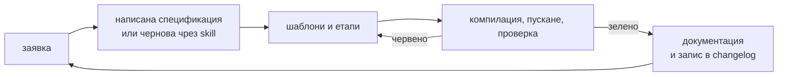

# Как е построен проектът - разработчик и ИИ, какъв отбор само

Генерираните приложения са обикновени. Начинът, по който *те* се появяват, не е. Хранилището се
пише и поддържа от човек, който работи с ИИ агенти - жизнен цикъл на разработка, воден от ИИ
(AI-DLC), на практика, не като етикет на слайд. И ще ви кажа, това е невероятен отбор - а процесът
е подреден така, че машина да може да поеме работата, без да изгуби нишката. Тази глава описва
това подреждане, защото то обяснява решения, които иначе изглеждат произволни.

Кой го е построил? Двама. Човек и агент, и всеки носи това, което другият няма.

Човекът носи преценката: кое си струва да се построи, кое решение ще издържи въпрос пред комисия, къде
е ръбът, отвъд който генераторът става опасен за собствения си потребител. Домейнът се познава от
някого, който е стоял в стая, докато се защитава проект.

Агентът носи издръжливостта. Голяма част от кода в `src/` е написана от Claude - в дълги сесии, по
цял етап наведнъж, с компилация след всяка стъпка. Това, че днес можеш да отвориш всеки файл и да
прочетеш защо изглежда така, не е резултат от един гениален следобед: резултат е от факта, че агентът
не забравя, когато дисциплината е записана във файлове вместо в глава.

И една подробност, която обяснява защо това работи: агентът не помни нищо между сесиите, освен ако не
е записано. Затова всичко е записано. Всичко.

## Цикълът

Всяка стъпка оставя артефакт, който може да се прегледа: спецификация, разлика в кода, доклад от
verify, запис в changelog. Нито един от тях не е разговор, който изчезва, когато прозорецът на
контекста се затвори. Разговорите изчезват. Файловете остават. Винаги залагайте на файла.

## Документация, проектирана за двама читатели

Документацията следва Diátaxis - урок, ръководство, справочник, обяснение - защото тези четири
отговарят на различни въпроси и остаряват с различна скорост. Справочната таблица остава вярна с
месеци; урокът се чупи седмицата, в която се смени команда. Смесете ги в един файл и стабилните части
се пренаписват всеки път, когато мръдне нестабилната. Пълен хаос. Всички сме чели такава
документация. Скучна, дълга и грешна - най-лошата комбинация. Като инструкция за мебел от
хипермаркет, само че без картинките.

Две конвенции правят дървото използваемо от агент:

- **Файл-маршрутизатор.** Един кратък документ в корена казва какво е проектът и коя документация да
  се прочете за коя задача. Агентът пристига по назован път; не разглежда наоколо. Без обикаляне.
  Влиза и излиза. Много ефективно.
- **Записи за решения.** Архитектурните избори живеят в номерирани ADR-и, в `docs/adr/`. Заменено
  решение запазва номера си и получава бележка какво го е заменило, така че старите връзки никога не
  гният.

Има и работна история, която документацията нарочно не дублира: по един changelog файл за промяна и
дневник на решенията, който записва кои поправки са опитани и са се провалили. Този дневник
съществува, защото най-скъпата грешка в дълго живеещ проект е да предложиш отново теория, опровергана
преди три сесии. Преди три сесии! Някой вече я е пробвал! Не сработи! Прочетете дневника.

## Умения вместо импровизирани промптове

LLM пътят на генератора не започва с „напиши ми спецификация“. Това е аматьорски час. Започва с
**умение**: документ, който казва договора, конвенциите, които ги няма в схемата, и грешките, които
наистина са били допуснати. Хранилището доставя две - едно за спецификации, едно за начални данни.
Умението за спецификации се ползва на три места; умението за начални данни е разговорният близнак на
собствения промпт на етапа `seed` и носи същите правила:

| Потребител | Какво получава |
|---|---|
| човек в чат | разговорния работен процес: първо пита, излъчва JSON, когато решенията са уточнени |
| цикълът на агента (`dps-nn create`) | същото ръководство без стъпките „попитай потребителя“ |
| собствената документация на хранилището | договора, спрямо който се тества останалата система |

Умението е по-евтино от дълъг промпт, повтарян при всяка заявка, и по-надеждно от гола схема: моделът
научава конвенциите веднъж и ги прилага до края на прозореца. А подобренията се трупат във файл,
вместо да се губят със сесията. Сложна лихва. За знание.

## Маршрутизиране на моделите и колко струва

Работата, която иска мислене, отива при по-голям модел; работата на обем отива при по-евтин. Не
пращате най-добрия си преговарящ да брои кашони:

| Обмен | Модел | Защо |
|---|---|---|
| чернова на спецификацията, поправка на спецификацията, преглед на разгръщането | клас Sonnet | преценка за домейна, обхвата и последователността |
| редове начални данни | клас Haiku | механично генериране спрямо схема, на едро |

И двата могат да се сменят с променлива на средата. Измерено при генериранията на автора, един цял
проект - чернова на спецификацията плюс начални данни - струва **под 17 американски цента**.
Седемнайсет цента! За толкова не можете да си купите и закуска от будката. Сега, за да сме точни,
защото сме точни: тази цифра е собствено измерване на автора, не независимо възпроизведен бенчмарк, и
зависи от дължината на описанието и броя на моделите. Цитира се, защото променя едно решение: на тази
цена повторното генериране на проект е по-евтино от отстраняването на грешки в лош.

С итерациите сметката се качва, защото всяка итерация е още един разговор със спецификацията и още
един цикъл начални данни. Реалистичната граница за завършен проект - спецификация, начални данни,
презентация, документация, въпроси, наръчник и последният агент, който обхожда приложението - е между
**0,20 и 0,70 евро** токени. Не на час, не на месец, за целия проект. Разликата между долната и горната
граница е колко пъти спецификацията е била поправяна, а не колко е сложно приложението.

## Колко време отнема - и защо е O(n)

Няма нереалистични цели, има нереалистични срокове - а срокът тук е един ред математика и едно
измерване, не обещание.

Времето не зависи от броя на страниците, които виждате, а от броя на моделите, които спецификацията
декларира. Един модел носи свойства, контролер, изгледи, административна повърхност и начални данни -
и всичко това расте линейно:

    T(n) = O(n),   n = брой модели в спецификацията,   T <= 15 - 20 минути

Линейно, не експоненциално. При двайсет модела генерирането не се взривява, а просто става по-дълго
със същата стъпка на модел. Горната граница от петнайсет до двайсет минути е измерена на машината на
автора и включва компилациите след всеки етап, миграциите и стартирането на приложението.

И една уговорка, защото `O(n)` не значи „бързо“, а „предвидимо“: константата пред `n` е голяма.
Първото пускане тегли пакети, създава базата и вдига Kestrel за проверката; второто пускане на същия
проект е забележимо по-кратко. Ако някой ви обещае генериране за трийсет секунди, той или брои само
един етап, или не брои компилацията. Ние броим всичко.

## Колко струва на купувача

Купувачът не купува код, купува спокойствие - а спокойствието не се компилира. То се купува с
отговори, с документи и с човек, който вдига телефона, когато нещо не тръгне.

Между **200 и 400 евро** за проект, платени през итерациите, не наведнъж. Четири неща местят числото:
обемът на изискванията (един домейн с три модела не е същото като маркетплейс с четиринайсет),
строгостта на проверяващите, менторът и темата.

Токените са под един процент от тази сума. Останалото е време, разговор и преценка - нещото, което не
се купува на килограм. Затова и цената не е цена на софтуер, а цена на доставка: приложението,
въпросите за защитата, документацията, презентацията и човекът, който отговаря, ако нещо се обърка.

## Тестовете решават дали нещо излиза

Тестовата дисциплина е тази, записана като умение за многократна употреба: червено, зелено, връщане,
зелено.

1. напишете тест, който възпроизвежда бъга, и гледайте как пада по посочената причина;
2. поправете кода, докато мине;
3. махнете поправката, запазете теста, гледайте как пада отново - доказателство, че тестът е свързан
   с провала;
4. върнете поправката.

Нищо не се слива и не се доставя при червени тестове. Непрекъснатата интеграция пуска .NET и GUI
тестовете на Windows при всеки push и pull request, а генерираното приложение се брои за готово за
доставка само когато `verify` мине - компилация, миграция, стартиране, вход, декларираните маршрути,
език. Следователно портата за доставка не е увереността на някой човек - увереността е евтина - а
генериране, което или минава, или не.

## Два входа отпред, един енджин

| Вход | Публика | Договор |
|---|---|---|
| **CLI** (`dps-nn`) | агенти и скриптове | стабилни кодове на изход, JSONL лог на напредъка, `--no-interactive` за генериране без надзор |
| **GUI** (Electron) | хора, които подготвят проект | менюта за избор, напредък на живо, същите файлове с лог и състояние отдолу |

GUI-то пуска CLI-я и чете изхода му; не притежава логика за генериране. Новото поведение се пише
веднъж, в CLI-я, и двата входа го наследяват. Затова и екранът за провал на GUI-то може да покаже
собствената причина за спиране на агента: чете реда, който CLI-ят е отпечатал, а не копие на логиката.

## Какво купува това подреждане

- **Повторяемост.** Една и съща спецификация произвежда един и същ код (включително дизайн-пресета,
  глава 12), така че бъгът е възпроизводим.
- **Проверимост.** Всяка стъпка оставя файл: спецификация, lock, начални данни, доклад от verify,
  changelog.
- **Оцеляване.** Нова сесия - човек или агент - може да възстанови защо кодът изглежда така от
  маршрутизатора, ADR-ите и дневника на решенията, без да пита никого.
- **Контрол над разходите.** Евтини модели там, където има значение обемът, скъпи модели там, където
  има значение преценката.

Повторяем, проверим, оцеляващ, достъпен. Четири думи. Ако всеки проект имаше тези четири думи -
щеше да има много по-малко катастрофи по света. Много по-малко.
