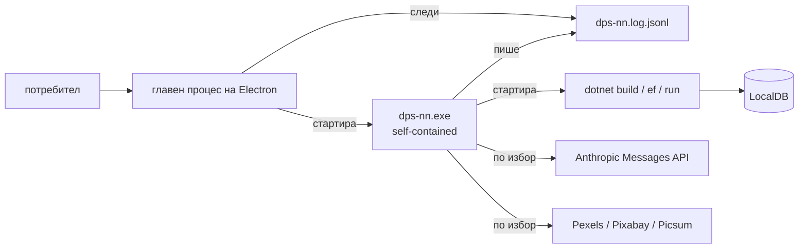

# Изпълнение, доставка и десктоп приложението - доставя се, наистина се доставя

Генераторът има два живота. Първо: хранилище, което компилирате от изходния код. Второ: инсталирана
програма, която пуска човек, който не е разработчик. Те се различават в точно едно нещо - къде може да
се пишат файлове - и тази една разлика обяснява повечето странно изглеждащ код в CLI-я.

Инсталира ли се наистина? На истински компютър, с истински инсталатор? Инсталира се: двоен клик,
напред, напред, край. И никога не пише в собствената си папка с програмата. Никога. Повечето програми
драскат навсякъде из инсталационната си папка - като общежитие в сесия. Не и тази.

## Две подредби

Двете подредби приличат на теснолинейка: влакът е малък и бавен, но разписанието е свято и никой не
слиза в нивата, за да си скъси пътя.

| | Разработка (хранилище) | Инсталирано |
|---|---|---|
| Файлове на програмата | `src/`, `templates/`, `spec.schema.json` в клонинга | `%LOCALAPPDATA%\Programs\DPS-NN\` - **само за четене** |
| Работна папка | коренът на хранилището | `Documents\DPS-NN\` - **с право на запис** |
| Генерирани проекти | `out/` | `Documents\DPS-NN\out\` |
| Логове, промптове, кеш | `logs/`, `prompts/`, `.image-cache/` | под същата работна папка |

Правилото: **инсталираната програма никога не пише до себе си**. Никога. Много възпитана програма.
Решаването на ресурсите проверява първо собствената папка на инструмента, после текущата папка, така
че един изпълним файл работи и в двете подредби (ADR-014). Същото правило е причината `templates/` да
се копира в инсталатора, вместо да се вгражда.

## Топология на процесите

От тази форма следват три свойства:

- **Една реализация на конвейера.** GUI-то не може да се размине с CLI-я, защото не притежава логика
  за генериране; неговата коректност е коректността на лога.
- **GUI-то е по избор.** Всяка възможност е достъпна от CLI-я; десктоп приложението добавя
  възстановяване на напредъка, менюта за избор и теми. Много хубави екстри. Позлатени, може да се
  каже.
- **Дъщерните процеси са повърхността на провала.** Липсващ `dotnet-ef`, старо SDK, недостъпен
  LocalDB - всички излизат като провали на CLI-я, затова съществува `doctor` и затова цикълът на
  агента може да ги класифицира.

### Подробността с `DOTNET_ROOT`

Самостоятелният `dps-nn.exe` няма родител `dotnet`, който да зададе `DOTNET_ROOT`, така че глобалните
инструменти, които пуска, не могат да намерят .NET инсталация за отделен потребител. CLI-ят извежда
`DOTNET_ROOT` от `dotnet` в `PATH`, преди да направи каквото и да е друго. Това е истински бъг, който
беше доставен веднъж - веднъж! - и е документиран тук, защото симптомът (инструментите „не са
намерени“ на машина, където работят чудесно в терминал) изглежда точно като счупена инсталация. Не е
счупена инсталация. Хитра променлива на средата е. Хванахме я.

## Разпространение

| Издание | Какво е | Защо съществува |
|---|---|---|
| **Пълно** | NSIS инсталатор: GUI + самостоятелен CLI + шаблони + `design/music/` (~1 GB) | цялото преживяване, включително тематичния музикален плейър |
| **Олекотено (Lite)** | същото дърво без музиката, автоматично огледално копирано във второ хранилище | за споделяне/изтегляне без гигабайт чужди записи |

Олекотеното издание се произвежда от пълното със скрипт, който копира дървото, маха `design/music/` и
заменя README-то с олекотеното - стъпка от компилацията, не разклонение, така че двете не могат да се
разминат в кода. Разклоненията се разминават. Стъпките от компилацията - не. Версията има един
източник: `VERSION` в корена се щампова в CLI-я, в инсталатора и на корицата на тази книга. Едно
число. Навсякъде. Пълна последователност.

Инсталаторът не е подписан, така че Windows SmartScreen предупреждава при първото пускане (*Още
информация → Изпълни въпреки това*). SmartScreen - много нервен, този. Винаги се притеснява. Като
съседка, която гледа през шпионката. Това е известна, документирана цена за некупен сертификат, не
дефект.

## Десктоп приложението на една страница

Electron обвивката е нарочно тънка. Тънкото е добро. Тънкото значи, че няма какво да се крие:

| Част | Отговорност |
|---|---|
| `gui/src/main` | жизнен цикъл на процеса, пътища на работната папка, IPC обработчици, пускане на `doctor`/`run`/`create`, следене на лога, последни проекти |
| `gui/src/renderer` | интерфейсът: избор на проект, напредък, терминал (xterm.js), настройки, теми и интерфейс на шест езика плюс Standard Galactic и шест шеговити режима |
| shared | типове и форми на събитията в лога, ползвани от двете страни |
| `gui/scripts/` + `gui/electron-builder.yml` | пакетиране: подреждане на CLI-я и ресурсите му в приложението, NSIS инсталаторът |

Темите са токени плюс незадължителни облици и тапети; новото съдържание - тапети, лога, текст във
футъра, музика - е файлове, не код, така че смяната на облика не иска прекомпилиране за частите, които
се четат по време на работа. Пълният договор (IPC канали, модел на прозорците, правила за темите) е в
[глава 18](18-gui-architecture.md) и `docs/explanation/gui-architecture.md`; визуалната спецификация е
`design/design-specs.md`.

## Работа с него

| Въпрос | Къде да погледнете |
|---|---|
| Готова ли е тази машина? | `dps-nn doctor` - по един ред за предварително условие с поправката му |
| Какво направи последното генериране? | `out/<Project>/dps-nn.log.jsonl` (граници на етапите) и `logs/<Project>/actions.log.jsonl` (подробности, пълни изключения) |
| Коя спецификация произведе това приложение? | `logs/registry.json` и архивът в `prompts/out/schemas/` |
| Защо базата не се мигрира наново? | `logs/<Project>/db.json` пази името на базата + хеша на спецификацията, които вече са мигрирани |
| Може ли да върви без мрежа? | в общи линии: NuGet пакетите трябва вече да са в локалния кеш, снимките искат доставчик или `--image-pack`, LLM стъпките искат ключ или предварително поставени файлове с отговори - а генерираното приложение зарежда Bootstrap и шрифтовете от CDN, така че офлайн изглежда без стилове |

## Позицията по сигурността, казана направо

Казваме го направо. Без завъртане:

- **Без тайни във входовете.** Паролите на seed потребителите са изведени, освен ако спецификацията не
  задава такава, и никога не се появяват в началните данни; изведените стойности се записват в lock
  файла и в `logs/<Project>/seed-credentials.txt`, така че третирайте тях като тайни. API ключовете са
  само променливи на средата.
- **Без hot-linking.** Генерираните приложения сервират изтеглените снимки от собствения си
  `wwwroot`; `.image-cache/` държи заявките към стоковите доставчици до една на фраза.
- **Без превод по време на работа** в генерираните приложения. Единствените отдалечени извиквания са
  CDN връзките в подредбата: Bootswatch/Bootstrap от jsDelivr и Google Fonts на пресета.
- **Чуждото съдържание е отделено.** Музиката не е покрита от лиценза на кода и е изключена от
  олекотеното издание.

Това, което *не* е подсилено - генерираното приложение няма ограничаване на заявките, няма CSP, няма
настройка за заключване на акаунти - е работа на [глава 22](22-limits.md). Демо приложението е със
сигурност за демо по дизайн, и да го кажеш е по-евтино, отколкото да намекваш обратното. Много
по-евтино. Намекването на обратното - това ви вкарва в беля. Ние не намекваме. Ние ви казваме.
