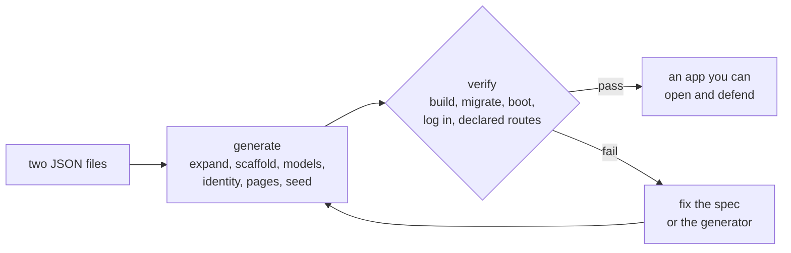

# One generation, from 30,000 feet — beautiful view

Before any machinery, let's follow a single project from a paper to a running app. Nothing in this
chapter is a command you have to run. It's the story. It's the arc. The rest of the book explains
it, piece by piece, and it's a great story, folks. One of the best.

I've told this story many times. Many, many times. And every time, people come up afterwards —
strong people, tough people, people who've seen a lot of diploma projects — and they say, "Sir, I
had tears in my eyes. A paper went in, and an app came out." True story. Let's tell it again.

## The paper

A student comes in with four pages. Title: *Online Bookstore*. Very nice title. There are readers
and administrators. Books have authors, categories, prices and covers. Readers browse, search,
review, keep a wishlist, and place orders. Administrators manage the catalogue and the users. And
the non-functional wishes — it must look modern, be entirely in Bulgarian, and be demonstrable on a
laptop. A laptop! Not a server farm. A laptop.

That's a normal, coherent requirements paper. And here's the thing nobody tells you: it's also a
specification in disguise. What it describes is *entities, relations, roles, pages, and rules*.
What it does not describe is code. Not one line.

## The decision: what becomes a sample app

The work starts with scoping, and scoping is where the winners are separated from the losers.
Three models of its own — not thirty, three: Book, Author, Category. Reviews, the wishlist and
orders come from three reusable features — `rating`, `catalogues` (a personal list of books, which
is exactly what a wishlist is, by the way) and `orders` (cart, checkout, order history) — and each
brings its own models. Everyone can log in. Administrators get the management screens. Readers get
the storefront.

Credit-card payment, e-mail delivery, a recommendation engine — *named and dropped*. Dropped! The
generator can't express them, and a half-wired feature is worse than an honest omission. Much
worse. A half-wired feature is a liability. We don't do liabilities.

## Two files instead of a codebase

The scope becomes two JSON documents:

- a **spec** — the three models with their Bulgarian labels (title, author, price), the validation
  rules ("price must be positive"), the two roles, the two areas, which pages exist and what kind
  each one is, the three features, and *how many* rows of demo data each model should get;
- a **seed** — the rows themselves: forty books with real titles, twelve authors, six categories,
  reviews with believable text, two orders with items.

Neither file contains C#. Zero C#. The input describes an application; it is not an unfinished
one. Big difference. Huge.

## The run

The student — or an agent, and the agent is fantastic, we'll get to the agent — starts a
generation. Eight things happen, in order, and each one is right there on the console for everyone
to see. Total transparency:

- **Expand** merges the three features, pins the project's style (one of eleven deterministic
  axes), and derives the demo users' passwords.
- **Scaffold** creates an ordinary ASP.NET Core MVC project and compiles it once — a baseline that
  every later step has to keep green. Green, green, green.
- **Models** writes the entities — the three the spec declares and the ones the features added —
  their validation attributes with Bulgarian messages, and the EF Core context.
- **Identity** creates the role model, a Bulgarian login/registration/profile experience, an
  administrator account and a reader account.
- **Controllers and views** build the two areas: storefront pages with search and sorting, the
  admin tables, and the pages the features need: reviews, personal lists, cart and orders.
- **Seed** fills the database: books with downloaded cover images, reviews and orders that
  reference each other by name, and the EF migration that creates the schema.
- **Verify** decides the run. It builds, migrates, boots the app on a random port, logs in through
  the real form as the administrator, fetches every page the spec declares, and scans the rendered
  text for English. One leaked "Add to cart" — one! — fails the run. Tough. Very tough. The home
  page and the login must succeed outright, every declared page must answer, and every admin or
  login-only page must turn away an anonymous visitor. Nobody walks in without a ticket.
- **Report** writes a machine-readable summary for whatever tooling wants to document the result.

## What the student sees

An app that starts on a laptop. A populated catalogue. A working login. An admin area that manages
everything. Pages that look like a designed product, not a scaffold. The credentials are printed at
the end of the run. The student is happy. Very happy. I've seen it — tears, almost.

## What the examiner sees

Three things that are very, very hard to fake:

1. **The run is on record.** The app was built, migrated, booted and logged into during
   generation, and the log says which pages answered. It's a file, not a claim. Files don't lie.
2. **The Bulgarian requirement is mechanically checked.** The language report lists any English
   text, pass or fail.
3. **The code is ordinary.** There's no runtime framework in the generated app — if the student
   can't explain a line, the generator is at fault, not the student. We take responsibility. Who
   does that anymore?

## When it goes wrong — and sometimes it does, folks

The interesting part of the story is the failure path. If a model is malformed, validation names
the model and the property before anything is generated. If a feature can't attach to the
project's main model, generation stops at expansion. If a file the spec promised is missing,
verify's manifest check names it before the app is even booted. If the app won't boot, verify fails
before scanning anything. In every case the run is **resumable at the failing stage**, and the
artefacts you need to diagnose it are right there on disk. No mystery. No witch hunt. The failure
has a name and an address.

The promise fits in one sentence, and it's a beautiful sentence: a paper goes in, a verified and
explainable app comes out, and when something fails, the failure is located.

## Where the rest of the book goes from here

| Question this story raises | Chapter |
|---|---|
| What exactly does a generated app look like inside? | [3](03-what-a-generated-app-is.md), then [10](10-generated-app-architecture.md) |
| How do I run it myself? | [4](04-first-run.md) |
| How do I turn *my* paper into that spec? | [5](05-paper-to-spec.md) |
| Where does the demo data come from? | [6](06-spec-to-seed.md) |
| Can the model do the whole thing? | [7](07-agent-mode.md) |
| What precisely is each stage, and where can it stop? | [9](09-workflow.md) |

That's the story. A paper in, an app out, every step checked. People ask me if it's the best
generation story ever told. I don't like to say it. Other people say it.
