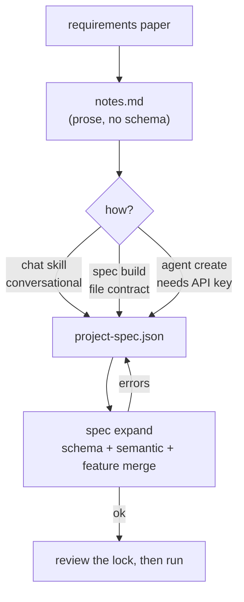

# From a requirements paper to a spec — the art of the spec

This is the chapter the tool exists for. A paper comes in, a spec has to come out. And let me tell
you, a spec is not a summary of the paper. Summaries are weak. A spec is a **decision record** the
generator can execute. Everything the generator can't execute has to be left out *explicitly* — not
silently dropped. We don't drop things silently. We announce it.

A lot of people ask me, "Sir, can't you just paste the paper in and hope?" No. Hope is not a spec.
Nobody writes specs like the people who read the paper properly, and after this chapter that's
going to be you. Believe me, it's easier than it looks — and it looks very easy.

## What a paper gives you, and where each part goes

| In the paper | Becomes | Watch for |
|---|---|---|
| Purpose, domain, target users | `meta.projectName`, `meta.domainHint` (English, used by prompts), `meta.domainHintBg` (Bulgarian, shown to users) | name the domain, not the technology |
| Actors / roles / permissions | `identity.roles`, one `areas[]` entry per role (`forRole` must name a role) | an "admin + user" paper maps to two areas; a third role usually means two areas plus a property |
| Entity list, attributes, "a product has many images" | `models[]` with `properties[]`, `relations[]` | every non-key, non-FK property needs a `displayName` in Bulgarian |
| Field rules ("price > 0", "email", "not in the future") | `validations[]` with a Bulgarian `errorMessage`; date rules via `customValidationAttributes` | a rule you cannot express is a limit to report, not to fake |
| Screens ("list of products with search", "admin table") | `views.pages[]` with a `kind` (`landing`, `contactFormStatic`, `cardGrid`, `adminTable`) + a controller in the matching area | search/sorting are configured on the controller, not hand-written |
| "CRUD for X" | one `controllers[]` entry with `generatedBy` = `scaffold` or `template` | use `removedActions` for actions the domain does not have |
| Reusable chunks ("cart", "orders", "posts", "reviews") | `features.<name>.enabled` | only enable what the paper actually asks for |
| "Should have demo data" | `seeding.rowsPerModel` | counts per model, modest (5–20), not one number for everything |
| Timestamps / soft delete | `conventions.timestamps`, `conventions.deleteBehavior` | ask; these change generated code shape |

## The workflow that works — and it works, folks



Three producers. One output. Choose by how much conversation the paper needs:

| Producer | Use when | Cost |
|---|---|---|
| **Chat skill** (`utils/claude-skills/dps-nn-spec-authoring`) | the paper is ambiguous and you want questions asked before JSON | free, needs a human in the loop |
| **`spec build --notes`** | you already have clean notes and just need the draft; works without an API key via the file contract | one exchange |
| **`create --describe`** | you want the loop to run the generator and repair the spec against real failures | API key; bounded rounds |

The first two write a **file**. The third writes *and repairs* it — that's the agent, a tremendous
agent, very hard-working, never sleeps. All three end at the same place: a spec that validates.

### Validate before you generate

Generation takes minutes and it can fail deep inside `seed`. The spec alone can be validated in
*seconds*. Seconds! Why would you wait minutes to find out what you can find out in seconds?

```bash
dotnet run --project src/Genesis.Cli -- spec expand --spec project-spec.json
```

This runs the two-layer check (JSON Schema, then semantic cross-references), merges the feature
fragments, resolves `$variation:` placeholders, and writes `project-spec.lock.json`. If it passes,
the structural risk that's left is in the templates, not in your input. Your input is clean. Very
clean. Squeaky.

## The rules that decide the shape

These are not style preferences. Every one of them is enforced somewhere, or it produces a bad app.
Nine rules. Nine great rules:

1. **Scope to a sample app: 5–10 models.** The generator's own drafting prompt says this. A paper
   listing 30 entities is a signal to cut to the demonstrable core and report the rest as out of
   scope. An app with 30 half-wired screens is worse than one with 8 complete ones. Much worse.
   Thirty half-wired screens — sad!
2. **Every visible property gets a Bulgarian `displayName`.** This is the hard requirement. The
   spec's semantic validation rejects a visible property without one before anything is
   generated, because a bare C# property name on a page is exactly an English leak.
3. **Bulgarian by default.** `meta.language` defaults to `bg`; all human-readable strings in the
   spec — labels, error messages, page titles — are Cyrillic. Brand names stay in their own script.
4. **Small reference models consolidate.** A model with only a name (Brand, Category) and no
   outgoing relation is flagged `isSpecification`; a join row (CartItem, PostComment) is
   `isLookup`. Both then live on one admin page ("Specifications") instead of cluttering
   navigation. Apply the flag by the rule, not by taste. Taste is for ties, folks.
5. **Strip actions that make no sense.** A model with ≤1 visible property does not need a Details
   page; an `Order` is not hand-created by an admin. `removedActions` is how you say so.
6. **`ownership` on anything a user owns.** Posts, reviews, catalogues, cart rows: the generator
   then enforces owner-or-admin on Edit/Delete server-side.
7. **The `images` block is for primary content only.** A model whose pictures *are* its content
   (Product) gets `images`; a secondary optional photo (Review, Post) gets a plain nullable
   `ImagePath` string and no dedicated management page.
8. **No passwords in `seedUsers`.** Emails and roles only; passwords are derived, and the banner
   reports them.
9. **`generatedBy` is one of exactly three values**: `scaffold`, `template`, `writtenFromScratch`.
   The first two cover most needs; the third is for the users controller and the Specifications
   page.

## How much of the output the spec controls

The spec isn't a wish list that the generator *interprets*. Interpretation is for poetry. The spec
is the composition plan, and almost every visible decision is right there in it:

| Decision | Where in the spec |
|---|---|
| Which entities exist, their properties, types, labels and validation messages | `models[]` |
| Which controllers exist, how each is produced, and which actions are removed or redirected | `controllers[]` |
| Page composition: layout, which pages exist, and what kind each one is | `views` |
| Role names, areas, which identity pages are emitted, seed users, extra user fields, the user controller's rules | `identity`, `areas[]` |
| Which feature fragments merge in — and with them their models, DTOs and controllers | `features` |
| Composed read models over several entities | `dtos[]` |
| How many demo rows per model, and where images come from | `seeding` |
| Theme, design preset, and any pinned variation axis | `meta.style`, `variationProfile` |
| What the report should point at | `outputReport` |

The practical effect — and this is big — is that **two projects built from the same requirements
paper need not share a single name**. The seller can change the domain vocabulary, pick which
features to enable, decide which models consolidate onto the Specifications page, rename
controllers and pages, write different validation messages, and pin a different theme and code
style. What stays constant is the machinery underneath — MVC conventions, the CRUD shape, the
verification gates — which is what the buyer is paying for in the first place. A great deal. For
everybody.

## When the paper asks for something impossible

Say so. In the spec. Out loud:

```json
"meta": {
  "unsupportedRequests": [
    { "request": "calendar booking for reading-room slots",
      "reason": "no scheduling/calendar feature; the generator has no recurring-time model" }
  ]
}
```

Agent mode writes these itself — very honest agent. If you author the spec by hand, you write them
yourself. The pipeline ignores the section; humans do not. Written down, it separates "the tool
cannot do this" from "the tool quietly did something else", and it's how the feature backlog grows
([Chapter 22](22-limits.md) lists what's genuinely out of reach today).

## Checklist: is this spec ready to run?

- [ ] `spec expand` passes with no schema and no semantic errors.
- [ ] Every model has exactly one `key` property, and every relation target exists.
- [ ] Every visible property has a Bulgarian `displayName`; no English labels anywhere.
- [ ] Every area's `forRole` names a declared role (or a `$variation:` placeholder).
- [ ] Every template-generated controller with `Index` has a page in `views.pages`.
- [ ] `seeding.rowsPerModel` covers every model you want populated.
- [ ] Features are enabled only for capabilities the paper actually asks for.
- [ ] Anything the generator cannot express is in `meta.unsupportedRequests`.

If all eight hold — eight for eight, perfect score — the remaining risk is generator-side, and the
next failure will tell you exactly which template. By name.
