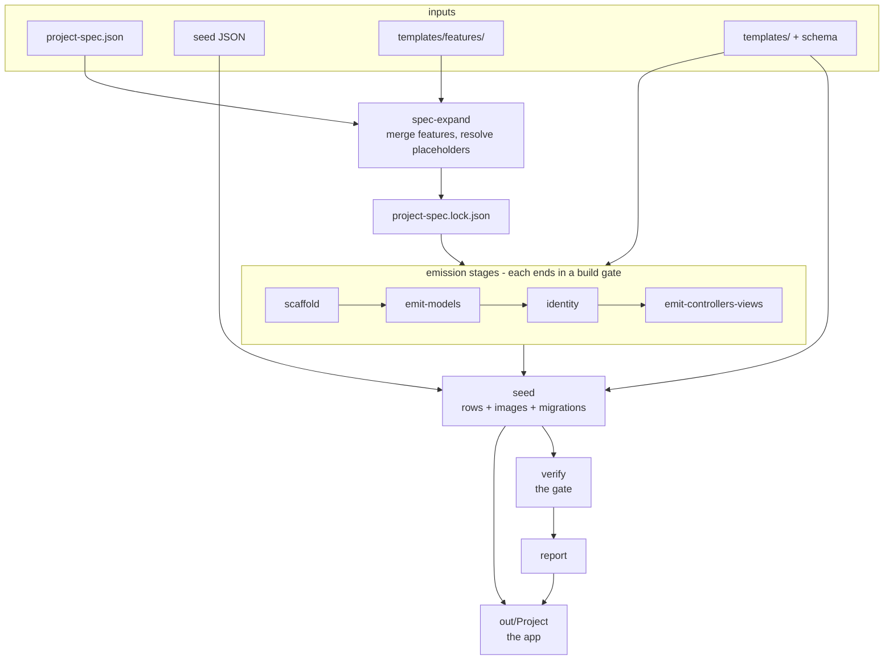

# The end-to-end workflow — a machine like you've never seen

This chapter follows the run as a machine. Who calls whom, what each step reads and writes, where
it can stop, and what survives the stop. A beautiful machine, folks. Runs like a Swiss watch — a
Swiss watch that also compiles. The chapters after this one zoom into one box each.

A lot of people ask me — engineers, serious engineers — "Sir, what happens between the moment I
press Enter and the moment the banner shows up?" Everything happens. Stage after stage, in order, each one
checked — up to nine, depending on the flow. Nobody knows this machine better than the people who built it, and in about ten pages
that's going to include you.

## The workflow, as data

`spec-expand` always runs before the loop. `spec-build` (notes → spec) is a separate command and is
not in this diagram — on purpose. It *produces* the left-hand box; it doesn't consume it.

## Stage by stage — nine stages, all of them tremendous

| # | Stage | Reads | Writes | Gate |
|---|---|---|---|---|
| 1 | `spec-build` | `notes.md`, `spec.schema.json` | `project-spec.json` | none — no code |
| 2 | `spec-expand` | the spec, `templates/features/`, variation seed | `project-spec.lock.json` | schema + semantic validation of input **and** lock |
| 3 | `scaffold` | lock | `.csproj`, solution, `Program.cs` base, connection string | build |
| 4 | `emit-models` | lock, `models/*.sbn` | `Models/`, DTOs, `{Project}Context.cs`, validation attributes | build |
| 5 | `identity` | lock, `identity/*.sbn`, `identity-bg-map.json` | `ApplicationUser`, `Program.cs`, Identity pages, error describer, roles + seed users | build |
| 6 | `emit-controllers-views` | lock, `controllers/*.sbn`, `views/*.sbn` | both areas' controllers + views, services, partials | codegen + build |
| 7 | `seed` | lock, seed JSON, image providers | `Data/seed-data.json`, `Data/SeedData.cs`, `wwwroot/images/`, migrations, DB | build → `ef migrations` → `ef database update` |
| 8 | `verify` | lock, the app | `wwwroot/output/verify-language-report.txt` | the real gate (below) |
| 9 | `report` | lock, `outputReport` | `wwwroot/output/project-summary.json` | none — optional |

**Resume** is per stage: each success appends its name to `{out}/{Project}/plan/state.json`.
`run --all` skips what's already there; `--from <stage>` re-runs that stage and everything after it
in the runner's seven. `spec-expand` is guarded by its own state entry.

And now I have to tell you about a very bad actor. A `--from` naming a stage the runner doesn't
know — `--from spec-build`, `--from spec-expand` — runs *nothing at all*. Nothing! No error, no
warning, just silence. I call it Sleepy No-Op. You can lose an hour to Sleepy No-Op. People have.
Good people. [Chapter 25](25-decisions.md) proposes making it fail loudly, and it should.

## The gate that defines the product

`verify` is not a smoke test bolted on at the end. It *is* the definition of done. In order,
cheapest first — because we don't waste money, folks, we never waste money:

1. clean `dotnet build` in the generated project;
2. `dotnet ef database update` against the real database;
3. **manifest check:** every file the lock file promised (models, DTOs, controllers, identity files,
   views, seed output) exists on disk;
4. the app boots on a random free port;
5. `GET /` — hard-required;
6. every discovered public route (`cardGrid` pages), anonymous;
7. every protected route (admin pages and login-only feature pages), anonymous — each must answer
   401/403 or redirect to the login page;
8. real form login as the seeded admin — a failed login fails `verify` — then every discovered
   authenticated route (`adminTable` pages and each enabled client-area feature page);
9. the visible-text language scan over **every page fetched above that answered 200** — skipped
   entirely, not merely non-fatal, when `meta.language` is not `bg`.

Steps 3 and 9 are the two that catch what unit tests can't: a file silently not emitted, and a
string that fell through translation. Two silent killers. Caught.

Every step is hard. Every one. No soft steps, no "we'll log it and move on". Steps 6–8 collect
their failures and report them together, so one run lists every declared page that did not answer
200 and every protected page an anonymous request could open — the whole list, at once, instead of
stopping at the first. Very efficient. You fix everything in one go.

And here's a story, folks, a true story. Until changelog 141 this gate was soft. A non-200 route was
logged and skipped, and nothing at all tested anonymous access. So they made it tough — and the
moment they added the anonymous check, what did they find? The scaffolded controllers carried **no
`[Authorize]` at all**. None! An anonymous visitor could walk right into the admin CRUD pages. Wide
open. Nobody knew. The tough gate found it on day one. That's why you build a tough gate. Now the
`[Authorize]` attributes step 7 tests are emitted by `emit-controllers-views`: the admin role on
every admin-area controller, and login on client-area controllers except their read-only
`Index`/`Details`. Locked. Tight. Beautiful.

## What a run leaves behind

| Artifact | Purpose | Survives `rm -rf out`? |
|---|---|---|
| `out/Project/` | the app | no — regenerate |
| `out/Project/plan/state.json` | resume state | no |
| `out/Project/dps-nn.log.jsonl` | stage boundaries + timings + hashed LLM exchanges | no |
| `prompts/out/<stage>-request.md`, `prompts/in/<stage>-response.json` | the LLM file contract, both modes | yes |
| `prompts/out/schemas/`, `prompts/out/seeds/` | archive of the spec + seed a successful run used | yes |
| `logs/registry.json(l)` | every project ← its spec and seed | yes |
| `logs/<Project>/actions.log.jsonl` | that project's leveled action log, full exceptions | yes |
| `logs/<Project>/db.json` | which database a spec hash was migrated into | yes |
| `.image-cache/` | downloaded images by provider+keyword | yes |

The split is deliberate: `out/` is disposable, `prompts/` + `logs/` are the audit trail. You can
throw `out/` away. The records stay. The records always stay.

## Three lifecycle states

| Situation | What the runner does |
|---|---|
| **Fresh** | runs every stage, writes each checkpoint |
| **Resumed** | skips stages recorded as done; re-runs the one that failed, plus everything after |
| **Forced** | `--from X` ignores checkpoints from X onward; every stage must still be idempotent, because it may find its own previous output |

Idempotency belongs to the stage, not the runner: a stage re-run after a crash has to find its own
work (an existing `.csproj`, valid seed data, an applied migration) and skip it. Every stage knows
what it did. Great memory. Tremendous memory.

## Failure semantics

| Exit | Meaning | What to do |
|---|---|---|
| `0` | done, verified, banner printed | open the app |
| `1` | a stage threw | read the stage name and the error; `logs/<Project>/actions.log.jsonl` has the full exception |
| `2` | bad usage (no description, no API key, bad option) | fix the invocation |
| `3` | an LLM exchange is waiting for a file | fill `prompts/in/<stage>-response.json`, re-run with `--resume` |

Code `3` is a hand-off, not an error. Any other non-zero means a real failure, and the run resumes
at the stage that failed instead of starting over. Starting over — that's for losers.

## The state a run carries: three files, three owners

| File | Written by | Read by | Why separate |
|---|---|---|---|
| `project-spec.json` | you, `spec build`, or agent mode | `spec-expand` only | it is your document; the tool must never edit it |
| `project-spec.lock.json` | `spec-expand` | every stage from `scaffold` on, and `verify`'s manifest | the expanded form is what drives emission, so re-expanding is always safe |
| `{out}/{Project}/plan/state.json` | the stage runner | the stage runner | resume is a property of the *run*, not of the spec |

Collapsing these into one file is the mistake the whole architecture exists to prevent. One file
cannot be your immutable input, the tool's working copy, *and* the run's progress log at the same
time, without writes from one role destroying the others. Three files. Three owners. Nobody steps
on anybody's toes. Very peaceful.

## The invariants a run relies on

Seven. Seven commandments, folks:

1. **Never edit generated output.** A file under `out/` is a result; fix the template or the stage.
2. **Bulgarian-only UI.** Every visible stored property has a `displayName`; the language gate fails
   a project whose pages leak English.
3. **Every code-emitting stage builds its own output.**
4. **Stages are idempotent:** re-running must detect finished work, because resume depends on it.
5. **The LLM changes JSON, never code.**
6. **The GUI never reimplements the pipeline:** it spawns the CLI and reads the log.
7. **`spec.schema.json` owns the spec's shape:** schema, loader and docs change together.

## Where a failure lives

The fastest diagnostic in this codebase: name the layer that produced the symptom. Don't guess.
Name it:

| Symptom | Layer | Fix |
|---|---|---|
| `All values fail against the false schema` (an unknown key) or `Value is "…" but should be "…"` from schema validation | your input | fix the spec against `spec.schema.json` |
| `Model X: relation target 'Y' is not a declared model.` | your input, cross-reference | declare the model or fix the relation |
| generated C# will not compile | template or stage | fix the `.sbn` or the stage that renders it |
| compiles, but a page 500s | page/route wiring | the semantic rule "a template controller's `Index` needs a page" catches the common case |
| boots, language gate fails | an emitted literal | remove it from the template, or add the missing `displayName` |
| boots, but `verify` lists a declared page as non-200 | route/area registration | check the area and `routing.defaultArea`, not the page |
| boots, but `verify` says an anonymous request was not refused | missing `[Authorize]` on a hand-written controller | protected pages must require login; the emitted controllers get it automatically |

Everything else is a bug in the layer the table points at — which is why the stage name in the
error message matters more than the exception text. The stage name tells you where to go. The
exception text tells you how it feels. Feelings don't fix builds.
