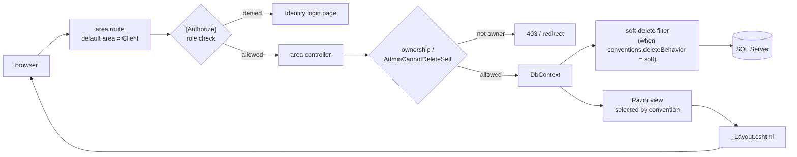

# What gets generated — a beautiful, beautiful app

The output is not a skeleton waiting to be filled in. It's a complete MVC application with a
deliberately small architecture. Small! Lean. No fat. This chapter is that architecture — what the
layers are, why each file exists, and how a request travels through it.

People open the generated code and they say, "Sir, where's the magic?" There is no magic. That's
the magic. Ordinary MVC, the way the textbooks say it should be done — and nobody writes ordinary
MVC more consistently than a template set, believe me. The student can explain every line. Every
single line.

## Layers of the generated app

| Layer | Files | Responsibility |
|---|---|---|
| **Presentation** | `Views/`, `Areas/*/Views/`, `Views/Shared/_Layout.cshtml` | Razor markup only; no business logic, no runtime translation |
| **HTTP** | `Areas/{Admin,Client}/Controllers/*.cs` (FaceNote's home page is `Areas/Client/Controllers/HomeController.cs`) | routing, authorization, model binding, orchestration |
| **Domain model** | `Models/*.cs` | plain entities with data annotations carrying the Bulgarian labels and messages |
| **Persistence** | `{Project}Context.cs`, `Migrations/`, `Data/` | `DbSet`s, relations, soft-delete filter, seeders |
| **Services** | `Services/ImageService.cs`, `FileUploadService.cs`, `UserProfileService.cs` | the only place file-system image work and the per-user profile aggregation live |
| **Composition** | `Program.cs` | DI, identity, area routes, migrate-then-seed startup |
| **Infrastructure** | `Infrastructure/Validation/*`, `Infrastructure/Identity/BgIdentityErrorDescriber.cs` | custom validation attributes; Bulgarian Identity errors |

There's no repository layer, no service layer over the entities, and no view-model mapping layer.
Controllers talk to the `DbContext` directly. Direct! No middlemen. That altitude is a choice. The
app is a teaching artifact, and every extra abstraction is one more thing its owner has to justify
in front of an examiner. Have you ever had to justify a generic repository in front of an examiner?
Not fun. Not fun at all. (The one exception — a DTO — exists in the schema for the rare composed
read model.)

## The request path

Two consequences follow, and they're big ones:

- **Authorization is attribute-based and area-scoped.** The area→role mapping in the spec is what
  makes "admin pages" and "client pages" real: every admin-area controller carries
  `[Authorize(Roles = "<admin role>")]`, and every client-area controller `[Authorize]` with
  `[AllowAnonymous]` on its read-only `Index`/`Details` — emitted by the stage, scaffolded or
  templated alike, and tested by `verify` with anonymous requests. Per-record `ownership` rules are
  enforced **inside** the action, server-side, never in the view. Never in the view, folks. A rule in the view is a
  suggestion. A rule on the server is a law.
- **Soft delete is a query filter**, applied on the model type, so no query can forget it. A model
  with `softDelete` (or a project with `conventions.deleteBehavior: "soft"`) gets `IsDeleted` from
  the shared `AuditableEntity` base and a global filter in the context.

## Where controllers come from, and why there are three ways

The most architecturally unusual part of the output: controllers have **provenance**. They have a
pedigree. Very good families:

| `generatedBy` | Produced by | Used for | Trade-off |
|---|---|---|---|
| `scaffold` | `aspnet-codegenerator`, then declarative **deviations** applied as anchored regex | standard CRUD over a model | matches what a student would scaffold, but depends on the scaffolder's output shape (ADR-006) |
| `template` | Scriban templates | feature controllers, home | fully controlled by this repo, easy to change |
| `writtenFromScratch` | a dedicated template | the users controller with server-side rules, and the Specifications page | the only place bespoke authorization logic lives |

The regex choice is the one that looks wrong — until you see the alternative. A Roslyn rewriter is a
large dependency to maintain for edits that are stable for a pinned SDK, and it fails *softly*.
Softly! A soft failure is the worst kind. The regex transforms fail **loud** when their anchor
disappears, so an SDK bump surfaces immediately. Loud is good. Loud is honest. Deviations are
declarative spec fields (`removedActions`, `redirects`, `sorting`, `pagination`, `ownership`) — the
spec never holds code.

## Identity: one mechanism per problem

| Problem | Mechanism | Why not the other thing |
|---|---|---|
| The account pages must be Bulgarian and styled like the app | core pages **emitted wholesale** from `identity/*.sbn` (ADR-002b) | translating markup at runtime corrupts Razor and cannot restyle |
| Scaffolder-leftover pages must not leak English | a static EN→BG replacement map (`identity-bg-map.json`) (ADR-002) | an LLM translator is non-deterministic and can corrupt markup |
| Identity's own error strings must be Bulgarian | `BgIdentityErrorDescriber` | a translation layer at runtime is a `.resx` problem, solved once at the source |
| A demo must have usable logins | `IdentitySeeder` creates roles + users; passwords are **derived** from the variation seed | checked-in passwords are a security smell and break reproducibility |

The same rule shows up four times, and when a rule shows up four times, you listen: **translate
text where it is produced, not where it is displayed.**

## Conditional emission

Most services exist only when the spec justifies them, and `verify`'s manifest expects a file only
when the spec says it should exist. You don't get a service you didn't earn:

| File | Emitted when |
|---|---|
| `Services/ImageService.cs` + image controllers/partials | any model declares an `images` block |
| `Services/FileUploadService.cs` | profile pictures, the rating feature or the posts feature |
| `Services/UserProfileService.cs` + `UserProfileViewModel` + public profile page | the `posts` or `catalogues` feature |
| `Infrastructure/Identity/BgIdentityErrorDescriber.cs` | `identity.errorDescriber` is set **and** `meta.language = bg` |

This is what keeps a minimal project minimal. And it's the part most likely to break when a spec
starts using a new capability: the emitter condition and the manifest condition have to agree. Two
conditions, one truth. If they disagree — trouble. Big trouble.

## Two areas, and one consolidated admin page

- **Client** is the user-facing area (the default route area when `meta.routing.defaultArea` is
  set), with landing/contact pages, card grids, and one page per enabled feature.
- **Admin** is the CRUD area. It does **not** grow one nav entry per model: `isSpecification` and
  `isLookup` models are consolidated onto a single **Specifications** page with a CRUD tab and a
  read-only filtered tab respectively (ADR-012). Every other model gets a normal admin table.
- `spec-expand` injects an admin CRUD surface for any model the spec forgot, so the admin area is
  complete even when the author only described the client side. You forgot a model? Genesis didn't
  forget. Genesis never forgets.

## What is deliberately absent

No test project, no Dockerfile, no CI file, no JavaScript framework, no runtime localization
layer, no repository abstraction. The app is the deliverable, not a platform. Each omission is a
documented altitude choice — and it's the first thing to check before you go around calling one of
them a bug.
