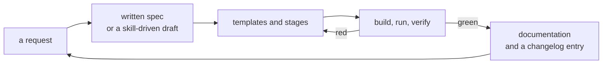

# How the project is built — a developer and an AI, what a team

The generated applications are ordinary. How *they* come to exist is not. The repository is written
and maintained by a person working with AI agents — an AI-driven development lifecycle (AI-DLC) in
practice, not as a label on a slide. And let me tell you, it's a tremendous team. The developer
brings the judgment, the agents bring the stamina, and the process is arranged so a machine can
pick up the work without losing the plot. This chapter describes that arrangement, because it
explains decisions that otherwise look arbitrary.

A lot of people ask me, "Sir, who built this?" A developer and an AI. That's the team. Tremendous
team. Maybe the best team. The developer knows the domain — nobody knows those diploma papers
better — and the AI writes, reads, and remembers nothing between sessions unless it's written down.
So everything is written down. Everything. That's the secret.

## The loop

Every step leaves a reviewable artifact: a spec, a diff, a verify report, a changelog entry. None of
them is a conversation that disappears when the context window closes. Conversations disappear,
folks. Files stay. Always bet on the file.

## Documentation designed for two readers

The docs follow Diátaxis — tutorial, how-to, reference, explanation — because those four answer
different questions and rot at different speeds. A reference table stays true for months; a
tutorial breaks the week a command changes. Mix them in one file and the stable parts get rewritten
every time the volatile part moves. Total chaos. We've all read that kind of documentation. Boring,
long, and wrong — the worst combination. The very worst.

Two conventions make the tree usable by an agent:

- **A router file.** One short document at the root says what the project is and which doc to read
  for which task. An agent arrives by a named path; it does not browse. No wandering around. In and
  out. Very efficient.
- **Decision records.** Architectural choices live in numbered ADRs, in `docs/adr/`. A superseded
  decision keeps its number and gains a note saying what replaced it, so old links never rot.

There's also a working history the documentation deliberately doesn't duplicate: one changelog
file per change, and a decision log that records which fixes were tried and failed. That log exists
because the most expensive mistake in a long-lived project is re-proposing a theory that was
already disproved three sessions ago. Three sessions ago! Somebody already tried it! It didn't
work! Read the log.

## Skills instead of ad-hoc prompts

The generator's LLM path does not begin with "write me a spec". That's amateur hour. It begins
with a **skill**: a document that states the contract, the conventions that aren't in the schema,
and the mistakes that have actually been made. The repository ships two — one for specs, one for
seed data. The spec skill is used in three places; the seed skill is the conversational twin of the
`seed` stage's own prompt and carries the same rules:

| Consumer | What it gets |
|---|---|
| a person in a chat | the conversational workflow: ask first, emit JSON when the decisions are settled |
| the agent loop (`dps-nn create`) | the same guide with the "ask the user" steps removed |
| the repository's own docs | the contract the rest of the system is tested against |

A skill is cheaper than a long prompt repeated per request, and more reliable than a bare schema:
the model learns the conventions once and applies them for the rest of the window. And
improvements accumulate in a file instead of getting lost with the session. Compound interest,
folks. For knowledge.

## Model routing, and what it costs

Reasoning-heavy work goes to a larger model; volume work goes to a cheaper one. You don't send your
best negotiator to count boxes:

| Exchange | Model | Why |
|---|---|---|
| spec draft, spec repair, expansion review | Sonnet-class | judgment about domain, scope and consistency |
| seed rows | Haiku-class | mechanical generation against a schema, in bulk |

Both are overridable by environment variable. Measured on the author's runs, one complete project —
spec draft plus seed — costs **under 17 US cents**. Seventeen cents! You can't buy a coffee for
that. Now, to be precise, because we're precise: that figure is the author's own measurement, not
an independently reproduced benchmark, and it depends on the description's length and the number
of models. It's quoted because it changes a decision: at that price, regenerating a project is
cheaper than debugging a bad one.

## Tests decide whether something ships

The testing discipline is the one written down as a reusable skill: red, green, revert, green.

1. write a test that reproduces the bug and watch it fail for the stated reason;
2. fix the code until it passes;
3. undo the fix, keep the test, watch it fail again — proof the test is connected to the failure;
4. restore the fix.

Nothing is merged or deployed on a red suite. Continuous integration runs the .NET and GUI suites
on Windows for every push and pull request, and a generated application counts as shippable only
when `verify` passes — build, migration, boot, login, the declared routes, language. The deployment
gate is therefore not a human's confidence — confidence is cheap — but a run that either passes or
doesn't.

## Two front ends, one engine

| Front end | Audience | Contract |
|---|---|---|
| **CLI** (`dps-nn`) | agents and scripts | stable exit codes, a JSONL progress log, `--no-interactive` for unattended runs |
| **GUI** (Electron) | people preparing a project | pickers, live progress, the same log and state files underneath |

The GUI spawns the CLI and reads its output; it owns no generation logic. New behavior is written
once, in the CLI, and both front ends inherit it. That's also why the GUI's failure screen can show
the agent's own stop reason: it reads the line the CLI printed, not a copy of the logic.

## What this arrangement buys

- **Repeatability.** The same spec produces the same code (design preset included, Chapter 12), so
  a bug is reproducible.
- **Reviewability.** Every step leaves a file: spec, lock, seed, verify report, changelog.
- **Survivability.** A new session — human or agent — can reconstruct why the code looks like this
  from the router, the ADRs and the decision log, without asking anyone.
- **Cost control.** Cheap models where volume matters, expensive models where judgment matters.

Repeatable, reviewable, survivable, affordable. Four words. If every project had those four
words — we'd have a lot fewer disasters out there. A lot fewer.
